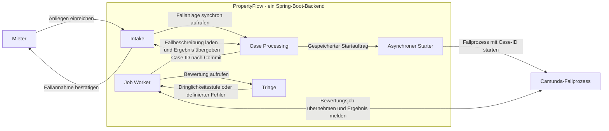
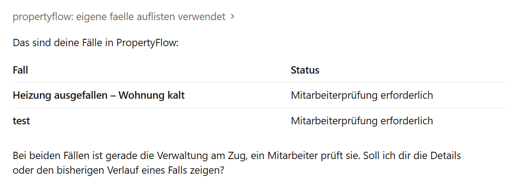
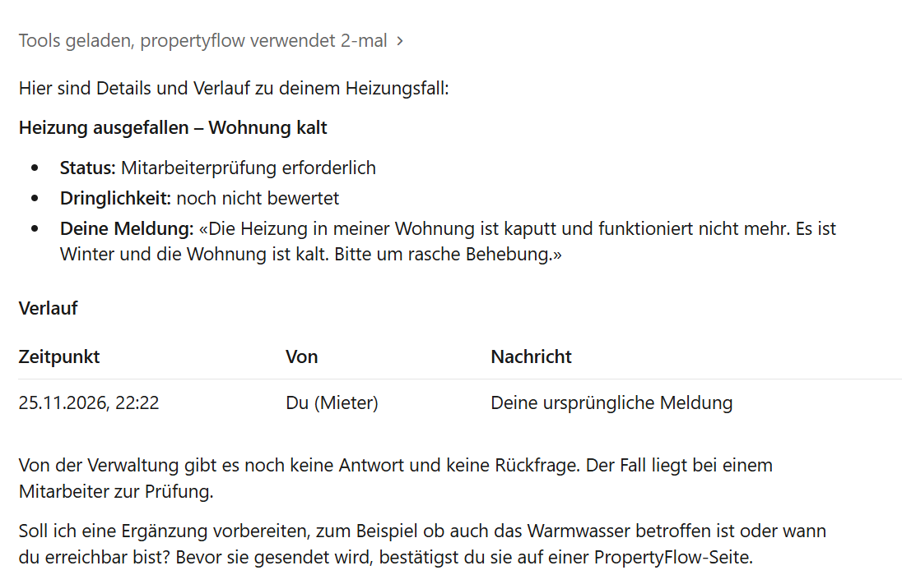
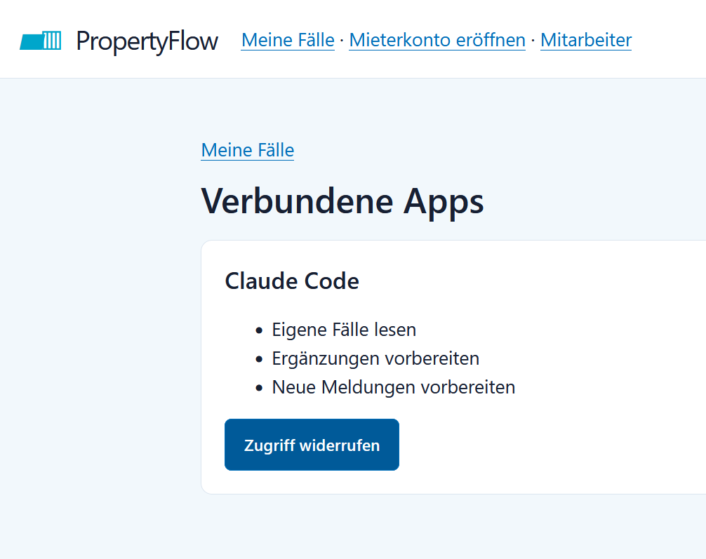
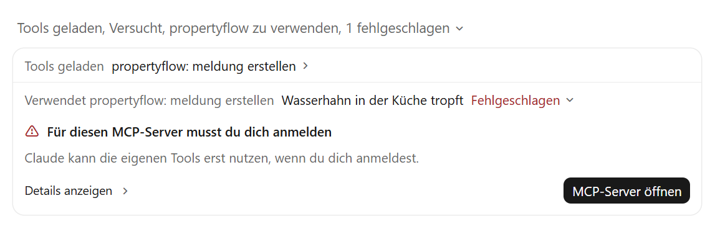

# PropertyFlow · Block 3 «Services»

Arbeitsfassung für das Abgabe-PDF, abgeglichen am 25.11.2026. Die verlinkten Projektdateien enthalten die
verbindlichen Entscheidungen, Verträge und Nachweise.

[Git-Repository · PropertyFlow](https://github.com/permarco/propertyflow)

## 1. Fachliche Zerlegung

Die Skizze zeigt die Zielarchitektur von der Fallannahme bis zur Erstbewertung.

| Modul | Änderungsgrund | Vertrag für die Erstbewertung |
| --- | --- | --- |
| Intake | Erfassungskanäle und Eingaberegeln ändern sich. | Validiert die Einreichung, ruft Case Processing synchron mit den geprüften Angaben auf und bestätigt die Annahme nach dem Commit. |
| Case Processing | Regeln für Fallanlage, Status und Verlauf ändern sich. | Vergibt die Case-ID und speichert Fall und Startauftrag in einer Transaktion. Liefert dem Worker die Fallbeschreibung und prüft und speichert die Bewertung unter Wahrung des Vorrangs manueller Einstufungen. |
| Triage | Bewertungskriterien, Modell oder Prompt ändern sich. | Empfängt vom Worker die für die Erstbewertung benötigten Angaben und liefert eine validierte Dringlichkeitsstufe oder einen definierten Fehler. |

**Begründung des Schnitts.** Die unterschiedlichen Änderungsgründe erlauben es,
Erfassungsregeln, Fallbearbeitung und Dringlichkeitskriterien unabhängig
weiterzuentwickeln, solange ihre Verträge stabil bleiben. Die Kopplung bleibt
auf definierte interne Aufrufe begrenzt, und Case Processing besitzt die
Falldaten über ihren gesamten Lebenszyklus. Für die Resilienz speichert Case
Processing Fall und Startauftrag gemeinsam, sodass die Annahme bei verfügbarer
Datenbank auch während eines Camunda- oder Modellausfalls möglich bleibt.

**Begründung der Verteilung.** Die Fachmodule laufen als modularer Monolith in
einem gemeinsamen Deployment, weil ihre Qualitätsziele mit internen Verträgen
und asynchroner Weiterverarbeitung erreichbar sind. Für die Prozesssteuerung
begründet die Anforderung an Zuverlässigkeit (NFR-03) den separaten Camunda-Betrieb.
Langlebige Prozesse müssen ihren Zustand, Wiedervorlagetimer und offene
Mitarbeiteraufgaben über Neustarts behalten, damit sie fortgesetzt werden können.

[Modulverträge](../architecture/schnittstellenentwurf-block-3.md#1-fachlicher-schnitt) ·
[ADR-001 · Modularer Monolith](../architecture/adr/ADR-001-grundarchitektur.md#entscheidung) ·
[ADR-002 · Camunda-Orchestrierung](../architecture/adr/ADR-002-camunda8-workflow-orchestrierung.md#entscheidung)

## 2. OpenAPI-Vertrag

Der zentrale Endpunkt `POST /mieter/fall` nimmt die Formulardaten entgegen. Die
Fallannahme ist nach dem Commit von Fall und Startauftrag bestätigt. HTTP `303`
verweist per `Location` auf die persönliche Fallansicht, in der die Case-ID
sichtbar ist. [OpenAPI-Datei](../architecture/openapi/propertyflow-web.yaml)

| Aspekt | Vertrag |
| --- | --- |
| Fehlerfälle | `400` für ungültige Eingaben, `401` für fehlende gültige Kontoanmeldung beim Kontoformular, `403` für fehlenden oder ungültigen CSRF-Nachweis und `409` für geänderte Daten mit derselben Absende-ID. Der Zielvertrag beschreibt auch `429` bei erreichtem Rate Limit, `500` bei einem unerwarteten Serverfehler und `503` bei nicht bestätigbarer Speicherung wegen vorübergehender Datenbankstörung. |
| Idempotenz | Die Absende-ID `operation` gilt innerhalb des serverseitig ermittelten Kontos oder der ursprünglichen Gastsitzung. Eine identische Wiederholung liefert dieselbe Case-ID und bei weiterhin gültigem Fall-Link dieselbe Weiterleitung. Sie erzeugt keinen zusätzlichen Fall oder Startauftrag. |
| Datenklasse | Eingaben enthalten personenbezogene Falldaten. Der Token in `Location` ist ein vertrauliches Zugangsgeheimnis. Die Weiterleitung verwendet `Cache-Control: no-store` und `Referrer-Policy: no-referrer`. Falldaten und Tokens bleiben aus technischen Protokollen. |
| Messbares Service-Ziel | Bei erreichbarer PostgreSQL-Datenbank sowie unerreichbarem Camunda und KI-Modell müssen in einem Zehn-Minuten-Test 20 von 20 gültigen Neueinreichungen HTTP `303` erhalten. Nach einem Neustart müssen pro bestätigter Case-ID genau ein Fall und ein offener Startauftrag vorhanden sein. |

Der Vertrag umfasst auch `GET /mieter/fall/zugang/{token}` für die direkte
Fallansicht und `POST /mieter/fall/zugang/{token}/nachrichten` für Ergänzungen.
Beim Senden folgt HTTP `303` nach dem Nachrichten-Commit und der bestätigten
Camunda-Korrelation. Bei einem technischen Fehler oder Timeout liefert
PropertyFlow `500`. Der Text und die Absende-ID bleiben im Formular. Ein
bereits gespeicherter Eintrag bleibt im Verlauf. [UC-009](../use_cases/UC-009-mieteranliegen-ergaenzen.md)

Das reguläre Backend setzt die Fallannahme und den persönlichen Fallzugriff mit
PostgreSQL um. `GuestCasePostgresTest`, `GuestCaseRestartPostgresTest` und
`TenantMessagePostgresTest` prüfen Speicherung, Wiederholung, Zugriff und
Neustart. Die Workflowtests verwenden die acht echten Anwendungsmodelle.
Der Zehn-Minuten-Störfall mit genau 20 Einreichungen ist als eigener Test
`CamundaOutageIntakeTest` umgesetzt (siehe Abschnitt 5); andere
Integrationstests ersetzen ihn nicht.

Die OpenAPI-Datei beschreibt alle umgesetzten Mitarbeiteraktionen mit ihren
tatsächlichen Pfaden, Feldern (etwa `operationId`, `userTaskKey`, `reviewToken`)
und Antworten; sie sind als `implementiert` gekennzeichnet. Einzige Abweichung
sind die Stammdatenreferenzen bei `objekt-wohnung-zuordnen`, vermerkt als
`x-propertyflow-abweichung`. Der frühere Zielvertrag `kritische-entscheidung`
ist entfallen, weil UC-027 über die Mitarbeiterprüfung abgedeckt ist.
Abschluss, Wiedereröffnung und Aufhebung des Antwortbedarfs melden Erfolg erst,
wenn der Worker den neuen Fallstand gespeichert hat; während der Wartezeit zeigt
das UI eine Verarbeitungsanzeige.

| Fachfunktion | Implementierung und automatisierte Prüfung | Grenze |
| --- | --- | --- |
| Bearbeitung fortsetzen | `StaffDecisionService`, `StaffDecisionPostgresTest`, `StaffDecisionCamundaTest` und Browserprüfung `staff-review.test.mjs` | Aktuelle Aufgabe, Fallversion und Prüfgrundlage erforderlich; keine Kosten- oder Auftragsfreigabe |
| Dringlichkeit, Objekt/Wohnung und internes Memo | `CaseDataService`, `StaffCaseDataController`, `CaseDataPostgresTest` | Manuelle Einstufung, Wiederholung, Versionskonflikt und interner Sichtbarkeitsschutz werden geprüft; keine produktive Stammdatenanbindung |
| Externe Nachricht und Rückfrage | `StaffMessageService`, `StaffMessagePostgresTest`, `StaffMessageCamundaTest` | Veröffentlichung und nachgelagerter Mailversand sind getrennte Ergebnisse |
| Wiedervorlage | `FollowUpCommandService`, `CaseWaitCamundaTest` | Timerwechsel, Aufhebung und Mieterkontakt werden an der echten Engine geprüft; noch keine vollständige Matrix aller Parallelitätsfälle |
| Abschluss und Wiedereröffnung | `CaseClosureCamundaTest`, `CaseReopenCamundaTest`, `StaffCaseDataWaitTest` | `200` erst nach gespeichertem Status; Wartezeit höchstens 2 s (Abschluss) bzw. 15 s (Wiedereröffnung), sonst `500` mit unklarem Ausgang. Wiedereröffnung startet eine neue führende Instanz; automatischer Abschluss bleibt fachlich gesperrt |
| Antwortbedarf aufheben | `AnswerCancellationWorkers`, `StaffCaseDataWaitTest` und zugehörige Prozess-/Dienstprüfungen | Konkrete Rückfrage und aktuelle Prozessfreigabe erforderlich; `200` erst nach gespeicherter Aufhebung |
| KI-Formulierung | Integrierte SSE-Formulierung und Browserfehlerprüfungen | Abbruch und Fehlerbehandlung sind technische Nachweise; keine Freigabe der Modellqualität |
| Kontoanlage und Rechteentzug | `AccountAdministrationService`, `AccountLifecyclePostgresTest`, `BackendAccessParityPostgresTest`, `McpOAuthFlowTest` | Verwaltungsrecht und Schutz des letzten Administrators; belegte Adresse und letzter Administrator ergeben `409`, ungültige Eingaben `400`. Workspace-Abnahme separat |
| Fall-Link ersetzen und Kontaktadresse ändern | `CaseAccessAdministrationService`, persistente Prüfung, Audit und Ersatzlink-Outbox | Atomarer Linkersatz; ausserhalb von Camunda. Identitätsprüfverfahren vor produktivem Einsatz abnehmen |
| Kritische Entscheidung gemäss UC-027 | Kritische Prüfgründe führen zu «Mitarbeiterprüfung erforderlich»; der Mitarbeiter entscheidet über «Bearbeitung fortsetzen» mit Begründung. `CriticalReviewCamundaTest` (durchgehend), `StaffDecisionPostgresTest`, `StaffDecisionCamundaTest`, `AutomaticClosurePostgresTest` | Kein eigenständiger Freigabe-/Ablehnungsablauf und kein Vier-Augen-Prinzip (Entscheid vom 25.11.2026); externe Massnahmen organisiert die Verwaltung ausserhalb |

Die [Umsetzungsmatrix](../use_cases/umsetzungsstand-2026-11-16.md) ordnet alle
Use Cases zu. Die [Testanleitung](../../src/test/README.md) beschreibt die
getrennten Java-, PostgreSQL-/Camunda- und Browserläufe. Die fachliche
Gesamtabnahme bleibt ein eigenes Arbeitspaket.

## 3. MCP-Werkzeug

Der MCP-Zugang ist im regulären Backend implementiert. OAuth-Delegationen,
Bestätigungsvorgänge und Audit werden persistent gespeichert. Mieter- und
Mitarbeiterwerkzeuge verwenden dieselben Fachfunktionen und Berechtigungen
wie die Webanwendung. Den Umfang und die Protokollverträge führt die
[Spezifikation der MCP-Werkzeuge](../specifications/mcp-werkzeuge.md).

`BackendMcpConfigurationTest` prüft die Backend-Routen und Toolverträge mit
MockMvc; `McpOAuthFlowTest` prüft OAuth, PKCE, Zustimmung, Widerruf und
Rollenentzug. Persistente MCP-Diensttests ergänzen Fallberechtigung und
Schreibbestätigung. `FallstandMcpHttpTest` startet das reguläre Backend
mit isoliertem PostgreSQL-Schema und prüft Anmeldung, OAuth-Freigabe,
Fallstandabruf und Widerruf über echtes HTTP.

**Nachweis mit einem echten MCP-Client vom 25.11.2026.** Claude Code erreicht
den lokalen Server ohne Tunnel. Ein Testmieter meldete sich über OAuth mit PKCE
an und gab die Mieterscopes frei. Danach rief Claude im Chat die Werkzeuge auf:

| Prüfung | Aufruf | Ergebnis |
| --- | --- | --- |
| Eigene Fälle | `eigene_faelle_auflisten` | Die zwei Fälle des Testmieters, keine fremden |
| Eigener Fall | `falldetails_abrufen` mit eigener Case-ID | Titel, Beschreibung, Status und Dringlichkeit |
| Fremder Fall | `falldetails_abrufen` mit Case-ID eines anderen Mieters | «Der Fallzugriff ist nicht verfügbar.» |
| Unbekannter Fall | `falldetails_abrufen` mit erfundener ID | «Der Fallzugriff ist nicht verfügbar.» |
| Widerruf | Widerruf unter «Verbundene Apps», danach `meldung_erstellen` | Abgewiesen; Claude verlangt eine neue Anmeldung |

Fremder und unbekannter Fall erhalten dieselbe Antwort; ein Client erfährt
nicht, ob eine fremde Case-ID existiert. Der Fall mit fremder Case-ID war ein
bestehender Fall eines anderen Mieters.

Für den Lauf wurden zwei Konfigurationsmöglichkeiten ergänzt:

- Claude Code meldet als Callback fest `http://localhost:<Port>/callback`.
  PropertyFlow nimmt `localhost` nur an, wenn genau diese URI konfiguriert ist
  (`McpOAuthLocalhostRedirectTest`).
- Claude Code fordert alle in den Metadaten angebotenen Scopes gleichzeitig an.
  Eine Mischung aus Mieter- und Mitarbeiterscopes weist PropertyFlow ab.
  `PROPERTYFLOW_MCP_ROLE=tenant` begrenzt Angebot und Freigabe deshalb auf die
  Mieterscopes (`McpOAuthSettingsTest`).

Zwei Beobachtungen aus dem Lauf betreffen nicht PropertyFlow: Die
Claude-Desktop-App öffnet eine Anmeldeseite über HTTP nicht, die Anmeldung
erfolgte deshalb in Claude Code im Terminal. Eine lokale Sicherheitssoftware
veränderte die MCP-Antworten an KI-Programme; mit `curl` ausserhalb von Claude
antwortete PropertyFlow korrekt. Für einen dauerhaften lokalen Betrieb wäre
HTTPS nötig. Die fachliche und betriebliche Freigabe bleiben vom Nachweis
getrennt.

## 4. Sicherheitskonzept für Agent und Werkzeug

Der Dienst prüft delegierte Rechte, aktuelle Kontorolle, Fallberechtigung und
Aktionsbedingungen bei jedem Aufruf. Wichtige MCP-Schreibaktionen werden auf
einer PropertyFlow-Seite bestätigt; die Bestätigung ist an Konto, Delegation,
Ziel und Inhalt gebunden. Tokens und Einmalcodes gehören weder ins Audit noch
in den Modellkontext. Automatisierte Prüfungen decken unter anderem Widerruf,
Rollenentzug, fremde Fälle und manipulierte Bestätigungen ab.

Die Bestätigung eines MCP-Vorgangs ersetzt nicht die menschliche Entscheidung
bei kritischen Prüfgründen nach UC-027. Diese trifft ein berechtigter
Mitarbeiter in der Mitarbeiterprüfung im Web.

[Sicherheitskonzept](../specifications/mcp-werkzeuge.md#sicherheitskonzept-für-agent-und-werkzeug) ·
[Zugriffsmodell](../architecture/adr/ADR-005-zugriffsmodell.md) ·
[Serverseitige Bestätigung](../architecture/adr/ADR-006-mcp-mieterwerkzeuge-und-nachrichtenfreigabe.md)

## 5. Kommunikationsentscheid

Die Fallannahme bestätigt den Commit von Fall und Startauftrag. Camunda startet
danach asynchron und orchestriert die Erstbewertung. Der vollständige
TRANSFER-Entscheid enthält Preis, Zehn-Minuten-Störfall, Prüffälle und den
Vergleich von Choreografie und Orchestrierung. Fallannahme, persistenter
Startauftrag und asynchrone Übergabe sind implementiert.

Der Zehn-Minuten-Störfall (Abnahmetest J2) ist als
[CamundaOutageIntakeTest](../../src/test/java/com/pertegato/propertyflow/caseprocessing/workflow/CamundaOutageIntakeTest.java)
umgesetzt und läuft im eigenen CI-Job «Ten-minute Camunda outage» auf `main`
und auf Anforderung. Der Test prüft in drei Phasen:

1. **Ausfall:** Camunda ist unerreichbar, das KI-Modell abgeschaltet. Zehn Gäste
   und zehn verifizierte Mieter reichen über zehn Minuten verteilt ein; alle 20
   erhalten `303`. Eine identische Wiederholung zählt einmal. Der Starter hat
   jeden Auftrag nachweislich vergeblich versucht.
2. **Neustart während des Ausfalls:** Je Einreichung besteht genau ein Fall mit
   genau einem offenen Startauftrag. Gast-Links sind lesbar; Mieter melden sich
   neu an und sehen ihren Fall.
3. **Wiederanlauf:** Der Rückstau wird abgebaut; jeder Fall erhält genau eine
   führende Prozessinstanz. Die gemessene Aufholzeit steht im Testbericht.

**Ausführungsnachweis vom 25.11.2026.** Der Test bestand auf `main` (Commit
`1046eba`). Während der zehn Minuten erhielten alle 20 Einreichungen HTTP
`303`. Die Prüfungen nach dem Backendneustart bestanden, und nach Camundas
Wiederanlauf war der Rückstau nach 291 Sekunden abgebaut.
[CI-Job und Testbericht](https://github.com/permarco/propertyflow/actions/runs/45567675163/job/139046359734)

[Architekturentscheid](../architecture/schnittstellenentwurf-block-3.md#4-architekturentscheid-für-artefakt-5)

## 6. Erste KI-Integration

Die Analyse ist in den Camunda-Fallprozess integriert.
`ConversationEvaluationService` führt Analyse, Empfehlung und Abschlussprüfung
über Fachverträge aus; die Workflowtests verwenden kontrollierte Modellantworten.
Der Java-Vertrag und ein früherer lokaler Ollama-Versuch sind dokumentiert.
Technische Regression belegt keine ausreichende Modellqualität: Der automatische
Abschluss bleibt bis zur bestandenen Evaluation und Freigabe gesperrt.
[KI-Servicevertrag und Versuch](../ai-usage/ki-service-vertrag.md)

## 7. Repo-weite Änderung und Diff-Review

Reviewt wurde die gemeinsame E-Mail-Prüfung für Fallanlage und Kontozugriff
aus Commit `1f315c4`. Der Projekt-Kontext bildete den Rahmen des KI-Vorschlags.
Jede betroffene Datei ist mit «übernommen», «korrigiert» oder «verworfen»
bewertet; je Stelle sind KI-Beitrag, eigene Entscheidung und Grund mit Diff oder
Test belegt. Das [Review-Dokument](../ai-usage/diff-review-1f315c4.md) enthält
Rahmen, Ausgangslage, Befunde, die Bewertung je Datei und das Ergebnis. Ein zweites
[Review zum BPMN-Umbau](../ai-usage/diff-review-bpmn-cleanup.md) zeigt eine
Änderung, die der Entwickler mit eigenen Vorgaben gesteuert hat.
[Regressionstests zum Fallzugriff](../architecture/frontend-demo-ablosung-2026-11-16.md) ·
[Projekt-Kontext](../project-context.md)

## 8. Projekt-Kontext v0.3

Der Projekt-Kontext ist auf Dokumentversion v0.3 und den integrierten
Backendstand vom 25.11.2026 abgeglichen. Er beschreibt Modulgrenzen,
Berechtigungen, MCP-Bestätigung und die weiterhin offenen fachlichen Freigaben.
Die Dokumentversion ist keine Produktionsfreigabe und kein Anwendungsversionstag.
[Projekt-Kontext](../project-context.md)

## Abgabe

Ein PDF mit den acht Punkten und den Belegen erstellen und zusammen mit der
Repository-URL abgeben. Den OpenAPI-Auszug oder den Verweis auf die
maschinenlesbare Datei aufnehmen. Die Teilabgabe ist formativ. Die Artefakte
müssen spätestens in der Schlussabgabe nachgewiesen sein.
