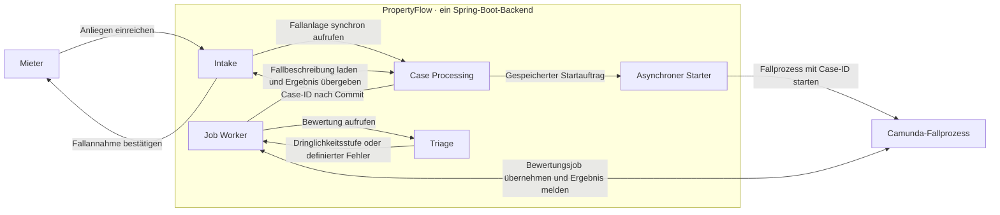

# PropertyFlow · Block 3 «Services»

Arbeitsfassung für das Abgabe-PDF. Die verlinkten Projektdateien enthalten die
verbindlichen Entscheidungen, Verträge und Nachweise.

[Git-Repository · PropertyFlow](https://github.com/permarco/propertyflow)

## 1. Fachliche Zerlegung

Die Skizze zeigt die Zielarchitektur von der Fallannahme bis zur Erstbewertung.

| Modul | Änderungsgrund | Vertrag für die Erstbewertung |
| --- | --- | --- |
| Intake | Erfassungskanäle und Eingaberegeln ändern sich. | Validiert die Einreichung, ruft Case Processing synchron mit den geprüften Angaben auf und bestätigt die Annahme nach dem Commit. |
| Case Processing | Regeln für Fallanlage, Status und Verlauf ändern sich. | Vergibt die Case-ID und speichert Fall und Startauftrag in einer Transaktion. Liefert dem Worker die Fallbeschreibung und prüft und speichert die Bewertung unter Wahrung des Vorrangs manueller Einstufungen. |
| Triage | Bewertungskriterien, Modell oder Prompt ändern sich. | Empfängt vom Worker die für die Erstbewertung benötigten Angaben und liefert eine validierte Dringlichkeitsstufe oder einen definierten Fehler. |

**Begründung des Schnitts.** Die unterschiedlichen Änderungsgründe erlauben es,
Erfassungsregeln, Fallbearbeitung und Dringlichkeitskriterien unabhängig
weiterzuentwickeln, solange ihre Verträge stabil bleiben. Die Kopplung bleibt
auf definierte interne Aufrufe begrenzt, und Case Processing besitzt die
Falldaten über ihren gesamten Lebenszyklus. Für die Resilienz speichert Case
Processing Fall und Startauftrag gemeinsam, sodass die Annahme bei verfügbarer
Datenbank auch während eines Camunda- oder Modellausfalls möglich bleibt.

**Begründung der Verteilung.** Die Fachmodule laufen als modularer Monolith in
einem gemeinsamen Deployment, weil ihre Qualitätsziele mit internen Verträgen
und asynchroner Weiterverarbeitung erreichbar sind. Für die Prozesssteuerung
begründet die Anforderung an Zuverlässigkeit (NFR-03) den separaten Camunda-Betrieb.
Langlebige Prozesse müssen ihren Zustand, Wiedervorlagetimer und offene
Mitarbeiteraufgaben über Neustarts behalten, damit sie fortgesetzt werden können.

[Modulverträge](../architecture/schnittstellenentwurf-block-3.md#1-fachlicher-schnitt) ·
[ADR-001 · Modularer Monolith](../architecture/adr/ADR-001-grundarchitektur.md#entscheidung) ·
[ADR-002 · Camunda-Orchestrierung](../architecture/adr/ADR-002-camunda8-workflow-orchestrierung.md#entscheidung)

## 2. OpenAPI-Vertrag

Der zentrale Endpunkt `POST /mieter/fall` nimmt die Formulardaten entgegen. Die
Fallannahme ist nach dem Commit von Fall und Startauftrag bestätigt. HTTP `303`
verweist per `Location` auf die persönliche Fallansicht, in der die Case-ID
sichtbar ist. [OpenAPI-Datei](../architecture/openapi/propertyflow-web.yaml)

| Aspekt | Vertrag |
| --- | --- |
| Fehlerfälle | `400` für ungültige Eingaben, `401` für fehlende gültige Kontoanmeldung beim Kontoformular, `403` für fehlenden oder ungültigen CSRF-Nachweis und `409` für geänderte Daten mit derselben Absende-ID. Der Zielvertrag beschreibt auch `429` bei erreichtem Rate Limit, `500` bei einem unerwarteten Serverfehler und `503` bei nicht bestätigbarer Speicherung wegen vorübergehender Datenbankstörung. |
| Idempotenz | Die Absende-ID `operation` gilt innerhalb des serverseitig ermittelten Kontos oder der ursprünglichen Gastsitzung. Eine identische Wiederholung liefert dieselbe Case-ID und bei weiterhin gültigem Fall-Link dieselbe Weiterleitung. Sie erzeugt keinen zusätzlichen Fall oder Startauftrag. |
| Datenklasse | Eingaben enthalten personenbezogene Falldaten. Der Token in `Location` ist ein vertrauliches Zugangsgeheimnis. Die Weiterleitung verwendet `Cache-Control: no-store` und `Referrer-Policy: no-referrer`. Falldaten und Tokens bleiben aus technischen Protokollen. |
| Messbares Service-Ziel | Bei erreichbarer PostgreSQL-Datenbank sowie unerreichbarem Camunda und KI-Modell müssen in einem Zehn-Minuten-Test 20 von 20 gültigen Neueinreichungen HTTP `303` erhalten. Nach einem Neustart müssen pro bestätigter Case-ID genau ein Fall und ein offener Startauftrag vorhanden sein. |

Der Vertrag umfasst auch `GET /mieter/fall/zugang/{token}` für die direkte
Fallansicht und `POST /mieter/fall/zugang/{token}/nachrichten` für Ergänzungen.
Beim Senden folgt HTTP `303` nach dem Nachrichten-Commit und der bestätigten
Camunda-Korrelation. Bei einem technischen Fehler oder Timeout liefert
PropertyFlow `500`. Der Text und die Absende-ID bleiben im Formular. Ein
bereits gespeicherter Eintrag bleibt im Verlauf. [UC-009](../use_cases/UC-009-mieteranliegen-ergaenzen.md)

Die Frontend-Demo belegt den direkten Fallzugriff, die Weiterleitung,
Eingabevalidierung und Wiederholung im Arbeitsspeicher. Die Camunda-Korrelation
und der Ausfalltest mit PostgreSQL stehen aus.
[Web-Tests](../architecture/frontend-demo-ablosung-2026-11-16.md) ·
[Grenzfalltests](../architecture/frontend-demo-ablosung-2026-11-16.md)

Die OpenAPI beschreibt alle 20 expliziten Browseroperationen der vorhandenen
Web-Controller. Dazu gehören das Erfassungsformular, der Mieterkontozugriff,
Anmeldung, Registrierung und Abmeldung sowie die Fallübersicht, das Falldetail
und die vorhandenen Demo-Schreibaktionen für Mitarbeitende.
[SS-001](../architecture/schnittstellenentwurf-block-3.md#2-zentraler-http-endpunkt)

Für «Bearbeitung fortsetzen» definiert die OpenAPI zusätzlich den Zielvertrag
`POST /mitarbeiter/faelle/{id}/bearbeitung-fortsetzen`. PropertyFlow prüft
Fallversion und `userTaskKey` und wartet synchron auf Camundas Bestätigung
für diese Aufgabe. Danach antwortet PropertyFlow mit `200`. Eine veraltete
Aufgabe ergibt `400`. Ein technischer Fehler oder Timeout ergibt `500`.
Das UI lädt den gespeicherten Fallstand neu. Die Camunda-Anbindung und der
Prüffall mit zwei Browser-Tabs stehen aus.
[UC-012](../use_cases/UC-012-fall-fachlich-steuern.md) ·
[SS-003](../architecture/schnittstellenentwurf-block-3.md#ss-003--camunda-integrationsvertrag)

`POST /mitarbeiter/faelle/{id}/dringlichkeit-aendern` definiert den Zielvertrag
für die vier Stufen der manuellen Einstufung. `200` folgt auf die bestätigte
Camunda-Korrelation. Bei veraltetem Fallstand oder unzulässiger Aktion folgt
`400`, bei technischem Fehler oder Timeout `500`. Die Absende-ID verhindert
doppelte Einstufungen und Benachrichtigungen. Der Nachweis der konkurrierenden
Änderungen und des manuellen Vorrangs steht aus.
[DRING-06](../specifications/dringlichkeitsbewertung.md#dring-06-manuelle-anpassung)

`POST /mitarbeiter/faelle/{id}/objekt-wohnung-zuordnen` nimmt einen Freitext
oder ein Paar von Stammdatenreferenzen entgegen. PropertyFlow prüft Fallstand
und bei Stammdaten die Zugehörigkeit der Wohnung zum Objekt. `200` bestätigt
die synchrone Korrelation mit Camunda, `400` meldet ungültige oder veraltete
Eingaben, `500` einen technischen Fehler oder Timeout. Die bestätigte
Zuordnung wird getrennt von der ursprünglichen Mieterangabe gespeichert.
Umsetzung und fachlicher Prüfbeleg stehen aus.
[FALL-04](../specifications/fallverwaltung.md#fall-04-ursprungsdaten-und-zuordnung)

`POST /mitarbeiter/faelle/{id}/externe-nachricht-veroeffentlichen` nimmt eine
Information oder eine Rückfrage entgegen. Camunda veranlasst die Veröffentlichung.
`200` setzt die dauerhaft gespeicherte und im Mieterfallverlauf abrufbare
Nachricht voraus. Der E-Mail-Versand folgt danach. Ein Test mit verzögerter
Speicherung und ausgefallenem Maildienst soll beide Grenzen nachweisen.
Wiederholungen mit derselben Absende-ID erzeugen weder eine zweite Nachricht
noch einen zusätzlichen Benachrichtigungsauftrag. Die Umsetzung steht aus.
[UC-010](../use_cases/UC-010-externe-fallnachricht-veroeffentlichen.md)

`POST /mitarbeiter/faelle/{id}/internes-memo-speichern` bestätigt mit `200`,
sobald der von Camunda veranlasste Eintrag dauerhaft im internen Fallverlauf
gespeichert ist. Das Memo ist nur für berechtigte Mitarbeitende abrufbar und
löst keine E-Mail aus. Ein Integrationstest soll Mieterzugriff, Mailauftrag
und identische Wiederholung prüfen. Die Umsetzung steht aus.
[UC-011](../use_cases/UC-011-internes-memo-erfassen.md)

`POST /mitarbeiter/faelle/{id}/wiedervorlage` bündelt Setzen, Ändern und
Löschen. Beim Setzen oder Ändern übermittelt das Formular entweder ein Datum
oder eine Tageszahl. Camunda führt den Timer im Fallprozess. `200` folgt auf
die bestätigte Aktion und die dauerhafte Speicherung von Terminstand und
Status. Eine neue Mieternachricht hebt eine laufende Wiedervorlage auf und
löst sofort die Mitarbeiterprüfung aus. Die Integration und der Prüffall
mit gleichzeitig fälligem Timer stehen aus.
[UC-013](../use_cases/UC-013-wiedervorlage-verwalten.md)

`POST /mitarbeiter/faelle/{id}/abschliessen` übergibt den bestätigten
Mitarbeiterentscheid an den Fallprozess. Camunda veranlasst den Abschluss
und beendet eine offene Wiedervorlage. `200` folgt erst nach dauerhafter
Speicherung von «Abgeschlossen» und Abschlussnachweis. Der Mitarbeiterabschluss
erzeugt keine automatische Nachricht oder E-Mail. Ein Integrationstest soll
dauerhafte Speicherung, beendeten Timer und das Ausbleiben von Nachrichten-/
Mailaufträgen auch bei Wiederholung nachweisen. Die Umsetzung steht aus.
[UC-014](../use_cases/UC-014-fall-abschliessen.md)

`POST /mitarbeiter/faelle/{id}/wiedereroeffnen` erfasst die bestätigte
Mitarbeiteraktion für einen abgeschlossenen Fall. Camunda veranlasst den
aktiven Status. `200` folgt nach dauerhafter Speicherung des neuen Status
und des Nachweises der Wiedereröffnung. Case-ID und Historie bleiben erhalten.
Ein Integrationstest soll auch prüfen, dass alte Timer und verspätete Worker-
Ergebnisse den wiedereröffneten Fall nicht verändern. Die Umsetzung und die
Fortsetzung bei bereits beendeter Camunda-Instanz stehen aus.
[UC-015](../use_cases/UC-015-fall-wiedereroeffnen.md)

`POST /mitarbeiter/faelle/{id}/nachrichten/{messageId}/antwortbedarf-aufheben`
adressiert genau eine Rückfrage. Camunda veranlasst die Aufhebung. `200`
folgt auf die dauerhafte Speicherung der Aufhebung und eines allfälligen
Statuswechsels. «In Bearbeitung» folgt nur ohne weitere offene Rückfragen,
laufende Wiedervorlage und vorrangigen Mitarbeiterprüfbedarf. Der geplante
Integrationstest prüft zwei offene Rückfragen, die Statusbedingungen und
die identische Wiederholung. Die Umsetzung steht aus.
[UC-028](../use_cases/UC-028-antwortbedarf-aufheben.md)

`POST /mitarbeiter/faelle/{id}/ki-formulierung` liefert den Vorschlag in
Textstücken als Server-Sent Events. Ein eigenes Abschlussereignis bestätigt
die vollständige Ausgabe. Über `POST /mitarbeiter/faelle/{id}/ki-formulierung/{attemptId}/abbrechen`
kann der Browser den Versuch schon vor dem ersten Textstück abbrechen. Der
Vorschlag bleibt ungespeichert. Ein geplanter Integrationstest prüft Abbruch
beim Warten und während der Ausgabe, verspätete Textstücke und den Ausschluss
interner Memos vom Modellkontext. Die Umsetzung steht aus.
[UC-004](../use_cases/UC-004-ki-analyse-durchfuehren.md)

`POST /mitarbeiter/konten` erlaubt die Kontoanlage mit dem Zusatzrecht
«Mitarbeiterkonten verwalten». `200` folgt nach der dauerhaften Speicherung
des Kontos mit Mitarbeiterrolle und Audit. `403` sperrt direkte Aufrufe ohne
das Zusatzrecht. Eine belegte E-Mail-Adresse ergibt `409`. Das erste
Verwaltungskonto wird einmalig per Serverbefehl eingerichtet. Die Umsetzung
und die Berechtigungs- und Wiederholungsprüfungen stehen aus.
[UC-007](../use_cases/UC-007-mitarbeiterkonto-anlegen.md)

`POST /mitarbeiter/konten/{userId}/zugriff-entziehen` erlaubt der berechtigten
Kontoverwaltung, ein Konto zu sperren oder seine Mitarbeiterrolle zu
entziehen. Ab dem nächsten Aufruf greifen die gespeicherten Rechte auch bei
bestehender Web-Sitzung oder MCP-Delegation. Änderung und Audit werden gemeinsam
gespeichert. Das letzte aktive Verwaltungskonto ist vor Entzug geschützt.
Die Umsetzung und die Prüfungen beider Kanäle stehen aus.
[UC-029](../use_cases/UC-029-mitarbeiterzugriff-entziehen.md)

`POST /mitarbeiter/faelle/{id}/kritische-entscheidung` bindet den Entscheid
eines berechtigten Mitarbeiters an die konkrete Handlung, den geprüften
Fallstand und den `userTaskKey`. `200` setzt den von Camunda bestätigten
Aufgabenabschluss und den dauerhaft gespeicherten Entscheid mit Audit voraus.
Ein geplanter Integrationstest prüft, dass die Freigabe für Handlung A keinen
Zugriff auf Handlung B gewährt. BPMN-Modell und Umsetzung stehen aus.
[UC-027](../use_cases/UC-027-kritische-fallentscheidung-treffen.md)

Die administrativen POST-Endpunkte `link-ersetzen` und
`kontaktadresse-aendern` verlangen das Zusatzrecht «Fallzugänge verwalten»
und einen serverseitig hinterlegten Prüfnachweis. Der Linkersatz sperrt den
alten Link im selben Commit. Bei einer geprüften Adresskorrektur desselben
Mieters ändert sich auch die Zuordnung zum verifizierten Konto im Web und
über MCP. `204` bestätigt die Speicherung. Die E-Mail folgt nachgelagert.
Beide Aktionen sind bei Camunda-Ausfall möglich. Identitätsprüfverfahren,
Rechtevergabe, Oberfläche und Integrationstests stehen noch aus.
[UC-024](../use_cases/UC-024-fall-link-widerrufen-oder-ersetzen.md) ·
[UC-025](../use_cases/UC-025-fall-kontaktadresse-aendern.md)

## 3. MCP-Werkzeug

Die [Spezifikation der MCP-Werkzeuge](../specifications/mcp-werkzeuge.md)
beschreibt den vereinbarten Zielumfang für Mieter und Bewirtschaftung im
regulären Backend. Der folgende Absatz dokumentiert den bisherigen Stand der Demo.

Das MCP-Werkzeug `fallstand_abrufen` ist in der lokalen Frontend-Demo verfügbar.
Für eigene Fälle liefert es Case-ID, Bearbeitungsstatus und wirksame Dringlichkeit.
Der HTTP-Integrationstest prüft, dass ein fremder und ein unbekannter Fall
dieselbe neutrale Antwort ergeben. Die lokale Lesefreigabe verwendet ein
befristetes und widerrufbares Bearer-Token. Produktive OAuth-Delegation und
dauerhafte Datenhaltung stehen aus.
[SS-004](../architecture/schnittstellenentwurf-block-3.md#ss-004--mcp-werkzeug-fallstand-abrufen) ·
[Demo-Anleitung](../../dev/README.md#mcp-werkzeug-lokal-ausprobieren) ·
[HTTP-Integrationstest](../../src/test/java/com/pertegato/propertyflow/caseprocessing/mcp/FallstandMcpHttpTest.java)

## 4. Sicherheitskonzept für Agent und Werkzeug

Das [Sicherheitskonzept für den geplanten MCP-Zugang](../specifications/mcp-werkzeuge.md#sicherheitskonzept-für-agent-und-werkzeug)
definiert die verbindlichen Regeln und die Prüffälle für das reguläre Backend.
Der folgende Absatz beschreibt den bisherigen Stand der Demo.

Der PropertyFlow-Dienst prüft selbst die Eingabe, das delegierte Leserecht und
die Fallberechtigung. Er protokolliert Erfolg und Ablehnung ohne Zugangstokens
oder Fallinhalte. Kritische Schreibaktionen erfordern eine menschliche Freigabe.
Der erste Abruf ist lesend. Für die lokale Demo sind Freigabe, Eingabeprüfung,
Fallberechtigung und Widerruf über HTTP geprüft. Die produktive OAuth-Prüfung
und der Nachweis einer kritischen Schreibaktion stehen aus.
[Zugriffsmodell](../architecture/adr/ADR-005-zugriffsmodell.md) ·
[Entscheid zur serverseitigen Bestätigung](../architecture/adr/ADR-006-mcp-mieterwerkzeuge-und-nachrichtenfreigabe.md) ·
[Freigaberegeln](../specifications/fallverwaltung.md#fall-10-automatisierung-und-menschliche-freigabe)

## 5. Kommunikationsentscheid

Die Fallannahme bestätigt den Commit von Fall und Startauftrag. Camunda startet
danach asynchron und orchestriert die Erstbewertung. Der vollständige
TRANSFER-Entscheid enthält Preis, Zehn-Minuten-Störfall, Prüffälle und den
Vergleich von Choreografie und Orchestrierung. Für das PDF den Entscheid
unverändert übernehmen. Die Umsetzung und der ausgeführte Ausfalltest stehen aus.
[Architekturentscheid](../architecture/schnittstellenentwurf-block-3.md#4-architekturentscheid-für-artefakt-5)

## 6. Erste KI-Integration

Der Triage-Prototyp bewertet die Dringlichkeit über den Port `AnalysisModel`.
Der Java-Vertrag und ein lokaler Ollama-Versuch sind dokumentiert. Die Einbindung
in den Camunda-Fallprozess und ihr Nachweis stehen aus.
[KI-Servicevertrag und Versuch](../ai-usage/ki-service-vertrag.md)

## 7. Repo-weite Änderung und Diff-Review

Die gemeinsame E-Mail-Prüfung für Fallanlage und Kontozugriff aus Commit
`1f315c4` ist der Kandidat für das Review. Den Projekt-Kontext als Rahmen des KI-Vorschlags dokumentieren
und jede betroffene Datei mit «übernommen», «korrigiert» oder «verworfen»
bewerten. Je Stelle den KI-Beitrag, die eigene Entscheidung und deren Grund mit
einem Diff oder Test belegen. Das Review-Dokument steht aus.
[Regressionstests zum Fallzugriff](../architecture/frontend-demo-ablosung-2026-11-16.md) ·
[Projekt-Kontext](../project-context.md)

## 8. Projekt-Kontext v0.3

Service-Verträge und Leitplanken für Agenten im Projekt-Kontext nachführen,
insbesondere Berechtigungen und Freigaben. Die veröffentlichte Fassung im
Repository steht derzeit auf v0.1.
[Projekt-Kontext](../project-context.md)

## Abgabe

Ein PDF mit den acht Punkten und den Belegen erstellen und zusammen mit der
Repository-URL abgeben. Den OpenAPI-Auszug oder den Verweis auf die
maschinenlesbare Datei aufnehmen. Die Teilabgabe ist formativ. Die Artefakte
müssen spätestens in der Schlussabgabe nachgewiesen sein.
