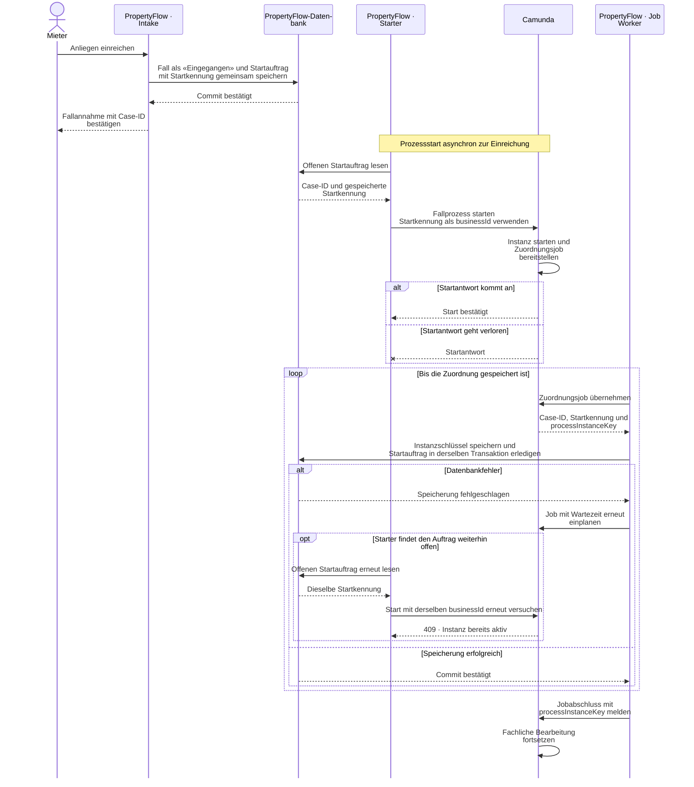
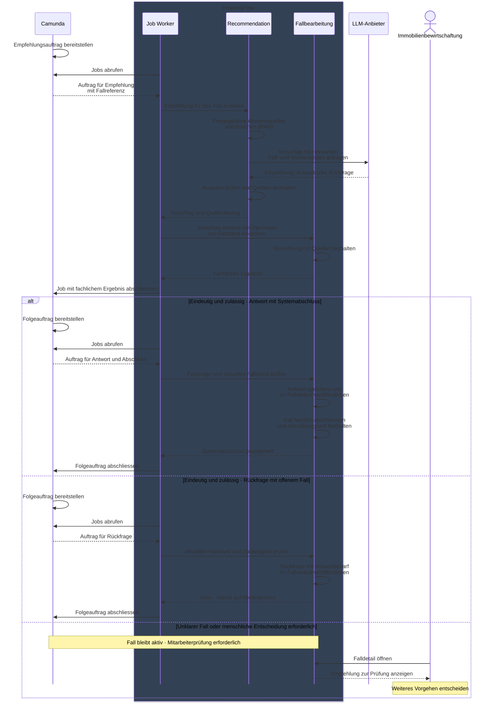

# ADR-002: Camunda 8 für die Orchestrierung langlebiger Prozesse

## Status

Akzeptiert. Am 13.11.2026 um die ausschliessliche Prozessführung und das Verhalten bei Camunda-Ausfall präzisiert. Der Integrationsentscheid zu SS-003 ist in dieser Fassung zusammengeführt. Die BPMN-Modellierung und Umsetzung stehen aus.

[Entscheidung](#entscheidung) · [Integrationsprinzipien](#integrationsprinzipien) · [Sequenzdiagramm zum Fallstart](#sequenzdiagramm--fallstart-und-zuordnung) · [Prüfung der Integration](#prüfung-der-integration)

## Kontext

Die Bearbeitung eines Mieteranliegens in PropertyFlow kann sich über einen
längeren Zeitraum erstrecken und mehrere automatisierte sowie manuelle
Bearbeitungsschritte enthalten.

Ein typischer Ablauf kann beispielsweise folgende Schritte umfassen:

1. Anliegen erfassen und persistent speichern
2. Mieter und Mietobjekt zuordnen
3. KI-gestützte Strukturierung und Dringlichkeitsbewertung durchführen
4. relevante Informationen über RAG ermitteln
5. Handlungsempfehlung erstellen
6. Empfehlung durch die Immobilienbewirtschaftung prüfen lassen
7. auf weitere Informationen oder eine externe Bearbeitung warten
8. Fall fortsetzen oder abschliessen

Ein Prozess kann dabei Minuten, Stunden oder mehrere Tage dauern.
Insbesondere menschliche Freigaben, Rückfragen, externe Abklärungen,
Timer sowie vorübergehend nicht verfügbare KI- oder RAG-Komponenten
führen zu Wartezuständen.

Der Zustand eines solchen Prozesses darf nicht nur im Arbeitsspeicher
der PropertyFlow-Anwendung gehalten werden. Ein Neustart oder temporärer
Ausfall einer Komponente darf nicht dazu führen, dass der
Bearbeitungsprozess verloren geht.

PropertyFlow verwendet gemäss ADR-001 als Backend einen modularen Monolithen.
Für die Orchestrierung der langlebigen Prozesse wird eine geeignete
Workflow-Lösung benötigt.

Zusätzlich soll PropertyFlow einen aktuellen Spring-Boot- und
Spring-AI-Stack verwenden, damit moderne KI-Integrationen und die im CAS
behandelten Technologien eingesetzt und evaluiert werden können.


## Relevante Qualitätsanforderungen

### NFR-03 – Zuverlässigkeit / Robustheit

Ein Mieteranliegen muss auch bei vorübergehendem Ausfall von Camunda,
KI, Retrieval oder E-Mail dauerhaft angenommen werden können. Die
Fallbearbeitung setzt verfügbare Prozesssteuerung voraus.

**Bedeutung für die Workflow-Architektur:**

Der Prozesszustand muss unabhängig von einzelnen Worker-Ausführungen
persistiert werden können. Fehler müssen wiederholt oder kontrolliert
bei verfügbarer Prozesssteuerung in eine Mitarbeiteraufgabe überführt
werden können.


### NFR-04 – Nachvollziehbarkeit / Auditierbarkeit

Der Bearbeitungsablauf sowie menschliche und KI-gestützte Entscheidungen
müssen später nachvollzogen werden können.

**Bedeutung für die Workflow-Architektur:**

Der aktuelle Prozesszustand und die ausgeführten Prozessschritte müssen
rekonstruierbar sein.


### NFR-06 – Betriebliche Einfachheit

Zusätzliche Infrastruktur soll nur eingeführt werden, wenn sie einen
klaren fachlichen oder qualitativen Nutzen bietet.

**Bedeutung für die Workflow-Architektur:**

Eine separate Workflow-Komponente erhöht den Betriebsaufwand.
Dieser zusätzliche Aufwand muss durch die zuverlässige Persistenz und
Orchestrierung langlebiger Prozesse gerechtfertigt sein.


### Human-in-the-Loop

KI-Empfehlungen dürfen bestimmte fachliche Entscheidungen nicht autonom
abschliessen.

**Bedeutung für die Workflow-Architektur:**

Ein Prozess muss auf eine menschliche Prüfung oder Freigabe warten und
anschliessend zuverlässig fortgesetzt werden können.


## Technische Rahmenbedingungen

PropertyFlow soll einen aktuellen Spring-Boot- und Spring-AI-Stack
verwenden.

Die Workflow-Lösung soll diese technologische Ausrichtung nicht unnötig
auf eine ältere Spring-Generation begrenzen.

Die Workflow-Orchestrierung soll ausserdem:

- BPMN-basierte Prozesse unterstützen,
- langlebige Prozessinstanzen persistieren,
- Timer und Wartezustände ermöglichen,
- Human Tasks unterstützen,
- automatisierte Prozessschritte an PropertyFlow delegieren können,
- Fehler und Wiederholungen kontrolliert behandeln können.


## Betrachtete Alternativen

### Alternative 1 – Prozesssteuerung direkt im PropertyFlow-Code

Der Bearbeitungsprozess wird vollständig durch Anwendungscode,
Statusfelder und bedingte Logik innerhalb des modularen Monolithen umgesetzt.

Beispielsweise:

```text
RECEIVED
   ↓
ANALYSING
   ↓
WAITING_FOR_REVIEW
   ↓
PROCESSING
   ↓
CLOSED
```

Die Anwendung entscheidet anhand des aktuellen Status, welcher
Bearbeitungsschritt als Nächstes durchgeführt werden muss.

#### Vorteile

- keine zusätzliche Workflow-Infrastruktur
- geringer initialer technischer Aufwand
- vollständige Kontrolle innerhalb der PropertyFlow-Anwendung
- keine zusätzliche externe Laufzeitkomponente

#### Nachteile

- langlebige Prozesse müssen selbst implementiert werden
- Timer, Wiederholungen und Wartezustände benötigen eigene Logik
- Human Tasks und Prozessfortsetzung müssen selbst verwaltet werden
- zunehmende Gefahr komplexer Zustands- und Verzweigungslogik
- Prozessabläufe sind weniger unmittelbar visualisierbar
- Änderungen am Prozess führen stärker zu Änderungen im Anwendungscode

#### Bewertung

Diese Variante wird nicht gewählt.

PropertyFlow besitzt explizit langlebige, unterbrechbare und
nachvollziehbare Bearbeitungsprozesse. Die dafür benötigten Mechanismen
sollen nicht vollständig als eigene Workflow-Infrastruktur implementiert
werden.


### Alternative 2 – Camunda 7 als eingebettete Process Engine

Camunda 7 wird direkt in die Spring-Boot-Anwendung eingebettet.

```text
PropertyFlow Backend
┌───────────────────────────────┐
│ Spring Boot                   │
│                               │
│ Fachmodule                    │
│                               │
│ Embedded Camunda 7 Engine     │
└───────────────────────────────┘
```

#### Vorteile

- vorhandene Erfahrung mit Camunda 7
- bekannte BPMN- und Java-Konzepte
- bekannte APIs
- JavaDelegate-Modell ist vertraut
- Engine und Fachanwendung laufen im selben Prozess
- geringe zusätzliche Laufzeit-Infrastruktur
- einfache lokale Integration

#### Nachteile

- stärkere Kopplung zwischen Process Engine und PropertyFlow-Anwendung
- die eingebettete Engine beeinflusst die Wahl kompatibler Spring-Versionen
- Camunda 7 passt weniger gut zur gewünschten aktuellen
  Spring-Boot-/Spring-AI-Technologiebasis
- PropertyFlow würde stärker an die ältere Camunda-Generation gekoppelt
- zukünftige technologische Weiterentwicklung wäre eingeschränkt

#### Bewertung

Camunda 7 war aufgrund der vorhandenen Erfahrung zunächst die bevorzugte
Variante.

Nach Prüfung der gewünschten aktuellen Spring-Boot- und
Spring-AI-Technologiebasis wurde die Variante jedoch verworfen.

Die vorhandene Erfahrung mit Camunda 7 reduziert zwar den
Entwicklungsaufwand, rechtfertigt aber nicht die Einschränkung der
übrigen Technologiebasis des Projekts.


### Alternative 3 – Camunda 8 als separate Workflow-Orchestrierung

Camunda 8 führt die BPMN-Prozesse als separate Orchestrierungskomponente aus.

PropertyFlow integriert sich über die unterstützten Client-Schnittstellen
und Job Worker.

```text
PropertyFlow Backend
        │
        │ Prozesse starten
        │ Jobs verarbeiten
        │
        ▼
    Camunda 8
```

Die PropertyFlow-Anwendung enthält weiterhin die Fachlogik.
Camunda steuert, wann welcher Bearbeitungsschritt ausgeführt werden soll.

#### Vorteile

- langlebige Prozesse werden unabhängig von einzelnen HTTP-Requests
  persistiert
- persistente Wartezustände werden unterstützt
- Timer können im Prozess modelliert werden
- Human Tasks können explizit im Prozess dargestellt werden
- BPMN macht Prozessabläufe sichtbar und nachvollziehbar
- Fehler und Wiederholungen können auf Workflow-Ebene behandelt werden
- Prozess-Orchestrierung bleibt von der Implementierung der Fachlogik
  getrennt
- kompatibel mit der aktuellen Spring-/AI-Technologiebasis
- gute Grundlage für langlebige und teilweise automatisierte Prozesse

#### Nachteile

- zusätzliche Laufzeitkomponente
- höhere Infrastruktur- und Betriebskomplexität
- PropertyFlow und Camunda besitzen getrennte persistente Zustände
- keine gemeinsame lokale Datenbanktransaktion zwischen Camunda und
  PropertyFlow
- Job Worker müssen mögliche Wiederholungen berücksichtigen
- Idempotenz muss bewusst umgesetzt werden
- Umstellung gegenüber bekannten Camunda-7-APIs und Konzepten
- zusätzliche Lernkurve


## Bewertung

| Kriterium | Eigene Prozesssteuerung | Camunda 7 Embedded | Camunda 8 |
|---|---|---|---|
| Langlebige Prozesse | mittel | hoch | **hoch** |
| Persistente Wartezustände | selbst zu entwickeln | hoch | **hoch** |
| Human-in-the-Loop | selbst zu entwickeln | hoch | **hoch** |
| BPMN-basierte Prozessdarstellung | niedrig | hoch | **hoch** |
| Robustheit bei Worker-Ausfällen | selbst zu entwickeln | mittel bis hoch | **hoch** |
| Betrieblicher Aufwand | **niedrig** | niedrig | mittel |
| Kompatibilität mit aktuellem Spring-/AI-Stack | hoch | niedrig bis mittel | **hoch** |
| Vorhandene Erfahrung | mittel | **hoch** | mittel |
| Zukunftsfähigkeit für PropertyFlow | mittel | mittel | **hoch** |


## Entscheidung

PropertyFlow verwendet **Camunda 8** zur Orchestrierung langlebiger
Bearbeitungsprozesse.

Camunda 8 wird nicht in die PropertyFlow-Anwendung eingebettet.

Das PropertyFlow-Backend bleibt gemäss ADR-001 ein modularer Monolith und
integriert sich über die von Camunda unterstützten Client-Schnittstellen
und Job Worker mit der Workflow Engine.

Camunda übernimmt insbesondere:

- Orchestrierung des Bearbeitungsprozesses
- Persistenz des technischen Workflow-State
- Wartezustände
- Timer
- Wiederholungen
- technische Fehlerzustände
- menschliche Aufgaben und Freigabeschritte

**Verbindliche Prozessführung:** PropertyFlow nimmt neue Anliegen unabhängig
von Camunda dauerhaft an und speichert sie als «Eingegangen». Der Prozessstart
erfolgt asynchron über SS-003. Für alle folgenden fachlichen Statuswechsel ist
der führende Camunda-Prozess zuständig. Mitarbeitende führen die dort
freigegebenen fachlichen Aktionen aus. Camunda entscheidet über den nächsten
Schritt und veranlasst den Statuswechsel. PropertyFlow prüft den Übergang,
speichert den fachlichen Status und stellt ihn für die Ansichten bereit.

Vor dem Prozessstart und bei einem Camunda-Ausfall können berechtigte
Mitarbeitende Fälle lesen. Fachliche Bearbeitungsaktionen bleiben
serverseitig gesperrt. Das gilt für Web und MCP. Bei Wiederanlauf holt
PropertyFlow ausstehende Starts nach. Der konkrete Mitarbeiterablauf und
die Prüfkriterien stehen in [FALL-06](../../specifications/fallverwaltung.md#fall-06-fachlicher-status-und-technischer-workflow).

Die fachliche Geschäftslogik verbleibt in PropertyFlow.


## Verantwortungsgrenzen

### PropertyFlow besitzt die fachlichen Daten

PropertyFlow ist die führende Quelle für fachliche Informationen wie:

- Mieteranliegen
- Mieter- und Mietobjekt-Zuordnung
- Dringlichkeitsbewertung
- KI-Ergebnisse
- Handlungsempfehlungen
- fachlicher Bearbeitungsstatus
- Bearbeitungsverlauf
- Auditinformationen

Diese Daten werden in der PropertyFlow-Datenhaltung gespeichert.


### Camunda besitzt den Workflow-State

Camunda hält den für die Prozesssteuerung erforderlichen technischen
Workflow-State.

Dazu gehören beispielsweise:

- aktuelle Position der Prozessinstanz
- aktive Aufgaben
- wartende Jobs
- Timer
- Prozessvariablen
- technische Fehlerzustände
- Retry-Zustände

Fachliche Daten sollen nicht unnötig zwischen PropertyFlow und Camunda
dupliziert werden.

Komplette Mieter-, Mietvertrags- oder Fallobjekte werden deshalb nicht
als Prozessvariablen gespeichert.

Bevorzugt werden Referenzen und die für die Prozesssteuerung notwendigen
Informationen.

Beispiel:

```json
{
  "tenantRequestId": "REQ-4711",
  "priority": "HIGH",
  "processingState": "WAITING_FOR_REVIEW"
}
```


## Integrationsprinzipien

Der technische Vertrag zu Startkennung, Nachrichtenfeldern und Fehlerabbildung ist unter [SS-003](../schnittstellenentwurf-block-3.md#ss-003--camunda-integrationsvertrag) beschrieben.

### Asynchroner Fallstart und Zuordnung

PropertyFlow speichert den Fall mit «Eingegangen» und den dauerhaften Startauftrag gemeinsam. Die Bestätigung an den Mieter folgt auf den Datenbank-Commit. Ein asynchroner Starter prüft regelmässig die offenen Startaufträge und verwendet für jeden Versuch desselben Auftrags dieselbe gespeicherte Startkennung. Camunda verhindert damit einen weiteren Start, solange die zugehörige Instanz aktiv ist.

Der erste Camunda-Job-Worker ordnet seine Instanz dem Fall zu. Er speichert den `processInstanceKey` am Fall und erledigt den Startauftrag in derselben Datenbanktransaktion. Bei einem vorübergehenden Speicherfehler wird der Job mit Wartezeit wiederholt, bis die Zuordnung gespeichert ist. Bis dahin bleibt der Fall auf «Eingegangen», und der Prozess wartet vor der fachlichen Bearbeitung. Eine Wiederholung für dieselbe bereits gespeicherte Instanz bestätigt die Zuordnung. Eine abweichende Instanz darf die gespeicherte Zuordnung nicht überschreiben oder den Fall weiterbearbeiten.

Die Startkennung identifiziert den Startauftrag. Der `processInstanceKey` bezeichnet die konkrete Ausführung des Fallprozesses. Die Case-ID ist die fachliche Referenz, die BPMN-Prozess-ID bezeichnet das Prozessmodell.

### Sequenzdiagramm · Fallstart und Zuordnung



### Synchrone Nachrichtenkorrelation

Bei fachlichen Übergaben, die das BPMN-Modell als Nachrichtenempfang vorsieht, wartet PropertyFlow synchron auf die Korrelation mit der zugeordneten Instanz. PropertyFlow ermittelt den `processInstanceKey` serverseitig. Das BPMN-Modell legt fest, in welchen Schritten eine Nachricht zulässig ist, wie der Prozess fortsetzt und wie er fachliche Fehler behandelt. Es gelten die Prozessfreigaben und die Regeln für kritische Aktionen. [FALL-06](../../specifications/fallverwaltung.md#fall-06-fachlicher-status-und-technischer-workflow) · [FALL-10](../../specifications/fallverwaltung.md#fall-10-automatisierung-und-menschliche-freigabe)

**Mieterergänzung.** Nach dem Speichern der Nachricht wartet PropertyFlow im selben Browseraufruf synchron auf die bestätigte Korrelation mit der zugeordneten Fallprozessinstanz. Erst danach meldet es dem Browser Erfolg. Ist Camunda nicht erreichbar oder scheitert die Korrelation technisch, einschliesslich Timeout, antwortet PropertyFlow mit HTTP `500`. Der Text bleibt im Formular. Eine bereits gespeicherte Nachricht bleibt im Fallverlauf erhalten. Bei einem Timeout kann Camunda die Nachricht bereits korreliert haben. Eine Wiederholung im Browser verwendet dieselbe Absende-ID. [SS-003](../schnittstellenentwurf-block-3.md#ss-003--camunda-integrationsvertrag) · [UC-009](../../use_cases/UC-009-mieteranliegen-ergaenzen.md)

### Synchroner Abschluss von User Tasks

Für jeden Prozesszustand mit einer nativen Camunda User Task gilt dieselbe Regel. Wenn eine Aktion die Aufgabe abschliesst, bezieht sich die Entscheidung auf die konkrete Aufgabe (`userTaskKey`) und den geprüften Fallstand. PropertyFlow prüft serverseitig Berechtigung, Fallstand, zulässige Aktion und ob die Aufgabe offen ist und zum Fallprozess (`processInstanceKey`) gehört. Es schliesst genau diese Aufgabe synchron ab und meldet Erfolg erst nach der Bestätigung durch Camunda. Ein veralteter Aufruf wird abgewiesen. Eine neu geöffnete Aufgabe hat einen eigenen Schlüssel und bleibt davon unberührt. Für zugelassene Aktionen über Web und MCP gilt dieselbe serverseitige Prüfung.

«Bearbeitung fortsetzen» ist die Anwendung dieser Regel bei «Mitarbeiterprüfung erforderlich». Camunda steuert den Folgeschritt. Der neue Fallstatus «In Bearbeitung» wird sichtbar, sobald der PropertyFlow-Worker ihn gespeichert hat. Die HTTP-Antworten und die Behandlung eines Timeouts stehen im Integrationsvertrag. [SS-003](../schnittstellenentwurf-block-3.md#ss-003--camunda-integrationsvertrag) · [UC-012](../../use_cases/UC-012-fall-fachlich-steuern.md#synchroner-vertrag-für-die-mitarbeiteraktion)

### Wiedervorlage

Der führende Fallprozess wartet auf den wirksamen Timer oder eine neue
Mieternachricht. Sobald eine während der Wartezeit gespeicherte Nachricht
korreliert ist, hebt Camunda die Wiedervorlage auf und veranlasst die
Mitarbeiterprüfung. Der Übergang wartet auf keine automatische Auswertung.
Erreicht der Timer den Prozess zuerst, wird die während der Wartezeit
gespeicherte Nachricht bei der bereits ausgelösten Prüfung berücksichtigt.
Pro Wiedervorlage entsteht höchstens eine Mitarbeiteraufgabe. [FALL-11](../../specifications/fallverwaltung.md#fall-11-wiedervorlage)

### Job Worker

Automatisierte Prozessschritte werden durch PropertyFlow als
Camunda Job Worker implementiert.

Mögliche Worker sind beispielsweise:

```text
classify-tenant-request
evaluate-urgency
retrieve-knowledge
create-recommendation
```

Die Worker rufen die entsprechende Fachlogik innerhalb des
PropertyFlow-Backends auf.


### Trennung von Workflow und Fachlogik

Camunda steuert den Ablauf.

PropertyFlow implementiert die Fachlogik.

Ein BPMN-Service-Task soll deshalb keine komplexe Fachlogik direkt
enthalten, sondern einen entsprechenden PropertyFlow-Worker aufrufen.

```text
Camunda
   │
   │ Job
   ▼
PropertyFlow Worker
   │
   ▼
fachliches Modul
```

#### Beispiel · Zuständigkeit und Vorgehen empfehlen

Camunda stellt den Auftrag für die Empfehlung bereit. Der Job Worker läuft in
PropertyFlow und ruft dort das Modul `recommendation` auf. Dieses kann eine
Empfehlung für die Immobilienbewirtschaftung oder einen Vorschlag für eine
Antwort oder Rückfrage an den Mieter liefern.

PropertyFlow übernimmt die vorgeschlagene Aktion automatisch, wenn sie sich
aus den vorliegenden Fallangaben und einer freigegebenen Fachregel eindeutig
ergibt, für die automatische Ausführung zugelassen ist und keine menschliche
Entscheidung aussteht. PropertyFlow prüft diese Voraussetzungen serverseitig
am aktuellen Fallstand. Bei fehlenden, unklaren oder widersprüchlichen
Angaben oder bei vorgeschriebener menschlicher Entscheidung prüft die
Immobilienbewirtschaftung den Fall und entscheidet über das weitere Vorgehen.
Der Fall bleibt bis dahin aktiv. Der Auslösepunkt und der Zuschnitt der Jobs
bleiben im BPMN- und Integrationsentwurf offen.
[UC-018](../../use_cases/UC-018-zustaendigkeit-und-vorgehen-empfehlen.md)

**Beispiel für eine direkte Antwort mit Systemabschluss.** Ein Mieter meldet
«Meine Lampe zu Hause funktioniert nicht mehr.» Bestätigen die Fallangaben und
eine hinterlegte Fachregel eindeutig, dass es seine private Lampe ist und der
Austausch in seiner Verantwortung liegt, ist «Für den Austausch Ihrer privaten
Lampe sind Sie selbst zuständig» eine mögliche Antwort.
PropertyFlow prüft die Regel und den aktuellen Fall serverseitig. Wenn keine
menschliche Entscheidung aussteht, zeigt der Beispielablauf die Veröffentlichung
im Fallverlauf vor dem Systemabschluss wegen fehlenden Bearbeitungsbedarfs
der Verwaltung. Die konkreten Regeln für die automatische Veröffentlichung
sind im Kommunikationsvertrag zu präzisieren.

**Beispiel für eine Rückfrage bei offenem Fall.** Ein Mieter meldet
«Der Lüftungsfilter im Badezimmer muss ausgetauscht werden.» Liegt der
Filterwechsel im konkreten Fall gemäss hinterlegter Fachregel in seiner
Verantwortung, kann der Ablauf folgende Rückfrage vorsehen.

> Sollen wir für Sie einen Ersatzfilter organisieren? Die Kosten für den Filter
> würden Sie tragen.

Wenn die Voraussetzungen für die automatische Veröffentlichung erfüllt sind,
veröffentlicht PropertyFlow die Rückfrage mit Antwortbedarf. Der Fall bleibt
aktiv und erhält im Beispiel den Status «Wartet auf Mieterantwort». Bei einer
Zusage klärt die Immobilienbewirtschaftung die Kosten und entscheidet über eine
allfällige Bestellung, die sie ausserhalb von PropertyFlow organisiert.
[FALL-05](../../specifications/fallverwaltung.md#fall-05-fachlicher-lebenszyklus) ·
[UC-021](../../use_cases/UC-021-ki-rueckfrage-vorschlagen.md)

Für beide Beispielabläufe gelten die Kontext-, Veröffentlichungs- und
Freigaberegeln.
[FALL-07](../../specifications/fallverwaltung.md#fall-07-abschluss-und-zeit-danach) ·
[FALL-10](../../specifications/fallverwaltung.md#fall-10-automatisierung-und-menschliche-freigabe) ·
[KOM-02](../../specifications/fallkommunikation.md#kom-02-llm-kommunikation-ohne-interne-memos) ·
[KOM-04](../../specifications/fallkommunikation.md#kom-04-nachrichtensperre-nach-fallabschluss)




### Idempotenz

Job Worker müssen so implementiert werden, dass eine erneute Ausführung
nicht zu unerwünschten Mehrfachwirkungen führt.

Insbesondere Aktionen gegenüber externen Systemen müssen eine mögliche
Mehrfachausführung berücksichtigen.

Beispielsweise darf ein wiederholter Worker-Aufruf nicht mehrfach denselben
externen Auftrag erzeugen.

Bei einer Dringlichkeitsbewertung speichert PropertyFlow das Ergebnis zusammen
mit dem Camunda-Job-Schlüssel in einer Datenbanktransaktion. Der Worker meldet
den Abschluss erst nach dem Commit. Wird derselbe Job erneut zugestellt und
liegt sein Ergebnis bereits vor, verwendet der Worker die gespeicherte
Bewertung und meldet nur den Abschluss an Camunda. Die Wiederholung löst
keinen Modellaufruf und keine weitere fachliche Änderung aus.


### Fehlerbehandlung

Der Ausfall einer KI-, Retrieval- oder anderen externen Komponente darf
nicht dazu führen, dass das Mieteranliegen verloren geht.

Ein fehlgeschlagener automatisierter Schritt kann beispielsweise:

- erneut versucht werden,
- in einen kontrollierten Fehlerzustand wechseln,
- zur manuellen Bearbeitung eskalieren.

Die fachlichen Daten des Mieteranliegens bleiben dabei in PropertyFlow
erhalten.


### Human-in-the-Loop

Kritische fachliche Aktionen dürfen nicht ausschliesslich aufgrund einer
KI-Ausgabe ausgeführt werden.

Der BPMN-Prozess enthält deshalb explizite menschliche Prüf- und
Freigabeschritte. In einer Mitarbeiterprüfung wartet er auf die fachliche
Entscheidung. Der Worker prüft beim Schreiben die Zuordnung zum aktuellen
Prozessschritt, damit verspätete Aufträge keine spätere Entscheidung verändern.

Beispiel:

```text
Mieteranliegen
      ↓
KI-Triage
      ↓
RAG / Empfehlung
      ↓
┌────────────────────────────┐
│ Menschliche Prüfung        │
│ Immobilienbewirtschaftung  │
└─────────────┬──────────────┘
              ↓
       weitere Bearbeitung
```


## Konsequenzen

### Positive Konsequenzen

- langlebige Prozesse werden explizit modelliert
- Wartezeiten von Stunden oder Tagen können zuverlässig abgebildet werden
- Prozesszustände bleiben unabhängig von einzelnen Backend-Requests erhalten
- Human-in-the-Loop wird als Bestandteil des Prozesses sichtbar
- Timer und Wiederholungsmechanismen müssen nicht vollständig selbst
  entwickelt werden
- BPMN-Prozesse können fachlich diskutiert und visualisiert werden
- KI-Schritte werden in einen kontrollierten Geschäftsprozess eingebettet
- PropertyFlow kann einen aktuellen Spring-Boot- und Spring-AI-Stack
  verwenden
- Prozesslogik und Fachlogik bleiben voneinander getrennt


### Negative Konsequenzen

- Camunda 8 muss zusätzlich betrieben werden
- die lokale Entwicklungsumgebung wird komplexer
- Camunda 8 muss zusätzlich überwacht und abgesichert werden
- ein Camunda-Ausfall unterbricht die Fallbearbeitung durch Mitarbeitende
- Entwickler müssen das Job-Worker- und Client-Modell von Camunda 8 kennen
- gegenüber Camunda 7 müssen neue APIs und Konzepte erlernt werden
- zwischen PropertyFlow und Camunda existiert keine gemeinsame lokale
  Datenbanktransaktion
- Idempotenz und verteilte Fehlerfälle müssen bewusst behandelt werden

### Preis der synchronen Übergaben

Synchrone Task-Abschlüsse und Nachrichtenkorrelationen machen die Antwortzeit und Verfügbarkeit der jeweiligen Aktionen von Camunda abhängig. Für Task-Abschlüsse muss der Aufruf die konkrete Aufgabe und den geprüften Fallstand referenzieren. Für Nachrichtenübergaben muss der Prozess einen passenden Nachrichtenempfang modellieren. Beim Intake erlaubt der dauerhafte Startauftrag die Bestätigung auch bei unerreichbarem Camunda.


## Auswirkungen auf die Architektur

Camunda 8 wird im C4-Level-2-Diagramm als separate
Orchestrierungskomponente dargestellt.

### PropertyFlow-Backend

Das PropertyFlow-Backend bleibt für die fachliche Verarbeitung
verantwortlich und enthält:

- die fachlichen Module und deren Geschäftslogik
- den Camunda Client zur Kommunikation mit Camunda 8
- Job Worker zur Ausführung automatisierter BPMN-Service-Tasks
- die Integration der User Tasks in die PropertyFlow-Anwendung

### Camunda 8

Camunda 8 ist für die technische Prozess-Orchestrierung verantwortlich
und verwaltet insbesondere:

- BPMN-Prozessinstanzen
- den technischen Workflow-State
- Jobs für automatisierte Prozessschritte
- Timer und Wartezustände
- den Zustand von User Tasks
- technische Retry- und Fehlerzustände

Die fachliche Geschäftslogik und die fachlichen Daten verbleiben in
PropertyFlow.

Die Immobilienbewirtschaftung interagiert nicht direkt mit Camunda,
sondern weiterhin über das PropertyFlow-Frontend.

Der modulare Monolith aus ADR-001 bleibt bestehen.

Camunda 8 ist nicht Bestandteil des modularen Monolithen selbst.


## Prüfung der Integration

- Camunda abschalten, ein Anliegen einreichen und den gespeicherten Fall als «Eingegangen» abrufen. Nach Wiederanlauf wird der Prozess gestartet und die Instanz dem Fall zugeordnet.
- Camunda den Prozess starten lassen, die Startantwort verwerfen und die Zuordnung im ersten Worker vorübergehend an einem Datenbankfehler scheitern lassen. Den Starter währenddessen erneut ausführen. Nach Behebung des Fehlers muss der Worker den ursprünglichen Prozess zuordnen und den Startauftrag erledigen. Der ausführliche Prüffall steht unter [SS-003](../schnittstellenentwurf-block-3.md#prüffall--verlorene-startantwort-und-datenbankfehler).
- Die Abschlussmeldung eines bereits gespeicherten Bewertungsjobs vor Camunda unterbrechen. Bei erneuter Zustellung meldet der Worker den Abschluss mit der gespeicherten Bewertung. Den Nachweis für Modellaufruf, Verlauf und Mailauftrag beschreibt [E3](../schnittstellenentwurf-block-3.md#prüffall--bewertungsjob-erneut-zugestellt).
- Zwei Fallprozesse mit je einer offenen Mitarbeiterprüfung starten. «Bearbeitung fortsetzen» schliesst über den `userTaskKey` nur die Aufgabe des gewählten Falls ab. PropertyFlow liefert `200`. Bis zum Commit des Workers zeigt der Abruf den bisherigen Fallstatus.
- Dieselbe Mitarbeiterprüfung zweimal nacheinander in einer Fallprozessinstanz öffnen. Die Aktion aus dem alten Tab ergibt `400`. Die zweite Aufgabe bleibt offen und der Fallstand bleibt unverändert. [SS-003 · Prüffall](../schnittstellenentwurf-block-3.md#prüffall--bearbeitung-aus-einem-alten-tab)
- Die Camunda-Antwort nach erfolgreichem Task-Abschluss verwerfen. PropertyFlow liefert `500`. Die Oberfläche lädt den gespeicherten Fallstand neu. Der Aufruf wird nicht automatisch wiederholt.


## Kriterien für eine Neubewertung

Die Entscheidung wird überprüft, wenn mindestens eine der folgenden
Bedingungen eintritt:

- die Bearbeitungsprozesse werden so einfach, dass eine Workflow Engine
  keinen ausreichenden Mehrwert mehr bietet
- der Betriebsaufwand von Camunda 8 wird für PropertyFlow unverhältnismässig
  hoch
- eine andere Workflow-Technologie bietet wesentliche Vorteile für die
  Anforderungen von PropertyFlow
- Lizenz-, Hosting- oder Betriebsbedingungen verändern sich wesentlich
- die Integration mit dem gewählten Spring-/AI-Stack ist langfristig nicht
  mehr sinnvoll möglich


## Nicht Bestandteil dieses ADR

Dieses ADR entscheidet über den Einsatz von Camunda 8 und die Prinzipien
seiner Anbindung über SS-003.

Folgende Entscheidungen werden separat getroffen:

- konkrete Betriebsform von Camunda 8
- lokale Entwicklungsumgebung für Camunda 8
- Authentifizierung und Autorisierung gegenüber Camunda
- konkrete BPMN-Prozessmodelle
- konkrete Wartezeiten für Wiederholungen und allgemeine Incident-Strategie
- detaillierte Job-Worker-Struktur
- technische Ausgestaltung des dauerhaften Startauftrags und allfälliger
  weiterer transaktionaler Folgeaufträge
