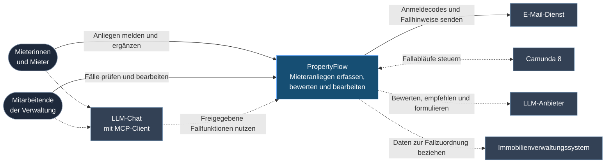

# C4 Level 1 – Systemkontext

PropertyFlow unterstützt Immobilienbewirtschaftungen bei der
KI-gestützten Triage und Bearbeitung von Mieteranliegen.

Der blaue Kasten steht für das Gesamtsystem. Die Pfeile zeigen, wofür Personen
und Nachbarsysteme mit PropertyFlow zusammenarbeiten. Durchgezogene Linien
stehen für Verbindungen in der lokalen Demo. Gestrichelte Linien zeigen das
Zielbild.

## Schnittstellen an der Systemgrenze

| Schnittstelle | Verantwortung | Status |
| --- | --- | --- |
| Mieter und Mitarbeitende → PropertyFlow | Mieter können ohne Konto einreichen und über den persönlichen Fall-Link antworten. Ein freiwilliges, per E-Mail verifiziertes Konto bietet «Meine Fälle». Mitarbeitende melden sich per Einmalcode an und bearbeiten Fälle. [Zugriffsregeln](../specifications/fallzugriff-und-sicherheit.md#zug-04-rechte-und-vertrauensgrenzen) | **Implementiert in der lokalen Demo** |
| PropertyFlow → E-Mail-Dienst | Anmeldecodes und Hinweise zu Fällen mit persönlichem Fall-Link versenden. [Benachrichtigungen](../specifications/benachrichtigungen-und-zustellung.md#ben-03-speicherung-und-zuverlässige-übergabe) | **Teilweise implementiert**. Einmalcodes in der Demo, Fallbenachrichtigungen geplant. |
| PropertyFlow ↔ Camunda 8 | Camunda steuert die Fallabläufe von der Erstbewertung bis zu Wiedervorlagen. PropertyFlow nimmt Fälle an und führt ihre fachlichen Daten und Ergebnisse. [ADR-002](adr/ADR-002-camunda8-workflow-orchestrierung.md#verantwortungsgrenzen) · [Wiedervorlage](../specifications/fallverwaltung.md#fall-11-wiedervorlage) | **Geplant**. Infrastruktur vorhanden, fachliche Anbindung ausstehend. |
| LLM-Chat → PropertyFlow | Mieter und Mitarbeitende geben dem Client im LLM-Chat ausgewählte Fallfunktionen im Rahmen ihrer Rechte frei. [ADR-005](adr/ADR-005-zugriffsmodell.md#autorisierung-über-mcp) | **Geplant** |
| PropertyFlow → LLM-Anbieter | PropertyFlow sendet freigegebene Eingaben zur Triage, Empfehlung oder Formulierung und prüft die Modellausgabe. [Triage-Vertrag](../ai-usage/ki-service-vertrag.md) · [KOM-02](../specifications/fallkommunikation.md#kom-02-llm-kommunikation-ohne-interne-memos) | **Prototyp vorhanden**. Triage separat erprobt, Einbindung in den Fallablauf geplant. |
| PropertyFlow → Immobilienverwaltungssystem | PropertyFlow bezieht die für die Zuordnung erforderlichen Mieter-, Mietverhältnis- und Objektdaten. [Fallzuordnung](../specifications/fallverwaltung.md#fall-04-ursprungsdaten-und-zuordnung) | **Geplant** |

Die [Containeransicht](c4-2-container.md) zeigt die Anwendung und ihre
Datenbank. Die [Komponentenansicht](c4-3-components.md) zeigt die Fachmodule
und Adapter, die die Schnittstellen bedienen.

Die Annahme eingehender Mieter-E-Mails bleibt Teil der Vision. Dafür ist ein
eigener Kanalvertrag vorgesehen. [UC-020](../use_cases/UC-020-mieteranliegen-per-e-mail-entgegennehmen.md)

Externe Beauftragungen organisiert die Verwaltung ausserhalb von PropertyFlow.
