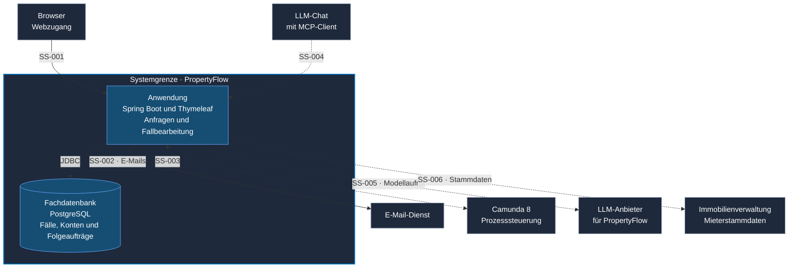

# C4 Level 2 – Containeransicht

Die Containeransicht zeigt, wie sich das System aus der
[Kontextansicht](c4-1-context.md) zur Laufzeit aufteilt. Die
**Spring-Boot-Anwendung** verarbeitet Anfragen und rendert die Web-Oberfläche
mit Thymeleaf. **PostgreSQL** speichert im Zielbetrieb die Fachdaten und
Folgeaufträge. Browser und MCP-Client verbinden sich mit der Anwendung.
Die [Komponentenansicht](c4-3-components.md) zeigt die Module und Adapter
innerhalb der Spring-Boot-Anwendung.

Durchgezogene Linien zeigen in der lokalen Demo genutzte Verbindungen.
Gestrichelte Linien zeigen geplante Anbindungen. Der Doppelpfeil bei
`SS-003` zeigt den Austausch von Prozessaufträgen und Jobmeldungen.

## Schnittstellen in der Anwendung

Die Tabelle ordnet die Schnittstellen den Teilen der Anwendung zu. Die
[Schnittstellenübersicht](schnittstellenentwurf-block-3.md#schnittstellenübersicht)
führt den Stand der Verträge. Die [C4-Komponentenansicht](c4-3-components.md)
zeigt die Kommunikationswege innerhalb der Anwendung.

| ID | Zuständiger Teil der PropertyFlow-Anwendung | Aufgabe |
| --- | --- | --- |
| **SS-001** | Spring MVC und Thymeleaf | Liefert Web-Erfassung, Fallansichten und Anmeldung über HTTPS im Zielbetrieb. Die KI-Formulierung in UI3 nutzt in der Demo einen Mock. [ADR-003](adr/ADR-003-praesentationsschicht.md#entscheidung) |
| **SS-002** | SMTP-Adapter | Sendet Einmalcodes. Fallbenachrichtigungen folgen nach der fachlichen Speicherung über dauerhafte Versandaufträge. [BEN-03](../specifications/benachrichtigungen-und-zustellung.md#ben-03-speicherung-und-zuverlässige-übergabe) |
| **SS-003** | Camunda-Client und Job Worker | Startet Fallprozesse und übermittelt Ereignisse. Der Worker öffnet die Verbindung zu Camunda, übernimmt Jobs, ruft die zuständige Fachfunktion auf und meldet das Ergebnis zurück. [ADR-002](adr/ADR-002-camunda8-workflow-orchestrierung.md#integrationsprinzipien) |
| **SS-004** | MCP-Adapter | Macht ausgewählte Fachfunktionen über HTTP mit delegiertem OAuth-Zugriff nutzbar. Web und MCP nutzen dieselben Anwendungsdienste. Dort gelten die Regeln für Fallzugriff, Aktion, menschliche Freigabe und Audit. [ADR-005](adr/ADR-005-zugriffsmodell.md#autorisierung-über-mcp) |
| **SS-005** | Modelladapter hinter dem Fachvertrag | Ruft das Modell mit den für die jeweilige Aufgabe nötigen Daten auf. Für die Triage kapselt der vorhandene `AnalysisModel`-Port den Anbieter. [Triage-Vertrag](../ai-usage/ki-service-vertrag.md) |
| **SS-006** | Stammdatenanbindung | Bezieht die für die Zuordnung nötigen Mieter-, Mietverhältnis- und Objektdaten. [FALL-04](../specifications/fallverwaltung.md#fall-04-ursprungsdaten-und-zuordnung) |

## Fallannahme und Erstbewertung

1. Der Browser reicht das Anliegen über `SS-001` ein. PropertyFlow speichert
   Fall und Prozessstartauftrag gemeinsam in PostgreSQL. Der Browser erhält die
   Bestätigung mit der Case-ID nach dem Commit. Die interne Aufteilung zeigt
   die [Komponentenansicht](c4-3-components.md#kommunikation-in-propertyflow).
2. PropertyFlow übergibt den gespeicherten Startauftrag im Hintergrund über
   `SS-003` an Camunda. Bei einem Camunda-Ausfall bleibt der Auftrag in
   PropertyFlow ausstehend und kann nach dem Wiederanlauf übergeben werden.
   Neue Fälle bleiben auf «Eingegangen». Mitarbeitende können Fälle lesen.
   Bearbeitungsaktionen setzen verfügbare Prozesssteuerung voraus.
3. Camunda stellt den Job zur Erstbewertung bereit. Der Worker in der
   PropertyFlow-Anwendung lädt die erforderlichen Daten über die Case-ID und
   ruft Triage intern auf. PropertyFlow speichert das Ergebnis. Der Worker
   meldet den Jobabschluss oder Fehlschlag an Camunda.

[Asynchrone Erstbewertung](schnittstellenentwurf-block-3.md#4-architekturentscheid-für-artefakt-5) · [FALL-02](../specifications/fallverwaltung.md#fall-02-erfolgreiche-annahme)

PostgreSQL ist als führender Speicher für Fälle, Konten, Verlauf, Audit und
Folgeaufträge vorgesehen. Camunda verwaltet den technischen Prozesszustand
mit Jobs und Timern und veranlasst fachliche Statuswechsel. PropertyFlow
speichert die bestätigten Übergänge. Für die vorgesehene Wissensbasis bleiben
Speichertechnik und Deployment offen.
[Modulstruktur](module-structure.md#externe-integrationen) · [ADR-002](adr/ADR-002-camunda8-workflow-orchestrierung.md#verantwortungsgrenzen)

Die lokale Demo hält Fälle und Konten im Arbeitsspeicher und versendet
Einmalcodes per SMTP. Triage ist separat erprobt. Die dauerhafte Fallannahme,
der fachliche Camunda-Prozess und Fallbenachrichtigungen sind Zielarchitektur.
[Demo](../../dev/README.md) · [Triage-Vertrag](../ai-usage/ki-service-vertrag.md)
