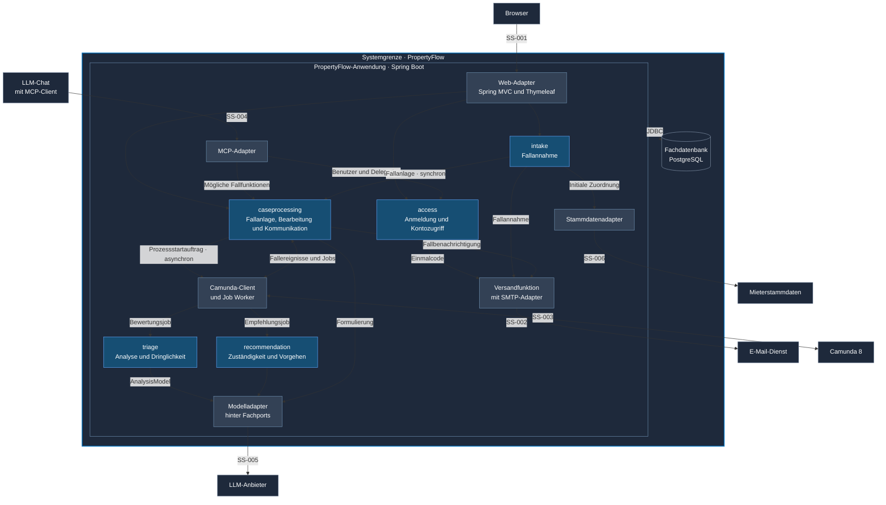

# C4 Level 3 – Komponentenansicht

Die Ansicht öffnet den Container «PropertyFlow-Anwendung» aus der
[Containeransicht](c4-2-container.md). Fachmodule und Adapter laufen gemeinsam
in einer Spring-Boot-Anwendung. PostgreSQL ist ein eigener Container innerhalb
der PropertyFlow-Systemgrenze. Die Pfeile benennen die wichtigsten Beziehungen.
Der Umsetzungsstand steht unter der Grafik.

## Kommunikation in PropertyFlow

- **Zugriff.** Der Web-Adapter bedient die Anmeldung und Fallfunktionen. Der
  MCP-Adapter soll ausgewählte Funktionen derselben Anwendungsdienste anbieten.
  Die Dienste prüfen die geltenden Konto-, Fall- und Aktionsrechte. Das erste
  Werkzeug für Mieter ist [«Fallstand abrufen»](schnittstellenentwurf-block-3.md#ss-004--mcp-werkzeug-fallstand-abrufen). [ZUG-04](../specifications/fallzugriff-und-sicherheit.md#zug-04-rechte-und-vertrauensgrenzen) · [UC-023](../use_cases/UC-023-mcp-zugriff-delegieren.md)
- **Fallanlage.** Intake nimmt das Anliegen entgegen und ruft die öffentliche
  Fallanlage von Case Processing synchron auf. Case Processing besitzt den
  Fall ab der Anlage und speichert ihn mit «Eingegangen» zusammen mit dem
  Prozessstartauftrag in einer Datenbanktransaktion. Intake bestätigt die
  Annahme nach dem Commit.
- **Fallprozess.** Der Camunda-Client startet den Fallprozess anhand des
  gespeicherten Auftrags asynchron zur Einreichung. Die Worker
  verbinden sich mit Camunda, übernehmen bereitgestellte Jobs, rufen die
  zuständigen Module auf und melden das Ergebnis zurück. Der Triage-Aufruf
  im Worker ist synchron. Nach der Fallannahme veranlasst Camunda alle
  fachlichen Statuswechsel. Mitarbeiteraktionen laufen über den führenden
  Prozess. Bei ausstehendem Prozessstart oder Camunda-Ausfall ist der
  Fallzugriff für Mitarbeitende lesend. [FALL-06](../specifications/fallverwaltung.md#fall-06-fachlicher-status-und-technischer-workflow) · [Erstbewertung](module-structure.md#erstbewertung--job-worker-und-triage) · [ADR-002](adr/ADR-002-camunda8-workflow-orchestrierung.md#integrationsprinzipien)
- **Wiedervorlage.** Camunda veranlasst beim wirksamen Timerablauf die
  Mitarbeiterprüfung. Eine während der Wartezeit gespeicherte Mieternachricht
  hebt die Wiedervorlage auf und führt ebenfalls sofort zur Mitarbeiterprüfung.
  Der Worker ruft die Fallbearbeitung auf, die den aktuellen Fallstand prüft
  und den Übergang speichert. Treffen Nachricht und Timer zusammen, entsteht
  für dieselbe Wiedervorlage nur eine Mitarbeiteraufgabe.
  [FALL-11](../specifications/fallverwaltung.md#fall-11-wiedervorlage)
- **Daten und Integrationen.** Der JDBC-Pfeil steht für die modulinterne
  Persistenz. Module greifen über fachliche Verträge auf fremde Daten zu.
  Der Modelladapter-Kasten bündelt die Sicht auf die Modellanbindung.
  `AnalysisModel` ist der Port für die Triage. Empfehlungen und Formulierung
  haben eigene fachliche Zwecke und Kontextregeln. [Modulstruktur](module-structure.md#abhängigkeitsregeln) · [ADR-001](adr/ADR-001-grundarchitektur.md#entscheidung) · [KOM-02](../specifications/fallkommunikation.md#kom-02-llm-kommunikation-ohne-interne-memos)
- **Versand.** Anmeldung und Registrierung veranlassen Einmalcodes.
  Fallannahme und Fallbearbeitung veranlassen Fallbenachrichtigungen über
  dauerhafte Aufträge nach den vereinbarten Auslösern. [Einmalcode](../specifications/fallzugriff-und-sicherheit.md#e-mail-einmalcode-für-registrierung-und-anmeldung) · [BEN-03](../specifications/benachrichtigungen-und-zustellung.md#ben-03-speicherung-und-zuverlässige-übergabe)

## Umsetzungsstand

Die lokale Demo zeigt Webzugriff, Fallbearbeitung und `access` mit
SMTP-Einmalcodes. Sie hält Fälle und Konten im Arbeitsspeicher. Triage ist als
separater Prototyp erprobt. Dauerhafte Fallannahme, die fachliche Camunda-Anbindung,
Fallbenachrichtigungen, die Modellanbindung für Empfehlungen und Formulierung,
die Stammdatenanbindung sowie MCP sind Zielarchitektur.
[Demo](../../dev/README.md) · [Triage-Vertrag](../ai-usage/ki-service-vertrag.md)

Für den geplanten E-Mail-Eingang fehlt ein eigener Kanalvertrag. Die
Wissensbasis für Empfehlungen ist vorgesehen. Ihre Speichertechnik und ihr
Deployment sind offen. [UC-020](../use_cases/UC-020-mieteranliegen-per-e-mail-entgegennehmen.md) · [UC-018](../use_cases/UC-018-zustaendigkeit-und-vorgehen-empfehlen.md)
