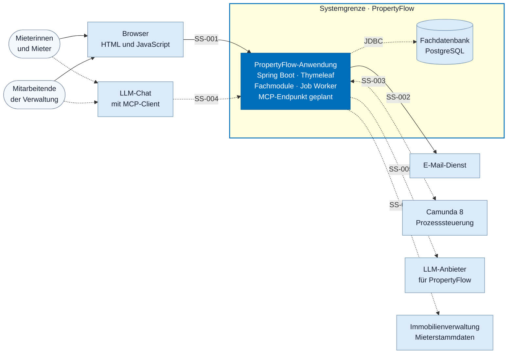

# C4 Level 2 – Containeransicht

Die Containeransicht zeigt die Zielarchitektur innerhalb der
[PropertyFlow-Systemgrenze](c4-context.md). Die Spring-Boot-Anwendung rendert
die Web-Oberfläche mit Thymeleaf. Der Camunda-Client, die Job Worker und der
geplante MCP-Endpunkt gehören zu dieser Anwendung. PostgreSQL speichert die
fachlichen Daten von PropertyFlow.

Durchgezogene Pfeile zeigen Verbindungen der lokalen Demo. Gestrichelte
Pfeile zeigen geplante Anbindungen. Der Doppelpfeil bei `SS-003` zeigt den
Austausch von Prozessaufträgen und Jobmeldungen.

## Schnittstellen in der Anwendung

Die Kennungen und der Umsetzungsstand stehen in der
[Schnittstellenliste des Systemkontexts](c4-context.md#schnittstellen-an-der-systemgrenze).

| ID | Zuständiger Teil der PropertyFlow-Anwendung | Aufgabe |
| --- | --- | --- |
| **SS-001** | Spring MVC und Thymeleaf | Liefert Web-Erfassung, Fallansichten und Anmeldung über HTTPS im Zielbetrieb. Die KI-Formulierung in UI3 nutzt in der Demo einen Mock. [ADR-003](adr/ADR-003-praesentationsschicht.md#entscheidung) |
| **SS-002** | SMTP-Adapter | Sendet Einmalcodes. Fallbenachrichtigungen folgen nach der fachlichen Speicherung über dauerhafte Versandaufträge. [BEN-03](../specifications/benachrichtigungen-und-zustellung.md#ben-03-speicherung-und-zuverlässige-übergabe) |
| **SS-003** | Camunda-Client und Job Worker | Startet Fallprozesse und übermittelt Ereignisse. Der Worker öffnet die Verbindung zu Camunda, übernimmt Jobs, ruft die zuständige Fachfunktion auf und meldet das Ergebnis zurück. [ADR-002](adr/ADR-002-camunda8-workflow-orchestrierung.md#integrationsprinzipien) |
| **SS-004** | MCP-Adapter | Macht ausgewählte Fachfunktionen über HTTP mit delegiertem OAuth-Zugriff nutzbar. Web und MCP nutzen dieselben Anwendungsdienste. Dort gelten die Regeln für Fallzugriff, Aktion, menschliche Freigabe und Audit. [ADR-005](adr/ADR-005-zugriffsmodell.md#autorisierung-über-mcp) |
| **SS-005** | Modelladapter hinter dem Fachvertrag | Ruft das Modell mit den für die jeweilige Aufgabe nötigen Daten auf. Für die Triage kapselt der vorhandene `AnalysisModel`-Port den Anbieter. [Triage-Vertrag](../ai-usage/ki-service-vertrag.md) |
| **SS-006** | Stammdatenanbindung | Bezieht die für die Zuordnung nötigen Mieter-, Mietverhältnis- und Objektdaten. [FALL-04](../specifications/fallverwaltung.md#fall-04-ursprungsdaten-und-zuordnung) |

## Fallannahme und Erstbewertung

1. Der Browser reicht das Anliegen über `SS-001` ein. Intake speichert Fall und
   Prozessstartauftrag gemeinsam in PostgreSQL. Der Browser erhält die
   Bestätigung mit der Case-ID nach dem Commit.
2. PropertyFlow übergibt den gespeicherten Startauftrag im Hintergrund über
   `SS-003` an Camunda. Bei einem Camunda-Ausfall bleibt der Auftrag in
   PropertyFlow ausstehend und kann nach dem Wiederanlauf übergeben werden.
3. Camunda stellt den Job zur Erstbewertung bereit. Der Worker in der
   PropertyFlow-Anwendung lädt die erforderlichen Daten über die Case-ID und
   ruft Triage intern auf. PropertyFlow speichert das Ergebnis. Der Worker
   meldet den Jobabschluss oder Fehlschlag an Camunda.

[Asynchrone Erstbewertung](schnittstellenentwurf-block-3.md#4-architekturentscheid-für-artefakt-5) · [FALL-02](../specifications/fallverwaltung.md#fall-02-erfolgreiche-annahme)

PostgreSQL ist als führender Speicher für Fälle, Konten, Verlauf, Audit und
Folgeaufträge vorgesehen. Camunda verwaltet den technischen Prozesszustand
mit Jobs und Timern. Für Empfehlungen ist eine Wissensbasis vorgesehen. Die
Speichertechnik und ihr Deployment sind offen.
[Modulstruktur](module-structure.md#externe-integrationen) · [ADR-002](adr/ADR-002-camunda8-workflow-orchestrierung.md#verantwortungsgrenzen)

Die lokale Demo hält Fälle und Konten im Arbeitsspeicher und versendet
Einmalcodes per SMTP. Triage ist separat erprobt. Die dauerhafte Fallannahme,
der fachliche Camunda-Prozess und Fallbenachrichtigungen sind Zielarchitektur.
[Demo](../../dev/README.md) · [Triage-Vertrag](../ai-usage/ki-service-vertrag.md)
