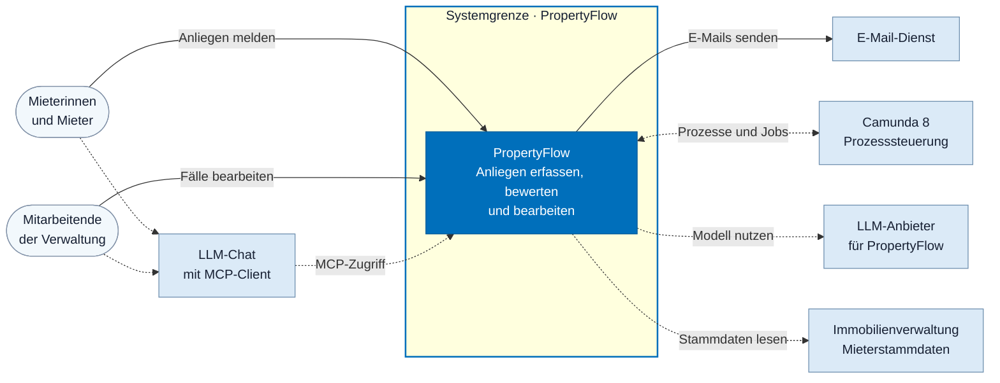

# C4 Level 1 – Systemkontext

PropertyFlow unterstützt Immobilienbewirtschaftungen bei der
KI-gestützten Triage und Bearbeitung von Mieteranliegen.

Der Rahmen markiert die Systemgrenze von PropertyFlow. Einfache Pfeile zeigen,
wer den Aufruf startet. Der Doppelpfeil zu Camunda zeigt den Austausch von
Prozessaufträgen und Jobmeldungen. Durchgezogene Linien zeigen Verbindungen,
die bereits in der lokalen Demo genutzt werden.
Gestrichelte Linien zeigen geplante Verbindungen.

## Schnittstellen an der Systemgrenze

| Schnittstelle | Verantwortung | Status |
| --- | --- | --- |
| Webzugang über den Browser | Mieter können ohne Konto einreichen und über den persönlichen Fall-Link antworten. Ein freiwilliges, per E-Mail verifiziertes Konto bietet «Meine Fälle». Mitarbeitende melden sich per Einmalcode an und bearbeiten Fälle. [Zugriffsregeln](../specifications/fallzugriff-und-sicherheit.md#zug-04-rechte-und-vertrauensgrenzen) | **Implementiert in der lokalen Demo** |
| PropertyFlow → E-Mail-Dienst | PropertyFlow übergibt Einmalcodes per SMTP und sieht für Fallbenachrichtigungen mit persönlichem Link dauerhafte Versandaufträge vor. [Benachrichtigungen](../specifications/benachrichtigungen-und-zustellung.md#ben-03-speicherung-und-zuverlässige-übergabe) | **Teilweise implementiert**. Einmalcodes in der Demo, Fallbenachrichtigungen geplant. |
| PropertyFlow ↔ Camunda 8 | PropertyFlow startet nach dauerhafter Fallannahme den Prozess mit der Case-ID. Camunda stellt Jobs bereit. Der Worker in PropertyFlow öffnet die Verbindung zu Camunda, erhält darüber die Jobs und meldet deren Abschluss oder Fehlschlag. Camunda steuert den Ablauf. PropertyFlow hält die fachlichen Daten und Ergebnisse. [ADR-002](adr/ADR-002-camunda8-workflow-orchestrierung.md#verantwortungsgrenzen) · [Asynchrone Erstbewertung](schnittstellenentwurf-block-3.md#4-architekturentscheid-für-artefakt-5) | **Geplant**. Infrastruktur vorhanden, fachliche Anbindung ausstehend. |
| MCP-Client → PropertyFlow | Mieter und Mitarbeitende geben dem Client im LLM-Chat Zugriff im Rahmen ihrer Rechte. Der Client ruft PropertyFlow über HTTP mit einem eigenen OAuth-Zugriffstoken auf. PropertyFlow prüft Konto, Client, Fall und Aktion. [ADR-005](adr/ADR-005-zugriffsmodell.md#autorisierung-über-mcp) | **Geplant** |
| PropertyFlow → LLM-Anbieter | PropertyFlow sendet freigegebene Eingaben zur Triage, Empfehlung oder Formulierung und prüft die Modellausgabe. [Triage-Vertrag](../ai-usage/ki-service-vertrag.md) · [KOM-02](../specifications/fallkommunikation.md#kom-02-llm-kommunikation-ohne-interne-memos) | **Prototyp vorhanden**. Triage separat erprobt, Einbindung in den Fallablauf geplant. |
| PropertyFlow → Immobilienverwaltungssystem | PropertyFlow bezieht die für die Zuordnung erforderlichen Mieter-, Mietverhältnis- und Objektdaten. [Fallzuordnung](../specifications/fallverwaltung.md#fall-04-ursprungsdaten-und-zuordnung) | **Geplant** |

**Beispiel für Camunda.** Wenn der Wiedervorlage-Timer abläuft, erreicht Camunda
im Fallprozess einen Service Task und stellt den zugehörigen Job bereit. Der
PropertyFlow-Worker erhält den Job über die von ihm gestartete Verbindung.
PropertyFlow prüft, ob der Fall aktiv und der Termin noch wirksam ist, und
setzt dann den Fallstatus auf «Mitarbeiterprüfung erforderlich». Der Worker
meldet den Abschluss oder Fehlschlag an Camunda zurück.
[FALL-11](../specifications/fallverwaltung.md#fall-11-wiedervorlage-und-parallele-nachrichtenverarbeitung) · [Camunda Job Worker](https://docs.camunda.io/docs/8.9/components/concepts/job-workers/)

Die [Containeransicht](c4-container.md) zeigt, welcher Teil der Anwendung die
jeweilige Schnittstelle bedient.

Die Annahme eingehender Mieter-E-Mails bleibt Teil der Vision. Dafür ist ein
eigener Kanalvertrag vorgesehen. [UC-001](../use_cases/UC-001-mieteranliegen-einreichen.md)

Externe Beauftragungen organisiert die Verwaltung ausserhalb von PropertyFlow.
