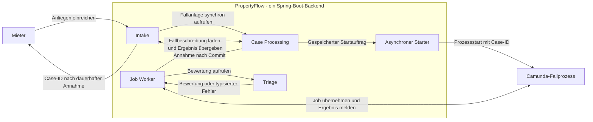

# Schnittstellenentwurf für PropertyFlow · Block 3

**Status:** Entwurf für PropertyFlow. Nach dem fachlichen Review geht Abschnitt 4 unverändert in Artefakt 5 des FFHS-Blocks 3 «Services» ein. Die Grundlage ist die Kursübung «TRANSFER».

Die [Schnittstellenübersicht](#schnittstellenübersicht) erfasst die sechs
nummerierten Verbindungen aus der [C4-Containeransicht](c4-2-container.md#schnittstellen-in-der-anwendung)
und die bisher erkennbaren internen Kommunikationswege. Die
[C4-Komponentenansicht](c4-3-components.md) zeigt, welche Module und Adapter
daran beteiligt sind. Die Abschnitte 1 bis 4 vertiefen den Entwurf für Block 3.

## Schnittstellenübersicht

### Verbindungen über die Anwendungsgrenze

| ID | Wer kommuniziert? | Wofür? | Stand |
| --- | --- | --- | --- |
| **SS-001** | Browser ↔ PropertyFlow-Web | Anliegen einreichen und ergänzen, Fälle ansehen und bearbeiten, Anmeldung und Kontozugriff. | Der [OpenAPI-Vertrag](openapi/fallannahme.yaml) erfasst die vorhandenen Browserrouten. Er kennzeichnet die Demo-Verträge für Mitarbeiterschreibzugriffe. |
| **SS-002** | PropertyFlow → E-Mail-Dienst | Einmalcodes und Benachrichtigungen zu gespeicherten Falländerungen senden. | Einmalcodes per SMTP in der Demo. [Statusmail aus dem Fallprozess](#ss-002--statusmail-aus-dem-fallprozess) spezifiziert. Die Umsetzung steht aus. |
| **SS-003** | PropertyFlow ↔ Camunda | Asynchroner Prozessstart nach Intake, synchrone User-Task-Abschlüsse und Nachrichtenkorrelationen im Fallprozess sowie Ausführung der Camunda-Jobs durch PropertyFlow-Worker. | [ADR-002](adr/ADR-002-camunda8-workflow-orchestrierung.md#integrationsprinzipien) hält die Orchestrierung und die Integrationsprinzipien fest. Der [Integrationsvertrag SS-003](#ss-003--camunda-integrationsvertrag) beschreibt die technischen Details. Die Umsetzung steht aus. |
| **SS-004** | MCP-Client → PropertyFlow | Mit delegiertem Zugriff freigegebene Fallfunktionen ausführen. | [«Fallstand abrufen»](#ss-004--mcp-werkzeug-fallstand-abrufen) ist als erstes Werkzeug für Mieter spezifiziert. Die Umsetzung steht aus. |
| **SS-005** | PropertyFlow → LLM-Anbieter | Modell für Dringlichkeit, Empfehlung, Nachrichtenformulierung und optional KI-Rückfragen aufrufen. | [Triage-Port](../ai-usage/ki-service-vertrag.md#aufruf-und-vertrag) als isolierter Prototyp. Die weiteren Modellaufrufe sind in den [Use Cases](../use_cases/README.md#llm-aufrufe-durch-propertyflow) beschrieben. Ihre technischen Verträge sind offen. |
| **SS-006** | PropertyFlow → Immobilienverwaltungssystem | Erforderliche Stammdaten für die Fallzuordnung beziehen. | [Fachliche Zuordnung](../specifications/fallverwaltung.md#fall-04-ursprungsdaten-und-zuordnung) beschrieben. Anbindung und Vertrag offen. |

Weitere dokumentierte Anbindungen sind die Fachdatenbank über JDBC, der
geplante [E-Mail-Eingang](../use_cases/UC-020-mieteranliegen-per-e-mail-entgegennehmen.md)
und die Wissensbasis für [Recommendation](module-structure.md#recommendation).
Die Datenbank ist ein eigener Container. Der sichere Vertrag für eingehende
E-Mails und die Anbindung der Wissensbasis sind noch offen.

### SS-002 · Statusmail aus dem Fallprozess

Bei einem sichtbaren Statuswechsel speichert der Status-Worker den neuen Status und den Verlaufseintrag in PropertyFlow. Nach dem Datenbank-Commit gibt er die Referenz des gespeicherten Wechsels an Camunda zurück. Bei erneuter Ausführung desselben Jobs verwendet er die gespeicherte Referenz. Der Fallprozess führt danach den Send Task für die Statusmail aus. Bei unverändertem Status überspringt der Prozess diesen Task.

Der wiederverwendbare Mail-Worker in PropertyFlow erhält die Referenz und den Benachrichtigungstyp. Beim Versand lädt er über den zuständigen Anwendungsdienst aus der Falldatenbank den ursprünglichen Statuswechsel, die aktuell bestätigte Fall-Kontaktadresse und den gültigen persönlichen Fall-Link. Bei einer geprüften Adresskorrektur desselben Mieters verwendet er die neue Adresse. Die Rückmeldung des E-Mail-Dienstes erfasst PropertyFlow gemäss BEN-04. [BEN-02](../specifications/benachrichtigungen-und-zustellung.md#ben-02-empfänger-inhalt-und-persönlicher-link) · [BEN-04](../specifications/benachrichtigungen-und-zustellung.md#ben-04-wiederholungen-und-zustellnachweis)

Nach einem bestätigten Linkersatz verwendet der Mail-Worker für ausstehende Statusmails den neuen Link. [UC-024](../use_cases/UC-024-fall-link-widerrufen-oder-ersetzen.md#business-rules-und-prüfkriterien)

An der externen Schnittstelle SS-002 übergibt der SMTP-Adapter dem E-Mail-Dienst die fertige Nachricht mit Empfänger, Betreff und Text. PropertyFlow unterscheidet bestätigte Annahme durch den Maildienst, fehlgeschlagene Übergabe und unklaren Ausgang, etwa bei einem Verbindungsabbruch nach möglicher Annahme. [C4-Containeransicht](c4-2-container.md#schnittstellen-in-der-anwendung) · [BEN-04](../specifications/benachrichtigungen-und-zustellung.md#ben-04-wiederholungen-und-zustellnachweis)

**Dauerhaft abgelehnte Statusmail.** Der Mail-Worker speichert die Ablehnung zum Versandauftrag in PropertyFlow. Nach dem Commit schliesst er den Job des Send Tasks über SS-003 mit dem fachlichen Ergebnis «Klärung nötig» ab. Bei erneut zugestelltem Job verwendet er die gespeicherte Ablehnung für die Rückmeldung. Bei einem aktiven Fall eröffnet Camunda die Mitarbeiterprüfung. Der Status-Worker speichert «Mitarbeiterprüfung erforderlich» mit dem internen Prüfgrund «E-Mail-Versand klären». Bei einem abgeschlossenen Fall bleibt das Versandproblem als interner Hinweis erhalten. [UC-019](../use_cases/UC-019-fallbenachrichtigung-zustellen.md) · [FALL-05](../specifications/fallverwaltung.md#fall-05-fachlicher-lebenszyklus)

In Version 1 umfasst dieser Ablauf die direkte dauerhafte Ablehnung während der Übergabe an den E-Mail-Dienst. Für Rückläufer, die erst nach bestätigter Annahme eintreffen, bleiben Entgegennahme, Zuordnung zum Versandauftrag und Übergabe an Camunda offen. [BEN-04](../specifications/benachrichtigungen-und-zustellung.md#ben-04-wiederholungen-und-zustellnachweis)

### SS-003 · Camunda-Integrationsvertrag

**Prozessstart nach Intake.** PropertyFlow speichert den Fall mit «Eingegangen» und den Startauftrag mit einer festen Startkennung gemeinsam. Die Bestätigung der Fallannahme folgt auf den Commit. Ein asynchroner Starter prüft regelmässig offene Startaufträge. Bei jedem Startversuch verwendet er dieselbe Startkennung als `businessId` und adressiert dieselbe BPMN-Prozessdefinition im selben Camunda-Tenant. Case-ID und Startkennung stehen dem ersten Worker als Prozessvariablen zur Verfügung. In Camunda 8.9 wird dafür die Business-ID-Eindeutigkeitsprüfung aktiviert. Existiert bereits eine aktive Hauptinstanz mit dieser Kennung, antwortet Camunda mit `409`. Sowohl bei erfolgreicher Startantwort als auch bei diesem Konflikt bleibt der Auftrag offen, bis der Worker die Zuordnung gespeichert hat. Die Prüfung in Camunda gilt für aktive Hauptinstanzen. Die dauerhafte Zuordnung in PropertyFlow schützt den Fall vor Mehrfachwirkung auch nach Prozessende. [Camunda 8.9 – Business-ID-Eindeutigkeit](https://docs.camunda.io/docs/8.9/components/concepts/process-instance-creation/#uniqueness-control)

**Erster Job: Instanz zuordnen.** Der Worker ermittelt den passenden Startauftrag anhand der Case-ID und der Startkennung. Er speichert den `processInstanceKey` und erledigt den Auftrag atomar in PropertyFlow. Er meldet den Jobabschluss nach dem Commit und stellt den Schlüssel für die spätere Nachrichtenkorrelation im Prozess bereit. Bei einem vorübergehenden Datenbankfehler gibt der Worker denselben Job mit Wartezeit zur Wiederholung frei. Die Zahl verbleibender Camunda-Versuche bleibt für diesen Fehler positiv, damit der Job bis zur erfolgreichen Speicherung automatisch erneut ausgeführt wird. Bis zur Zuordnung bleibt der Fall auf «Eingegangen», und der Prozess wartet vor der fachlichen Bearbeitung. Eine erneute Ausführung mit demselben `processInstanceKey` bestätigt die bestehende Zuordnung. Ein anderer Schlüssel darf sie nicht überschreiben und keine fachliche Verarbeitung auslösen. [Camunda 8.9 – Jobwiederholungen](https://docs.camunda.io/docs/8.9/components/concepts/job-workers/#completing-or-failing-jobs)

**Nachricht an den laufenden Fallprozess.** Für fachliche Übergaben, die das BPMN-Modell als Nachrichtenempfang vorsieht, verwendet PropertyFlow in Camunda 8.9 `POST /v2/messages/correlation`. Der Adapter bestimmt den `processInstanceKey` aus der gespeicherten Zuordnung. Er sendet den für die Aktion definierten Nachrichtennamen und den Prozessinstanzschlüssel als Zeichenfolge im Feld `correlationKey`. Der BPMN-Nachrichtenempfang muss denselben Namen und Schlüssel verwenden und am aktuellen Schritt geöffnet sein. Dazu stellt der Prozess den Schlüssel vor dem Öffnen des Empfangs als Prozessvariable bereit, beispielsweise über einen initialen Worker. Camunda korreliert die Nachricht sofort oder weist sie ohne Pufferung ab. Die Nachrichtennamen für bestehende Fälle sind wartenden Schritten vorbehalten. PropertyFlow prüft den in der Antwort gelieferten `processInstanceKey` gegen die erwartete Instanz. Das BPMN-Modell und seine Tests müssen pro Aktion und Instanz eine eindeutige wartende Stelle sicherstellen. [ADR-002](adr/ADR-002-camunda8-workflow-orchestrierung.md#synchrone-nachrichtenkorrelation) · [Camunda 8.9 – Nachrichtenkorrelation](https://docs.camunda.io/docs/8.9/apis-tools/orchestration-cluster-api-rest/specifications/correlate-message/) · [Camunda 8.9 – Nachrichtenempfang](https://docs.camunda.io/docs/8.9/components/concepts/messages/#message-subscriptions)

**Synchroner Abschluss einer User Task.** Für jede native Camunda User Task bezieht sich der Auftrag auf den ursprünglichen `userTaskKey` und den geprüften Fallstand. PropertyFlow prüft serverseitig die Berechtigung, die Zulässigkeit der Aktion am aktuellen Fallstand und ob die offene Aufgabe zur gespeicherten Fallprozessinstanz (`processInstanceKey`) gehört. Der Adapter wartet bei `POST /v2/user-tasks/{userTaskKey}/completion` auf die Bestätigung für genau diesen Schlüssel. [ADR-002](adr/ADR-002-camunda8-workflow-orchestrierung.md#synchroner-abschluss-von-user-tasks) · [Camunda 8.9 – User Task abschliessen](https://docs.camunda.io/docs/8.9/apis-tools/orchestration-cluster-api-rest/specifications/complete-user-task/)

Für die Web-Aktion «Bearbeitung fortsetzen» verwendet der Browser `POST /mitarbeiter/faelle/{id}/bearbeitung-fortsetzen`. Nach der Berechtigungsprüfung gelten diese Antworten. [OpenAPI-Vertrag](openapi/fallannahme.yaml) · [UC-012](../use_cases/UC-012-fall-fachlich-steuern.md#synchroner-vertrag-für-die-mitarbeiteraktion)

| HTTP-Antwort von PropertyFlow | Bedingung und Verhalten |
| --- | --- |
| `200` | Camunda bestätigt den Abschluss der adressierten Aufgabe mit `204`. Das UI lädt den Fallstand aus PropertyFlow neu. Es zeigt «In Bearbeitung», sobald der Worker den Status gespeichert hat. |
| `400` | Die Aktion oder der geprüfte Fallstand ist fachlich ungültig oder die adressierte Aufgabe kann nicht mehr abgeschlossen werden. Das gilt auch, wenn Camunda die Aufgabe beim Abschluss nicht mehr findet (`404`) oder einen unzulässigen Task-Zustand meldet (`409`). Das UI lädt den aktuellen Fallstand. |
| `500` | Ein technischer Fehler oder ein Timeout verhindert die Bestätigung. Bei einem Timeout kann Camunda die Aufgabe bereits abgeschlossen haben. Das UI lädt den gespeicherten Fallstand neu. PropertyFlow wiederholt den Abschluss nicht automatisch. |

**Manuelle Dringlichkeit.** `POST /mitarbeiter/faelle/{id}/dringlichkeit-aendern` übergibt die gewählte Stufe synchron an den Fallprozess. Nach bestätigter Korrelation antwortet PropertyFlow mit `200`. Die wirksame Stufe wird sichtbar, sobald der Worker die Änderung gespeichert hat. Der BPMN-Nachrichtenname und die Empfangsstelle sind im Prozessmodell festzulegen. [OpenAPI-Vertrag](openapi/fallannahme.yaml) · [DRING-06](../specifications/dringlichkeitsbewertung.md#dring-06-manuelle-anpassung)

**Objekt und Wohnung zuordnen.** `POST /mitarbeiter/faelle/{id}/objekt-wohnung-zuordnen` übernimmt einen geprüften Stammdatenvorschlag oder Freitext. PropertyFlow prüft den Fallstand und bei strukturierten Referenzen die Zuordnung der Wohnung zum Objekt. `200` folgt auf die bestätigte synchrone Korrelation. Der Worker speichert die Zuordnung getrennt von der ursprünglichen Mieterangabe. Nachrichtenname und Empfangsstelle bleiben im BPMN-Modell festzulegen. [OpenAPI-Vertrag](openapi/fallannahme.yaml) · [FALL-04](../specifications/fallverwaltung.md#fall-04-ursprungsdaten-und-zuordnung)

**Externe Fallnachricht veröffentlichen.** Über `POST /mitarbeiter/faelle/{id}/externe-nachricht-veroeffentlichen` beauftragt PropertyFlow den zugeordneten Fallprozess. Camunda veranlasst die Veröffentlichung durch einen PropertyFlow-Worker. Der Browser erhält `200`, sobald die Nachricht dauerhaft gespeichert und im berechtigten Mieterfallverlauf abrufbar ist. Der Versand folgt der Veröffentlichung gemäss BEN-03. Die Übergabe im BPMN und der Abgleich mit der gespeicherten Veröffentlichung sind bei der Umsetzung festzulegen. [OpenAPI-Vertrag](openapi/fallannahme.yaml) · [UC-010](../use_cases/UC-010-externe-fallnachricht-veroeffentlichen.md) · [BEN-03](../specifications/benachrichtigungen-und-zustellung.md#ben-03-speicherung-und-zuverlässige-übergabe)

**Internes Memo speichern.** Über `POST /mitarbeiter/faelle/{id}/internes-memo-speichern` beauftragt PropertyFlow den zugeordneten Fallprozess. Camunda veranlasst die Speicherung durch einen PropertyFlow-Worker. `200` setzt die dauerhafte Speicherung im internen Fallverlauf voraus. PropertyFlow bestimmt interne Sichtbarkeit, Absender und Zeitpunkt serverseitig. Das Memo löst keine E-Mail aus. Die BPMN-Übergabe und der Abgleich mit dem gespeicherten Memo sind bei der Umsetzung festzulegen. [OpenAPI-Vertrag](openapi/fallannahme.yaml) · [UC-011](../use_cases/UC-011-internes-memo-erfassen.md)

**Wiedervorlage verwalten.** Über `POST /mitarbeiter/faelle/{id}/wiedervorlage` übergibt PropertyFlow Setzen, Ändern und Löschen synchron an den zugeordneten Fallprozess. Camunda führt den Timer und veranlasst die Änderung. `200` folgt auf die bestätigte Aktion und die dauerhafte Speicherung von Terminstand, Status und internem Änderungsnachweis. Die Tagesberechnung, Uhrzeit, Zeitzone und Empfangsstellen im BPMN bleiben zu konkretisieren. [OpenAPI-Vertrag](openapi/fallannahme.yaml) · [UC-013](../use_cases/UC-013-wiedervorlage-verwalten.md) · [FALL-11](../specifications/fallverwaltung.md#fall-11-wiedervorlage)

**Fall abschliessen.** Über `POST /mitarbeiter/faelle/{id}/abschliessen` übergibt PropertyFlow den geprüften Mitarbeiterentscheid synchron an den zugeordneten Fallprozess. Camunda veranlasst den Abschluss und beendet den Timer einer offenen Wiedervorlage. `200` folgt, sobald der Worker «Abgeschlossen» samt Abschlussnachweis dauerhaft gespeichert hat. Der Abschluss beendet offenen Antwortbedarf und sperrt neue Nachrichten und Memos. Der E-Mail-Versand folgt nachgelagert. Die Empfangsstelle im BPMN und der Abgleich mit dem gespeicherten Abschluss bleiben festzulegen. [OpenAPI-Vertrag](openapi/fallannahme.yaml) · [UC-014](../use_cases/UC-014-fall-abschliessen.md) · [BEN-05](../specifications/benachrichtigungen-und-zustellung.md#ben-05-fallabschluss-und-sicherheit)

**Fall wiedereröffnen.** Über `POST /mitarbeiter/faelle/{id}/wiedereroeffnen` fordert ein berechtigter Mitarbeiter die Wiedereröffnung eines abgeschlossenen Falls an. Camunda veranlasst den neuen Status. `200` folgt erst auf die dauerhafte Speicherung von «In Bearbeitung» oder «Mitarbeiterprüfung erforderlich» samt Nachweis der Wiedereröffnung. Case-ID und Historie bleiben erhalten. Wie der Prozess bei einer bereits beendeten Camunda-Instanz fortgesetzt wird, bleibt im BPMN-Entwurf festzulegen. [OpenAPI-Vertrag](openapi/fallannahme.yaml) · [UC-015](../use_cases/UC-015-fall-wiedereroeffnen.md)

**Antwortbedarf aufheben.** Über `POST /mitarbeiter/faelle/{id}/nachrichten/{messageId}/antwortbedarf-aufheben` übergibt PropertyFlow den Auftrag für die geprüfte Rückfrage synchron an den zugeordneten Fallprozess. `200` setzt die dauerhaft gespeicherte Aufhebung und einen allfälligen Statuswechsel voraus. Camunda veranlasst «In Bearbeitung» nur, wenn keine offene Rückfrage, keine laufende Wiedervorlage und kein vorrangiger Mitarbeiterprüfbedarf mehr bestehen. Die Empfangsstelle im BPMN und der Abgleich mit der gespeicherten Aufhebung bleiben festzulegen. [OpenAPI-Vertrag](openapi/fallannahme.yaml) · [UC-028](../use_cases/UC-028-antwortbedarf-aufheben.md) · [FALL-05](../specifications/fallverwaltung.md#status-nach-manuellem-aufheben-des-antwortbedarfs)

**Kritische Fallentscheidung treffen.** Über `POST /mitarbeiter/faelle/{id}/kritische-entscheidung` schliesst PropertyFlow die konkrete Camunda User Task synchron ab. Jede Aufgabe ist an genau eine serverseitig geführte Handlung gebunden. Ändert sich die Handlung, erhält sie eine neue Aufgabe. `200` folgt nach Camundas Bestätigung und dauerhafter Speicherung des Entscheids samt Audit. Freigabe, Ablehnung und Klärungsbedarf sind unterscheidbar. Die konkrete Task und die Folgeschritte sind im BPMN-Modell zu definieren. [OpenAPI-Vertrag](openapi/fallannahme.yaml) · [UC-027](../use_cases/UC-027-kritische-fallentscheidung-treffen.md)

Job Worker beziehen ihre Aufträge über die Camunda-Worker-Schnittstelle und melden den Abschluss oder Fehler für den jeweiligen Job. Camunda ordnet diese Meldungen über den Job-Schlüssel zu. Die Prozessinstanz aus dem Job dient PropertyFlow zur Prüfung der Fallzuordnung. [Camunda 8.9 – Job Worker](https://docs.camunda.io/docs/8.9/apis-tools/java-client/job-worker/)

**Bewertungsjob.** Camunda übergibt für die Erstbewertung die Case-ID und für eine Neubewertung zusätzlich die ID der gespeicherten Mieternachricht, die den Job ausgelöst hat. Die Beschreibung und der Nachrichtenverlauf bleiben in der PropertyFlow-Falldatenbank. Der Worker lädt die ursprüngliche Fallbeschreibung über den zuständigen PropertyFlow-Anwendungsdienst. Bei einer Neubewertung prüft er die Zugehörigkeit der Nachricht zum Fall und lädt den relevanten Nachrichtenverlauf bis einschliesslich dieser Nachricht. Er kennzeichnet sie beim Aufruf von Triage als Auslöser. [DRING-05](../specifications/dringlichkeitsbewertung.md#dring-05-erst--und-neubewertung-im-prozess) · [UC-016](../use_cases/UC-016-dringlichkeit-automatisch-bewerten.md)

**Erneut zugestellter Bewertungsjob.** PropertyFlow speichert die Dringlichkeitsbewertung eindeutig pro Camunda-Job-Schlüssel. Ergebnis, Job-Schlüssel und die zugehörigen fachlichen Änderungen werden gemeinsam gespeichert. Bei erneuter Zustellung liest der Worker zuerst das Ergebnis zu diesem Schlüssel. Liegt es vor, meldet er Camunda nur den Jobabschluss mit dem gespeicherten Ergebnis. Er ruft das Modell dabei nicht erneut auf und erzeugt weder einen neuen Verlaufseintrag noch einen weiteren Mailauftrag. Liegt noch kein Ergebnis vor, gilt der reguläre Bewertungspfad. Auch bei gleichzeitiger Verarbeitung darf für denselben Schlüssel nur eine Bewertung fachlich wirksam werden. [ADR-002](adr/ADR-002-camunda8-workflow-orchestrierung.md#idempotenz)

Das BPMN-Modell muss die vorgesehenen Aktionen und Ereignisse je Prozessschritt und ihre Folgeschritte abdecken. User Tasks, Nachrichtenempfänge und die Behandlung von Wiedereröffnungen nach Prozessende werden je Ablauf spezifiziert.

**Mieterergänzung zu einem bestehenden Fall.** PropertyFlow prüft vor der Speicherung, ob der zugeordnete Fallprozess läuft und Camunda erreichbar ist. Steht der Prozessstart noch aus, weist PropertyFlow den Sendeversuch ab und lässt den Text im Formular. Ist Camunda bereits bei dieser Prüfung nicht erreichbar, erhält der Browser HTTP `500`, der Text bleibt im Formular und die Nachricht wird nicht gespeichert.

Nach dem Speichern übergibt PropertyFlow den Nachrichteneingang zusammen mit der ID der gespeicherten Nachricht synchron an die zugeordnete Instanz. Camunda verwendet diese Nachrichten-ID für den zugehörigen Bewertungsjob. Der Browser erhält erst nach dem Datenbank-Commit und bestätigter Korrelation eine Erfolgsmeldung. Bei einem technischen Fehler oder Timeout bei der Korrelation antwortet PropertyFlow mit HTTP `500`. Der Text bleibt im Formular und ein bereits gespeicherter Eintrag bleibt im Fallverlauf. Bei einem Timeout kann die Korrelation bereits erfolgt sein. Bei erneutem Absenden verwendet der Browser dieselbe Absende-ID. Die anschliessende Verarbeitung im Fallprozess und die E-Mail-Benachrichtigung laufen nachgelagert. Die Prüffälle stehen in [UC-009](../use_cases/UC-009-mieteranliegen-ergaenzen.md#business-rules-und-prüfkriterien). Für Neueinreichungen gilt der asynchrone Prozessstart.

#### Prüffall · Verlorene Startantwort und Datenbankfehler

1. Ein Anliegen einreichen. PropertyFlow bestätigt die Case-ID. Der Fall ist als «Eingegangen» gespeichert, und der Startauftrag ist offen.
2. Camunda den Fallprozess starten lassen und die Startantwort an den Starter verwerfen. Die Zuordnung beim ersten Worker gezielt an einem vorübergehenden Datenbankfehler scheitern lassen. Der Startauftrag bleibt für den Starter lesbar.
3. Den Starter erneut laufen lassen, solange der Worker die Zuordnung noch nicht speichern kann. Der Starter verwendet dieselbe Startkennung. In Camunda existiert genau eine aktive Hauptinstanz für den Auftrag. In PropertyFlow bleibt der Fall auf «Eingegangen». Camunda hat noch keine Erstbewertung ausgelöst.
4. Den Datenbankfehler aufheben. Der erste Worker wiederholt den Job für dieselbe Instanz und speichert deren Schlüssel zusammen mit dem erledigten Startauftrag. Danach überspringt der Starter den Auftrag, und der ursprüngliche Prozess setzt die Bearbeitung fort.
5. Den Zuordnungsjob nach dem Commit erneut zustellen. Die Zuordnung und der erledigte Auftrag bleiben erhalten. Die Wiederholung erzeugt keine zusätzliche fachliche Änderung.

#### Prüffall · Bewertungsjob erneut zugestellt

1. Einen Bewertungsjob für einen Fall ohne bisherige Bewertung auslösen. Das Testmodell liefert «Hoch». Prüfen, dass PropertyFlow «Hoch» zusammen mit dem Job-Schlüssel gespeichert hat und genau ein Dringlichkeitseintrag und ein zugehöriger Mailauftrag entstanden sind.
2. Nach dem Datenbank-Commit die erste Abschlussmeldung des Workers vor Camunda abfangen. Den Worker neu starten und Camunda denselben Job mit demselben Schlüssel erneut zustellen lassen.
3. Prüfen, dass der Worker den Abschluss mit der gespeicherten Bewertung «Hoch» meldet und Camunda den Job abschliesst. Der Zähler des Testmodells bleibt bei einem Aufruf. Die gespeicherte Bewertung, der Verlauf und der Mailauftrag bleiben unverändert.

#### Prüffall · Bearbeitung aus einem alten Tab

1. Ein berechtigter Mitarbeiter öffnet dieselbe Mitarbeiterprüfung in zwei Browser-Tabs. Beide Tabs zeigen die Aufgabe mit demselben `userTaskKey`.
2. Er schliesst die Aufgabe in einem Tab über «Bearbeitung fortsetzen» ab. Danach erzeugt dieselbe Fallprozessinstanz eine weitere Mitarbeiterprüfung mit einem neuen `userTaskKey`.
3. Er klickt im alten Tab auf «Bearbeitung fortsetzen». PropertyFlow antwortet mit `400` und das UI lädt den aktuellen Fallstand. Die neue Aufgabe bleibt offen. Der alte Aufruf erzeugt keinen Statuswechsel oder fachlichen Verlaufseintrag. [UC-012](../use_cases/UC-012-fall-fachlich-steuern.md#business-rules-und-prüfkriterien)

### Interne Kommunikationswege

| Aufruf oder Übergabe | Fachlicher Zweck und Stand |
| --- | --- |
| Web und MCP → Anwendungsdienste | Dieselben Fachregeln für Fallzugriff und Änderungen. Die Dienste prüfen Identität, Fallberechtigung und Aktion. [ZUG-04](../specifications/fallzugriff-und-sicherheit.md#gemeinsame-anmeldung-und-mcp-delegation) |
| Intake → Case Processing | Intake ruft die Fallanlage synchron auf. Case Processing speichert Fall und Startauftrag gemeinsam und bestätigt die Anlage nach dem Commit. [Modulvertrag](module-structure.md#fallanlage--intake-und-case-processing) · [UC-001](../use_cases/UC-001-mieteranliegen-einreichen.md) |
| Startauftrag → Prozessübergabe | Der Starter übergibt den gespeicherten Auftrag asynchron zur Einreichung an Camunda. [SS-003](#ss-003--camunda-integrationsvertrag) · [Asynchrone Erstbewertung](#4-architekturentscheid-für-artefakt-5) |
| Job Worker → Triage → Modellport | Der Worker ruft Triage synchron auf. Triage nutzt den internen Port `AnalysisModel` für die Modellanbindung über SS-005. [Entwurf des internen Vertrags](module-structure.md#erstbewertung--job-worker-und-triage) |
| Job Worker → Recommendation | Empfehlung anhand von Fallangaben und freigegebenen Wissensquellen erstellen. Der genaue Jobzuschnitt und der technische Vertrag sind offen. [UC-018](../use_cases/UC-018-zustaendigkeit-und-vorgehen-empfehlen.md) |
| Job Worker → Fallbearbeitung | Durch Camunda veranlasste Übergänge und Ergebnisse am aktuellen Fallstand prüfen und speichern. Bei der Dringlichkeit behält eine manuelle Einstufung Vorrang. [Entwurf des internen Vertrags](module-structure.md#erstbewertung--job-worker-und-triage) |
| Web oder MCP → Camunda über SS-003 | PropertyFlow wartet bei berechtigten Mitarbeiteraktionen auf den bestätigten Abschluss der konkreten User Task oder auf die bestätigte Korrelation der im BPMN-Modell vorgesehenen Nachricht. Camunda veranlasst die Statuswechsel. Vor Prozessstart und bei Camunda-Ausfall sind fachliche Bearbeitungsaktionen gesperrt. [FALL-06](../specifications/fallverwaltung.md#fall-06-fachlicher-status-und-technischer-workflow) |
| Fallkommunikation → Prozessübergabe | Nach dem Speichern wartet PropertyFlow im Browseraufruf synchron auf die bestätigte Korrelation mit dem laufenden Fallprozess. Bei laufender Wiedervorlage hebt Camunda sie auf und veranlasst sofort die Mitarbeiterprüfung. Neubewertung und Prüfung offener Rückfragen folgen den Freigaben des Fallprozesses. [UC-009](../use_cases/UC-009-mieteranliegen-ergaenzen.md) · [FALL-11](../specifications/fallverwaltung.md#fall-11-wiedervorlage) · [KOM-03](../specifications/fallkommunikation.md#kom-03-asynchrone-fallkommunikation) · [SS-003](#ss-003--camunda-integrationsvertrag) |
| Mitarbeiter-Falldetail → Formulierungshilfe | Über SS-001 startet der Browser den Formulierungsversuch und liest den Vorschlag als Server-Sent Events. Der Browser kann den Versuch mit seiner Versuchs-ID auch vor dem ersten Textstück abbrechen. Der Modelladapter über SS-005 und die Umsetzung stehen aus. [OpenAPI-Vertrag](openapi/fallannahme.yaml) · [UC-004](../use_cases/UC-004-ki-analyse-durchfuehren.md) |
| Gespeicherte Falländerung → Versandfunktion | Bei einem sichtbaren Statuswechsel beauftragt der Fallprozess den Mail-Worker über einen Send Task. Der Worker lädt die Versanddaten über den zuständigen PropertyFlow-Anwendungsdienst. Die Übergabe für weitere Auslöser ist offen. [SS-002](#ss-002--statusmail-aus-dem-fallprozess) · [BEN-03](../specifications/benachrichtigungen-und-zustellung.md#ben-03-speicherung-und-zuverlässige-übergabe) |

## 1. Fachlicher Schnitt

**Artefakt 1 · Fachliche Zerlegung.** Die Skizze zeigt die beteiligten
Fachmodule und ihre Verträge von der Fallannahme bis zur Erstbewertung.

| Modul | Änderungsgrund | Vertrag und Lastprofil |
| --- | --- | --- |
| `intake` | Erfassungskanäle und Eingaberegeln ändern sich mit den Anforderungen an die Fallannahme. | Prüft die Einreichung, ruft die Fallanlage synchron auf und meldet den Erfolg nach dem Commit zurück. Die Antwortzeit hängt vor allem von Validierung und Datenbank ab. |
| `caseprocessing` | Regeln für die Fallanlage und den Fallverlauf ändern sich mit der fachlichen Bearbeitung. | Besitzt den Fall ab der Anlage, vergibt die Case-ID und speichert Fall und Startauftrag in einer Transaktion. Liefert dem Worker die Fallbeschreibung, prüft das Bewertungsergebnis am aktuellen Fallstand und speichert es unter Wahrung der manuellen Dringlichkeit. |
| `triage` | Die Bewirtschaftung präzisiert die Einstufung. Modell und Prompt können unabhängig davon wechseln. | Bewertet den freigegebenen, minimierten Anliegenstext. Liefert `KRITISCH`, `HOCH`, `NORMAL`, `NIEDRIG` oder einen typisierten Fehler. Jeder Aufruf beansprucht Modelllaufzeit. |

Intake, Case Processing und Triage haben unterschiedliche Änderungsgründe,
kommunizieren über explizite Verträge und werden für einen einfachen Betrieb
gemeinsam als modularer Monolith bereitgestellt. Camunda läuft separat und
speichert den Workflow-Zustand, damit langlebige Fallprozesse mit Timern,
Wartezuständen und Wiederholungen nach einem Neustart fortgesetzt werden
können. Bei verfügbarer Datenbank bleibt die
Fallannahme auch während eines Camunda- oder Modellausfalls möglich.
[ADR-001](adr/ADR-001-grundarchitektur.md#entscheidung) ·
[ADR-002](adr/ADR-002-camunda8-workflow-orchestrierung.md#entscheidung)

## 2. Zentraler HTTP-Endpunkt

`POST /mieter/fall` ist die Formularroute für die Fallannahme. Nach dauerhafter
Speicherung führt HTTP `303` über den `Location`-Header zur persönlichen
Fallansicht mit der Case-ID. Formulareingaben, Fehlerantworten, Idempotenz,
Datenklasse und messbares Service-Ziel stehen im
[OpenAPI-Vertrag](openapi/fallannahme.yaml). Er beschreibt auch das direkte
Öffnen der persönlichen Fallansicht per GET und das Absenden einer Ergänzung
per POST. Für die Ergänzung folgt `303` auf den Nachrichten-Commit und die
bestätigte Camunda-Korrelation. Fehler und Timeouts sind in SS-003 beschrieben.
Die Demo bildet Formular, Weiterleitung und Wiederholungen im Arbeitsspeicher
ab. Dauerhafte Speicherung, Camunda-Anbindung und Ausfalltest stehen aus.

Der OpenAPI-Vertrag enthält zudem das Erfassungsformular, den Zugriff über
das Mieterkonto, Anmeldung, Registrierung und Abmeldung, die Fallübersicht
und das Falldetail für Mitarbeitende sowie die vorhandenen Demo-Formulare für
Mitarbeiternachrichten, Memos und Fallaktionen. Die OpenAPI enthält zusätzlich
die Zielverträge «Bearbeitung fortsetzen», «Dringlichkeit ändern», «Objekt
und Wohnung zuordnen», «Externe Fallnachricht veröffentlichen», «Internes
Memo speichern», «Wiedervorlage verwalten», «Fall abschliessen» und «Fall
wiedereröffnen», «Antwortbedarf aufheben» und «Kritische Fallentscheidung
treffen» aus SS-003.
Für UC-004 definiert die OpenAPI den Start mit Live-Stream und einen Abbruch
für den konkreten Versuch.
[UC-010](../use_cases/UC-010-externe-fallnachricht-veroeffentlichen.md) ·
[UC-012](../use_cases/UC-012-fall-fachlich-steuern.md) ·
[UC-004](../use_cases/UC-004-ki-analyse-durchfuehren.md)

### Mitarbeiterkonto anlegen

`POST /mitarbeiter/konten` verlangt eine aktive Mitarbeitersitzung, CSRF und
das Zusatzrecht «Mitarbeiterkonten verwalten». PropertyFlow vergibt die
Mitarbeiterrolle und speichert Konto und Audit gemeinsam. Bei einer bereits
belegten E-Mail-Adresse antwortet der Dienst mit `409`. Das gilt auch, wenn
die Adresse einem Mieterkonto gehört. Das erste Verwaltungskonto mit dem
Zusatzrecht wird einmalig per Serverbefehl eingerichtet. Der Zielendpunkt und
der Einrichtungsbefehl sind noch umzusetzen.
[OpenAPI-Vertrag](openapi/fallannahme.yaml) ·
[UC-007](../use_cases/UC-007-mitarbeiterkonto-anlegen.md) ·
[ZUG-04](../specifications/fallzugriff-und-sicherheit.md#rollen-und-zusatzrechte)

### Mitarbeiterzugriff entziehen

`POST /mitarbeiter/konten/{userId}/zugriff-entziehen` verlangt eine aktive
Mitarbeitersitzung, CSRF und das Zusatzrecht «Mitarbeiterkonten verwalten».
Die gewählte Aktion sperrt das Konto oder entzieht die Mitarbeiterrolle.
PropertyFlow speichert die Änderung mit Audit. Bestehende Web-Sitzungen
und MCP-Delegationen werden beim nächsten Aufruf anhand des aktuellen
Kontostands und der Rolle geprüft. Die letzte aktive Person mit
Kontoverwaltungsrecht behält ihren Zugriff. Die Umsetzung steht aus.
[OpenAPI-Vertrag](openapi/fallannahme.yaml) ·
[UC-029](../use_cases/UC-029-mitarbeiterzugriff-entziehen.md)

### Fall-Link und Kontaktadresse verwalten

`POST /mitarbeiter/fallzugaenge/{id}/link-ersetzen` ersetzt den persönlichen
Link. `POST /mitarbeiter/fallzugaenge/{id}/kontaktadresse-aendern` korrigiert
die bestätigte Adresse desselben Mieters und ersetzt den Link im selben
Commit. Beide Aktionen verlangen das Zusatzrecht «Fallzugänge verwalten» und
einen serverseitig gebundenen Prüfnachweis. Sie liegen ausserhalb von UI3 und
sind unabhängig von Camunda. `204` bestätigt die Speicherung samt Audit und
Versandauftrag. Prüfverfahren, Rechtevergabe, Verwaltungsansichten und
Umsetzung stehen aus.
[OpenAPI-Vertrag](openapi/fallannahme.yaml) ·
[UC-024](../use_cases/UC-024-fall-link-widerrufen-oder-ersetzen.md) ·
[UC-025](../use_cases/UC-025-fall-kontaktadresse-aendern.md)

### Kontaktadresse und Benutzerkontext im Dienstvertrag

Web und ein späteres MCP-Werkzeug zur Einreichung im eigenen Namen verwenden dieselbe fachliche Regel: Der Dienst bestimmt bei angemeldeten Mietern die verifizierte Kontaktadresse anhand des geprüften Benutzerkontexts. Weder eine Benutzer-ID noch eine E-Mail aus Formular- oder Toolargumenten ersetzt die Authentifizierung. Der MCP-Vertrag für diese Einreichung benötigt kein E-Mail-Argument. Die Einreichung ohne Konto bleibt ein eigener zulässiger Web-Zugangsweg mit erforderlicher Kontaktadresse.

Zu prüfen sind die Übernahme der Konto-Adresse ohne E-Mail-Eingabe, ein manipulierter abweichender Wert, eine abgelaufene Anmeldung und eine Einreichung ohne Konto mit fehlender oder ungültiger Adresse. Der Triage-Vertrag erhält keine separate Kontaktadresse; für den Anliegenstext gelten weiterhin die Regeln zur Datenminimierung.

## 3. Werkzeug für einen Agenten

### SS-004 · MCP-Werkzeug «Fallstand abrufen»

Der MCP-Client übergibt die **Case-ID**. Der Anwendungsdienst validiert die Eingabe und prüft bei jedem Aufruf das Zugriffstoken, das aktuelle Mieterkonto und das an den Client delegierte Leserecht. Der Abruf ist nur zulässig, wenn die aktuell verifizierte E-Mail-Adresse des Kontos mit der aktuellen Kontaktadresse des Falls übereinstimmt. Die Identität stammt aus dem geprüften Anmeldekontext. [ZUG-04](../specifications/fallzugriff-und-sicherheit.md#gemeinsame-anmeldung-und-mcp-delegation) · [UC-023](../use_cases/UC-023-mcp-zugriff-delegieren.md)

Die erfolgreiche Antwort enthält genau drei Angaben aus dem gespeicherten Fallstand.

| Angabe | Bedeutung |
| --- | --- |
| Case-ID | Referenz des abgerufenen Falls. |
| Bearbeitungsstatus | Aktuell gespeicherter fachlicher Status des Falls. |
| Wirksame Dringlichkeit | Aktuell gültige Stufe unter Berücksichtigung des Vorrangs einer manuellen Einstufung. Liegt keine wirksame Einstufung vor, lautet die Angabe «Noch nicht bewertet». [DRING-02](../specifications/dringlichkeitsbewertung.md#dring-02-noch-nicht-bewertet) · [DRING-06](../specifications/dringlichkeitsbewertung.md#dring-06-manuelle-anpassung) |

Der Abruf ist rein lesend und benötigt nach erteilter Delegation keine menschliche Einzelfreigabe. PropertyFlow protokolliert Erfolg und Ablehnung ohne Zugangstokens oder Fallinhalte. Für eine fremde oder nicht vorhandene Case-ID liefert das Werkzeug dieselbe neutrale Fehlerrückmeldung ohne Falldaten.

**Prüffall UC-023-AK-04 · Fremde Case-ID.** Ein Mieterkonto mit gültiger Delegation ruft zuerst einen eigenen Fall ab und erhält genau die drei vereinbarten Angaben. Derselbe Client verwendet anschliessend die Case-ID eines existierenden Falls mit anderer Kontaktadresse. Der Dienst verweigert den Zugriff. Die Rückmeldung enthält keine Falldaten und ist von der Rückmeldung für eine gültig formatierte, nicht vorhandene Case-ID nicht unterscheidbar.

## 4. Architekturentscheid für Artefakt 5

**Die Erstbewertung läuft nach der dauerhaften Fallannahme asynchron im Camunda-Fallprozess.**

### Folgt aus

FALL-02 und NFR-03 geben der dauerhaften Annahme Vorrang vor einer sofort verfügbaren Bewertung. Bei einem Modellfehler kann der laufende Camunda-Prozess eine Mitarbeiterprüfung veranlassen. FALL-03 verlangt dieselbe Case-ID bei identischer Wiederholung. DRING-05 und [ADR-002](adr/ADR-002-camunda8-workflow-orchestrierung.md) legen die Bewertung in den Camunda-Fallprozess. DRING-06 gibt der manuellen Einstufung Vorrang vor einem verspäteten KI-Ergebnis.

### Entscheid und Prüfung je Teilentscheid

Die Prüfungen sind geplant. Jede Zeile beschreibt einen beobachtbaren Nachweis für den zugehörigen Teilentscheid.

| Nr. | Entscheid | Prüfung |
| --- | --- | --- |
| E1 | Intake bestätigt die Einreichung nach dem lokalen Commit von Fall und rekonstruierbarem Prozessstartauftrag, unabhängig von der Erreichbarkeit von Camunda und Modell. | **Integrationstest:** Bei unerreichbarem Camunda und Modell einreichen, die Case-ID bestätigen lassen und nach Anwendungsneustart Fall und ausstehenden Folgeauftrag nachweisen. Bei erzwungenem Datenbankfehler bleibt die Annahme unbestätigt. |
| E2 | Camunda orchestriert die Erstbewertung asynchron anhand der Case-ID, wobei der Job Worker den Triage-Service über dessen fachlichen Vertrag aufruft. | **Integrationstest:** Den ausstehenden Auftrag nach Wiederanlauf übergeben und im Camunda-Testprozess genau den vorgesehenen Bewertungsjob auslösen. Der Job lädt die Bewertungsdaten in PropertyFlow über die Case-ID. |
| E3 | Identische Einreichungswiederholungen und erneut zugestellte Prozessstart- oder Bewertungsaufträge behalten dieselbe fachliche Identität und wirken höchstens einmal. Ein erneut zugestellter Bewertungsjob verwendet sein gespeichertes Ergebnis und meldet nur den Abschluss. | **Integrationstest:** Dieselbe Absende-ID parallel einreichen und die Prüffälle [verlorene Startantwort und Datenbankfehler](#prüffall--verlorene-startantwort-und-datenbankfehler) und [erneut zugestellter Bewertungsjob](#prüffall--bewertungsjob-erneut-zugestellt) ausführen. Genau eine Case-ID, einen führenden Fallprozess und eine fachlich wirksame Bewertung prüfen. |
| E4 | Bei einem Modellfehler führt Camunda den aktiven Fall mit dem Prüfgrund nach FALL-05 zur Mitarbeiterprüfung, während manuelle Einstufungen auch bei verspäteten KI-Ergebnissen wirksam bleiben. | **Integrationstest:** Einen Modell-Timeout auslösen, den Status «Mitarbeiterprüfung erforderlich» samt Prüfgrund und zugehörige Mitarbeiteraufgabe prüfen. Eine manuelle Einstufung setzen und ein verspätetes KI-Ergebnis zustellen. Die wirksame Stufe muss der manuellen Einstufung entsprechen. |

### Preis

Die Bewertung steht bei der Einreichungsbestätigung unter Umständen noch aus. Die Anwendung muss offene Folgeaufträge dauerhaft halten, nach einem Neustart weiterverarbeiten und doppelte Zustellungen beherrschen. Bei einem Camunda-Ausfall können Mitarbeitende Fälle lesen. Die Fallbearbeitung pausiert bis zum Wiederanlauf. Der Abbau des Rückstaus muss überprüfbar sein.

### Störfall · Camunda antwortet zehn Minuten lang nicht

Die Fallannahme läuft weiter, solange die lokale Datenbank verfügbar ist. Pro gültiger Neueinreichung entsteht ein ausstehender Prozessstartauftrag. Bei `r` gültigen Neueinreichungen pro Minute beträgt der zusätzliche Rückstau nach zehn Minuten ungefähr `10 × r`. Identische Wiederholungen zählen dabei einmal. Für PropertyFlow liegt hier noch keine gemessene Eingangsrate vor. Im Ausfalltest werden die tatsächlich angenommenen Fälle und die offenen Aufträge gezählt.

Der Mieter erhält weiterhin seine Annahmebestätigung. In der Fallansicht kann «Noch nicht bewertet» erscheinen. Die Bewirtschaftung kann bestätigte Fälle lesen. Bearbeitungsaufrufe für neue und bereits laufende Fälle werden bei ausgefallenem Camunda serverseitig abgewiesen. Nach Wiederanlauf werden die ausstehenden Aufträge erneut übergeben. Der Test prüft, ob der Rückstau abgebaut wird und pro Fall höchstens ein führender Prozess entsteht.

### Revidieren, wenn

Den Entscheid überprüfen, wenn nach einem Zehn-Minuten-Ausfall die gemessene Aufholrate dauerhaft höchstens so hoch ist wie die laufende Rate gültiger Neueinreichungen. Dann kann der Rückstau unter dieser Last nicht abgebaut werden.

### Alternativen

Ein synchroner Aufruf bis zur fertigen Bewertung würde die Quittung an die Verfügbarkeit und Laufzeit des Modells binden. Bei Choreografie würden Module auf Ereignisse reagieren und Fehlerpfade sowie Übergänge über ihre Ereignisverträge abstimmen. Camunda-Orchestrierung hält in PropertyFlow den Bewertungsauftrag, den Fehlerpfad und die menschliche Prüfung im führenden Fallprozess nachvollziehbar zusammen.

### KI-Gegenprüfung und fachlicher Abgleich

**Prüffrage an Codex:** «Welche Anforderung verletzt dieser Entscheid?»

| KI-Befund | Abgleich und Konsequenz |
| --- | --- |
| Ein nur im Speicher vorgemerkter Prozessstart könnte nach bestätigter Einreichung bei einem Neustart verloren gehen. | FALL-02 verlangt rekonstruierbare Folgeaufträge. Befund übernommen. E1 fordert deren Commit vor der Bestätigung und prüft den Neustart. |
| Eine stabile Case-ID allein verhindert keinen doppelten Camunda-Prozessstart, wenn die Antwort auf einen erfolgreichen Start verloren geht. | FALL-03 verlangt Schutz vor Mehrfachwirkung. Befund übernommen. E3 enthält diesen Störfall ausdrücklich. Die technische Absicherung muss beim Implementieren belegt werden. |
| Eine verspätete KI-Antwort könnte eine manuelle Einstufung überschreiben. | DRING-06 schützt den Vorrang der manuellen Einstufung. Befund übernommen. E4 prüft die konkurrierenden Änderungen am Fall. |
