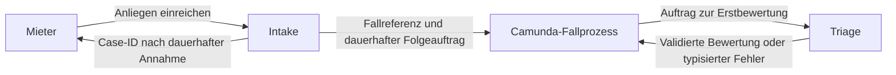

# TRANSFER · Block 3 «Services»

**Status:** Entwurf für PropertyFlow nach der FFHS-Vorlage «TRANSFER · Ein Entscheid für Ihr Projekt, der sich prüfen lässt». Nach dem fachlichen Review geht Abschnitt 4 unverändert in Artefakt 5 ein.

## 1. Fachlicher Schnitt

| Modul | Änderungsgrund | Vertrag und Lastprofil |
| --- | --- | --- |
| `intake` | Erfassungskanäle und Eingaberegeln ändern sich mit den Anforderungen an die Fallannahme. | Prüft und speichert die Einreichung, vergibt die Case-ID und meldet den Erfolg nach dem Commit zurück. Die Antwortzeit hängt vor allem von Validierung und Datenbank ab. |
| `triage` | Die Bewirtschaftung präzisiert die Einstufung. Modell und Prompt können unabhängig davon wechseln. | Bewertet den freigegebenen, minimierten Anliegenstext. Liefert `KRITISCH`, `HOCH`, `NORMAL`, `NIEDRIG` oder einen typisierten Fehler. Jeder Aufruf beansprucht Modelllaufzeit. |

Die Module haben unterschiedliche Änderungsgründe und koppeln sich über explizite Auftrags- und Ergebnisverträge. Die dauerhafte Annahme bleibt bei einem Modell- oder Workflow-Ausfall möglich. Das gemeinsame Backend-Deployment folgt [ADR-001](adr/ADR-001-grundarchitektur.md).

## 2. Zentraler HTTP-Endpunkt

**Vertragsentwurf.** `POST /api/cases` für die Einreichung. Die vorhandene Demo verarbeitet `POST /mieter/fall` als Formularroute. Vor der OpenAPI-Spezifikation die Einbindung des neuen Vertrags mit dieser Route festlegen.

| Aspekt | Entwurf |
| --- | --- |
| Anfrage | Betreff, Beschreibung und Objekt-/Wohnungsreferenz gemäss [FALL-02](../specifications/fallverwaltung.md#fall-02-erfolgreiche-annahme), dazu eine serverseitig geprüfte Absende-ID als Idempotenzschlüssel. Ohne Anmeldung zusätzlich die Kontaktadresse; mit verifiziertem Mieterkonto wird sie serverseitig aus dem geprüften Konto übernommen und nicht als Nutzereingabe benötigt. |
| Erfolg | `201` nach dauerhafter Speicherung mit der Case-ID. Bei identischer Wiederholung dieselbe Case-ID und dieselbe Annahmeantwort. |
| Fehler | `422` bei ungültigen Feldern, `409` bei geändertem Inhalt mit derselben Absende-ID, `503` bei vorübergehend nicht verfügbarer Speicherung. Die Antworten verwenden eine gemeinsame Fehlerform. |
| Wiederholung | Dieselbe Absende-ID mit demselben Inhalt erzeugt genau einen Fall und einen fachlichen Folgeauftrag gemäss [FALL-03](../specifications/fallverwaltung.md#fall-03-wiederholung-und-doppelte-einreichung). Gültigkeitsbereich und Aufbewahrungsdauer im OpenAPI-Entwurf präzisieren. |
| Datenklasse | Personenbezogene Daten in den Eingaben. Die HTTP-Antwort enthält die Case-ID. Zugriff auf gespeicherte Falldaten erfordert eine eigene Berechtigung gemäss [ZUG-04](../specifications/fallzugriff-und-sicherheit.md#zug-04-rechte-und-vertrauensgrenzen). |
| Messbares Ziel | Bei erreichbarer Datenbank werden im definierten Ausfalltest 100 % der gültigen Neueinreichungen dauerhaft angenommen, auch bei abgeschaltetem Modell und unerreichbarem Camunda. Messung über bestätigte Annahmen und gespeicherte Fälle. Herleitung aus NFR-03 und FALL-02. |

### Kontaktadresse und Benutzerkontext im Dienstvertrag

Web und ein späteres MCP-Werkzeug zur Einreichung im eigenen Namen verwenden dieselbe fachliche Regel: Der Dienst bestimmt bei angemeldeten Mietern die verifizierte Kontaktadresse anhand des geprüften Benutzerkontexts. Weder eine Benutzer-ID noch eine E-Mail aus Formular- oder Toolargumenten ersetzt die Authentifizierung. Der MCP-Vertrag für diese Einreichung benötigt kein E-Mail-Argument. Die Einreichung ohne Konto bleibt ein eigener zulässiger Web-Zugangsweg mit erforderlicher Kontaktadresse.

Zu prüfen sind die Übernahme der Konto-Adresse ohne E-Mail-Eingabe, ein manipulierter abweichender Wert, eine abgelaufene Anmeldung und eine Einreichung ohne Konto mit fehlender oder ungültiger Adresse. Der Triage-Vertrag erhält keine separate Kontaktadresse; für den Anliegenstext gelten weiterhin die Regeln zur Datenminimierung.

## 3. Werkzeug für einen Agenten

**Vorschlag.** Ein lesendes MCP-Werkzeug ruft den Bewertungsstand eines Falls ab. Es gibt nur den Analysezustand und die für den Akteur zulässige wirksame Dringlichkeit aus. Der Dienst validiert die Case-ID, prüft den technischen Akteur und dessen Zugriff auf den konkreten Fall und protokolliert Erfolg und Ablehnung. Für diesen Lesezugriff ist keine menschliche Einzelfreigabe vorgesehen. Kritische Aktionen wie Fallabschluss und verbindliche Beauftragung liegen ausserhalb dieses Werkzeugs. Die dazu geltenden Freigaberegeln gehören ins Sicherheitskonzept.

## 4. Architekturentscheid für Artefakt 5

**Die Erstbewertung läuft nach der dauerhaften Fallannahme asynchron im Camunda-Fallprozess.**

### Folgt aus

FALL-02 und NFR-03 geben der dauerhaften Annahme und manuellen Bearbeitbarkeit Vorrang vor einer sofort verfügbaren Bewertung. FALL-03 verlangt dieselbe Case-ID bei identischer Wiederholung. DRING-05 und [ADR-002](adr/ADR-002-camunda8-workflow-orchestrierung.md) legen die Bewertung in den Camunda-Fallprozess. DRING-06 gibt der manuellen Einstufung Vorrang vor einem verspäteten KI-Ergebnis.

### Entscheid und Prüfung je Teilentscheid

Die Prüfungen sind geplant. Jede Zeile beschreibt einen beobachtbaren Nachweis für den zugehörigen Teilentscheid.

| Nr. | Entscheid | Prüfung |
| --- | --- | --- |
| E1 | Intake bestätigt die Einreichung nach dem lokalen Commit von Fall und rekonstruierbarem Prozessstartauftrag, unabhängig von der Erreichbarkeit von Camunda und Modell. | **Integrationstest:** Bei unerreichbarem Camunda und Modell einreichen, die Case-ID bestätigen lassen und nach Anwendungsneustart Fall und ausstehenden Folgeauftrag nachweisen. Bei erzwungenem Datenbankfehler bleibt die Annahme unbestätigt. |
| E2 | Camunda orchestriert die Erstbewertung asynchron anhand der Case-ID, wobei der Job Worker den Triage-Service über dessen fachlichen Vertrag aufruft. | **Integrationstest:** Den ausstehenden Auftrag nach Wiederanlauf übergeben und im Camunda-Testprozess genau den vorgesehenen Bewertungsjob auslösen. Der Job lädt die Bewertungsdaten in PropertyFlow über die Case-ID. |
| E3 | Identische Einreichungswiederholungen und erneut zugestellte Prozessstart- oder Bewertungsaufträge behalten dieselbe fachliche Identität und wirken höchstens einmal. | **Integrationstest:** Dieselbe Absende-ID parallel einreichen, nach verloren gegangener Startantwort die Prozessübergabe erneut versuchen und denselben Bewertungsjob erneut ausführen. Genau eine Case-ID, einen führenden Fallprozess und eine fachlich wirksame Bewertung prüfen. |
| E4 | Bei einem Modellfehler bleibt der aktive Fall bearbeitbar und erhält den Prüfgrund nach FALL-05, während manuelle Einstufungen auch bei verspäteten KI-Ergebnissen wirksam bleiben. | **Integrationstest:** Einen Modell-Timeout auslösen, den Status «Mitarbeiterprüfung erforderlich» samt Prüfgrund prüfen und den Fall manuell bearbeiten. Eine manuelle Einstufung setzen und ein verspätetes KI-Ergebnis zustellen. Die wirksame Stufe muss der manuellen Einstufung entsprechen. |

### Preis

Die Bewertung steht bei der Einreichungsbestätigung unter Umständen noch aus. Die Anwendung muss offene Folgeaufträge dauerhaft halten, nach einem Neustart weiterverarbeiten und doppelte Zustellungen beherrschen. Wiederanlauf und Abbau des Rückstaus verursachen zusätzliche Arbeit und müssen überprüfbar sein.

### Störfall · Camunda antwortet zehn Minuten lang nicht

Die Fallannahme läuft weiter, solange die lokale Datenbank verfügbar ist. Pro gültiger Neueinreichung entsteht ein ausstehender Prozessstartauftrag. Bei `r` gültigen Neueinreichungen pro Minute beträgt der zusätzliche Rückstau nach zehn Minuten ungefähr `10 × r`. Identische Wiederholungen zählen dabei einmal. Für PropertyFlow liegt hier noch keine gemessene Eingangsrate vor. Im Ausfalltest werden die tatsächlich angenommenen Fälle und die offenen Aufträge gezählt.

Der Mieter erhält weiterhin seine Annahmebestätigung. In der Fallansicht kann «Noch nicht bewertet» erscheinen. Die Bewirtschaftung kann bestätigte Fälle manuell bearbeiten. Nach Wiederanlauf werden die ausstehenden Aufträge erneut übergeben. Der Test prüft, ob der Rückstau abgebaut wird und pro Fall höchstens ein führender Prozess entsteht.

### Revidieren, wenn

Den Entscheid überprüfen, wenn nach einem Zehn-Minuten-Ausfall die gemessene Aufholrate dauerhaft höchstens so hoch ist wie die laufende Rate gültiger Neueinreichungen. Dann kann der Rückstau unter dieser Last nicht abgebaut werden.

### Alternativen

Ein synchroner Aufruf bis zur fertigen Bewertung würde die Quittung an die Verfügbarkeit und Laufzeit des Modells binden. Bei Choreografie würden Module auf Ereignisse reagieren und Fehlerpfade sowie Übergänge über ihre Ereignisverträge abstimmen. Camunda-Orchestrierung hält in PropertyFlow den Bewertungsauftrag, den Fehlerpfad und die menschliche Prüfung im führenden Fallprozess nachvollziehbar zusammen.

### KI-Gegenprüfung und fachlicher Abgleich

**Prüffrage an Codex:** «Welche Anforderung verletzt dieser Entscheid?»

| KI-Befund | Abgleich und Konsequenz |
| --- | --- |
| Ein nur im Speicher vorgemerkter Prozessstart könnte nach bestätigter Einreichung bei einem Neustart verloren gehen. | FALL-02 verlangt rekonstruierbare Folgeaufträge. Befund übernommen. E1 fordert deren Commit vor der Bestätigung und prüft den Neustart. |
| Eine stabile Case-ID allein verhindert keinen doppelten Camunda-Prozessstart, wenn die Antwort auf einen erfolgreichen Start verloren geht. | FALL-03 verlangt Schutz vor Mehrfachwirkung. Befund übernommen. E3 enthält diesen Störfall ausdrücklich. Die technische Absicherung muss beim Implementieren belegt werden. |
| Eine verspätete KI-Antwort könnte eine manuelle Einstufung überschreiben. | DRING-06 schützt den Vorrang der manuellen Einstufung. Befund übernommen. E4 prüft die konkurrierenden Änderungen am Fall. |
