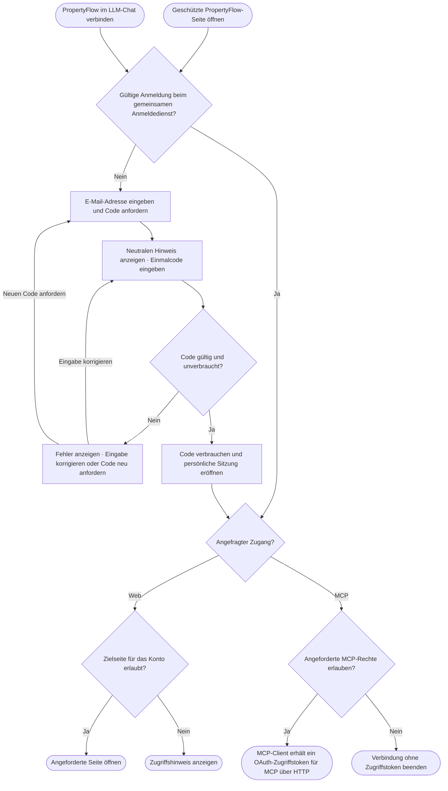

# Screen 04 – Anmeldung per E-Mail-Einmalcode

**Projekt:** PropertyFlow – FFHS CAS AISE  
**Status:** Die Anmeldung für Mitarbeitende und Mieter sowie die Mieter-Selbstregistrierung per E-Mail-Einmalcode sind in der lokalen Frontend-Demo umgesetzt. Die Weiterführung zu MCP beschreibt das Zielbild.\
**Stand:** 13.11.2026\
**Darstellung:** Serverseitig gerendertes Formular mit Thymeleaf.

## 1. Zweck und Umfang

UI4 ermöglicht die persönliche Anmeldung am Mitarbeiterbereich. Die Verwaltung richtet das Konto und die Rolle gemäss [UC-007](../use_cases/UC-007-mitarbeiterkonto-anlegen.md) ein. Die Anmeldung folgt [UC-006](../use_cases/UC-006-mitarbeiter-anmelden.md). Die Ansicht kann auch beim Verbinden von PropertyFlow aus einem LLM-Chat erscheinen. Die Regeln für Rollen, Fallzugriff und MCP-Freigaben stehen in [ZUG-04](../specifications/fallzugriff-und-sicherheit.md#zug-04-rechte-und-vertrauensgrenzen).

Die gemeinsame Ansicht dient auch der Anmeldung am freiwilligen Mieterkonto. [UC-005](../use_cases/UC-005-userkonto-eroeffnen.md) beschreibt die Kontoeröffnung mit E-Mail-Verifikation, [UC-022](../use_cases/UC-022-mieter-anmelden.md) die Anmeldung mit einem bestehenden Konto. Die öffentliche Einreichung und der persönliche Fall-Link führen weiterhin direkt zu [UI1](ansicht-01-mieter-fallansicht.md).

### Mieterkonto eröffnen und nutzen

«Userkonto eröffnen» führt von der Anmeldung und dem Mieterformular nach `/registrieren`.
Nach «Code anfordern» bestätigt die Person ihre Adresse mit «E-Mail bestätigen».
Die Rückmeldung zur Code-Anforderung folgt den [Regeln für E-Mail-Einmalcodes](../specifications/fallzugriff-und-sicherheit.md#e-mail-einmalcode-für-registrierung-und-anmeldung).
Erst ein gültiger Code aktiviert ein neues Mieterkonto oder öffnet das bestehende Konto.
Mitarbeiterrollen werden über die Registrierung weder vergeben noch geändert.

Nach erfolgreicher Anmeldung gelangen Mieter zu «Meine Fälle» (`/mieter/faelle`).
Die Übersicht umfasst auch frühere Gast-Anliegen derselben aktuellen Kontaktadresse
und bietet «Neues Anliegen melden». Eigene Fallansichten unter `/mieter/faelle/{id}`
zeigen nur mieteröffentliche Inhalte und erlauben Nachrichten ausschliesslich in aktiven Fällen.
Jeder Zugriff prüft die serverseitige Konto-Adresse. Die Kopfzeile zeigt «Meine Fälle»,
die angemeldete Adresse und [«Abmelden»](../specifications/fallzugriff-und-sicherheit.md#web-abmeldung). Die Daten bleiben bis zum Neustart im Arbeitsspeicher.

## 2. Felder, Aktionen und Rückmeldungen

| Ansichtszustand | Inhalt und Bedienung |
| --- | --- |
| **E-Mail eingeben** | Überschrift «Anmelden», Feld «E-Mail-Adresse», Aktion «Code anfordern». Bei fehlender oder formal ungültiger Eingabe erscheint ein Hinweis am Feld. |
| **Einmalcode eingeben** | Feld «Einmalcode», Aktion «Anmelden». Der Hinweis zur Anforderung lautet «Wenn für diese Adresse ein berechtigtes Konto besteht, senden wir einen Einmalcode.» Die Person kann die Adresse ändern oder einen neuen Code anfordern. |
| **Code ungültig, abgelaufen oder bereits verwendet** | «Der Code ist ungültig oder abgelaufen.» Die Person kann die Eingabe korrigieren oder einen neuen Code anfordern. |
| **Erneute Anforderung vorübergehend begrenzt** | Die Ansicht zeigt einen verständlichen Wartehinweis. Dauer und Wiederholungsgrenzen werden im technischen Vertrag festgelegt. |
| **Anmeldung fehlt oder ist abgelaufen** | Von [UI2](ansicht-02-mitarbeiter-falluebersicht.md) oder [UI3](ansicht-03-mitarbeiter-falldetail.md) zur Anmeldung führen. Nach erfolgreicher Anmeldung die angeforderte Seite neu laden, sofern der Zugriff erlaubt ist. Eine abgewiesene Schreibaktion wird nicht automatisch wiederholt. |
| **Gültige Anmeldung ohne erforderliche Berechtigung** | Zugriffshinweis ohne geschützte Daten. |
| **MCP-Freigabe** | Nach gültiger Anmeldung den anfragenden Client und die angeforderten Rechte anzeigen. Die Person kann den Zugriff erlauben oder ablehnen. |

Felder haben sichtbare Beschriftungen. Der Einmalcode kann in ein Feld eingefügt werden. Die Schritte sind per Tastatur bedienbar und Fehler werden verständlich am jeweiligen Formular angezeigt.

### Wireframes für Desktop, Tablet und Mobil

Die Entwürfe zeigen in jeder Grösse zwei aufeinanderfolgende Zustände der Mitarbeiteranmeldung: **Code anfordern** und **Einmalcode eingeben**. Sie verwenden die gemeinsame [Gestaltungsbasis von UI2](ansicht-02-mitarbeiter-falluebersicht.md#bestätigte-schriftgrössen-abstände-und-farben) mit weisser Kopfzeile, hellem Hintergrund, weisser Formularkarte und blauer Hauptaktion. Auf Mobilgeräten nutzt die Hauptaktion die volle Formularbreite.

| Ansicht | Browserbreite | Entwurf |
| --- | --- | --- |
| Desktop | 1440 CSS-Pixel | [Desktop-JPG](design/ansicht-04-login.jpg) |
| Tablet | 834 CSS-Pixel | [Tablet-JPG](design/ansicht-04-login-tablet.jpg) |
| Mobil | 390 CSS-Pixel | [Mobil-JPG](design/ansicht-04-login-mobile.jpg) |

## 3. Flussdiagramm · Anmeldung und Rückkehr

## 4. Übergänge und serverseitige Prüfungen

- Code-Anforderung, Gültigkeit, Einmalverwendung und Kontozuordnung folgen den [Regeln für E-Mail-Einmalcodes](../specifications/fallzugriff-und-sicherheit.md#e-mail-einmalcode-für-registrierung-und-anmeldung). Für die Mitarbeiterrolle gilt die serverseitige Prüfung nach [ZUG-04](../specifications/fallzugriff-und-sicherheit.md#zug-04-rechte-und-vertrauensgrenzen).
- Nach erfolgreicher Anmeldung öffnet PropertyFlow das zulässige interne Ziel oder setzt die geprüfte OAuth-Anfrage gemäss den Regeln für [gemeinsame Anmeldung und MCP-Delegation](../specifications/fallzugriff-und-sicherheit.md#gemeinsame-anmeldung-und-mcp-delegation) fort.

## 5. Prüfkriterien

- **UI4-AK-01:** Eine Person mit eingerichtetem Mitarbeiterkonto fordert einen Code an, gibt ihn ein und erreicht die angeforderte, zulässige Mitarbeiterseite. Die Formulare sind per Tastatur bedienbar.
- **UI4-AK-02:** Die Anforderung für eine bekannte und für eine unbekannte Adresse zeigt denselben öffentlichen Hinweis. Ein falscher, abgelaufener oder bereits verwendeter Code eröffnet keine Sitzung.
- **UI4-AK-03:** Nach Ablauf der Sitzung bietet die geschützte Ansicht die erneute Anmeldung an. Eine abgewiesene Schreibaktion wird dabei nicht wiederholt. Ein gültiges Konto ohne Mitarbeiterrolle erhält einen Zugriffshinweis ohne Falldaten.
- **UI4-AK-04:** Beim Verbinden aus dem LLM-Chat im selben Browserprofil wird eine gültige Anmeldung wiederverwendet. Die Freigabe zeigt den Client und die angeforderten Rechte. Bei Ablehnung erhält der Client kein Zugriffstoken.
