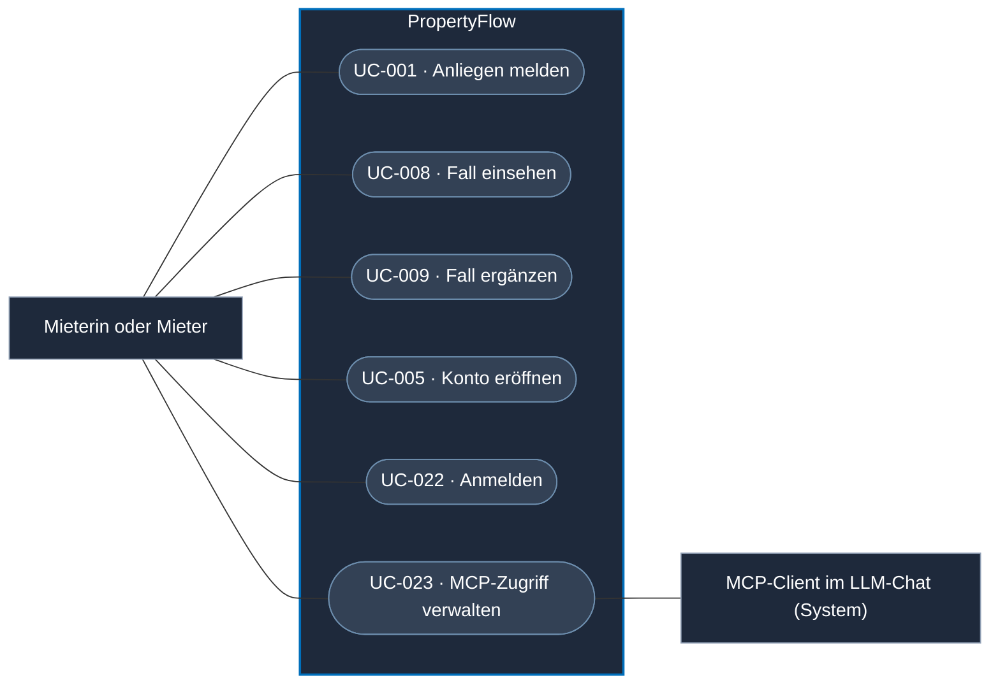
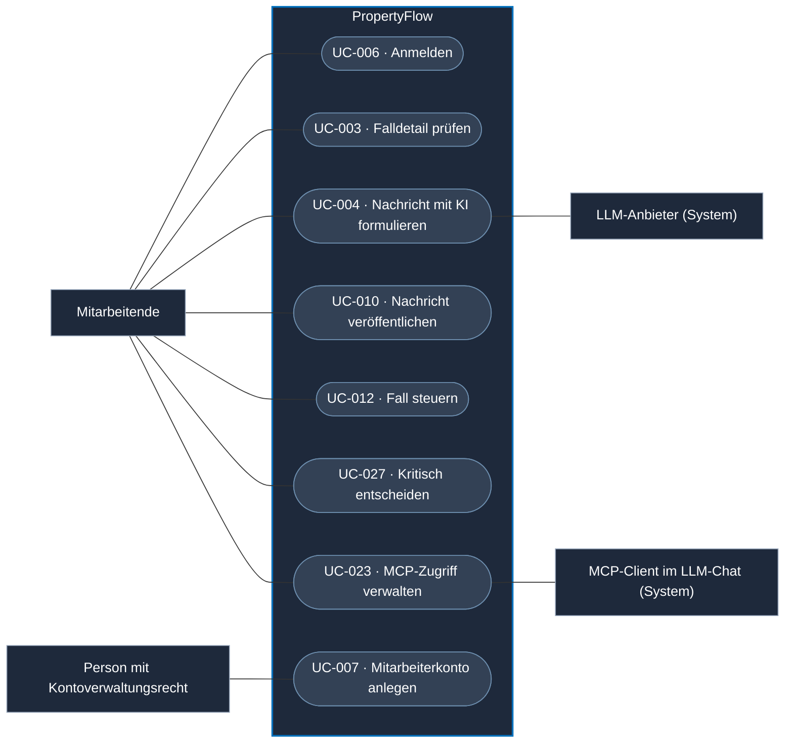
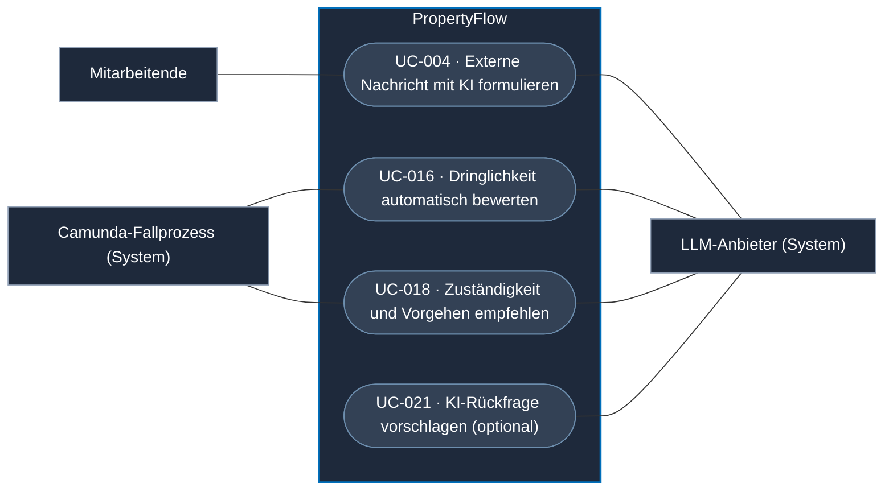

# Use Cases von PropertyFlow

Die Übersicht verbindet die beschriebenen Benutzerziele mit den fachlichen
Abläufen im Hintergrund. Jeder Use Case führt Akteur, Ziel und Stand. Die
Fachregeln bleiben in den verlinkten Spezifikationen. Ein Use Case kann
mehrere Schnittstellen nutzen. Mehrere Use Cases können dieselbe Schnittstelle
verwenden.

## Use-Case-Diagramme

Die Diagramme zeigen zentrale Benutzerziele. Die Tabellen führen alle Use
Cases und ihren Stand auf. Die [LLM-Aufrufe durch PropertyFlow](#llm-aufrufe-durch-propertyflow)
sind in einer eigenen Übersicht dargestellt. Jede verlinkte Datei enthält ihr eigenes
Use-Case-Diagramm. Die Darstellung verwendet kompatible Mermaid-Flowcharts: Akteure stehen ausserhalb
der Systemgrenze, Use Cases erscheinen als abgerundete Knoten innerhalb von
PropertyFlow. Systemakteure sind mit «System» gekennzeichnet. Eine spezielle
UML-Erweiterung oder Mermaid 12 ist dafür nicht erforderlich.

### Mieterinnen und Mieter

Mieter können ein Anliegen als Gast melden und ihren Fall über den persönlichen
Link einsehen oder ergänzen. Der geplante MCP-Zugang setzt ein persönliches
Konto und eine Delegation voraus. Das erste Werkzeug für Mieter ist
[«Fallstand abrufen»](UC-023-mcp-zugriff-delegieren.md#erstes-mcp-werkzeug-für-mieter--fallstand-abrufen).

### Immobilienbewirtschaftung

Mitarbeitende können im geplanten MCP-Zugang den LLM-Chat mit PropertyFlow
verbinden. Der MCP-Client darf im Rahmen der Mitarbeiterrolle nur ausdrücklich
delegierte und freigegebene Aktionen aufrufen. Kritische Aktionen erfordern die
vorgesehene menschliche Freigabe. Für «Mit KI formulieren» sieht der Zielablauf
einen Modellaufruf durch PropertyFlow vor. [UC-023](UC-023-mcp-zugriff-delegieren.md) ·
[UC-004](UC-004-ki-analyse-durchfuehren.md) ·
[ADR-005](../architecture/adr/ADR-005-zugriffsmodell.md#autorisierung-über-mcp)

### LLM-Aufrufe durch PropertyFlow

Camunda veranlasst die Dringlichkeitsbewertung und die Empfehlung über Job
Worker in PropertyFlow. Der genaue Auslösepunkt der Empfehlung im
Fallprozess ist offen. [ADR-002 · Job Worker](../architecture/adr/ADR-002-camunda8-workflow-orchestrierung.md#job-worker)

Bei der automatischen Prüfung von Mieterantworten ist der LLM-Einsatz noch
offen. Beim MCP-Zugang ruft der Client im LLM-Chat freigegebene
PropertyFlow-Funktionen auf. [UC-017](UC-017-mieterantwort-auswerten.md) ·
[UC-023](UC-023-mcp-zugriff-delegieren.md)

## Fallannahme und Mieterzugriff

| Use Case | Zugang und Stand |
| --- | --- |
| [UC-001 · Mieteranliegen erfassen](UC-001-mieteranliegen-einreichen.md) | Web als Gast oder mit Mieterkonto in der Demo. Dauerhafte Annahme und Prozessübergabe geplant. |
| [UC-008 · Eigenen Fall einsehen](UC-008-eigenen-fall-einsehen.md) | Persönlicher Fall-Link oder «Meine Fälle» in der Demo. |
| [UC-009 · Mieteranliegen ergänzen oder Rückfrage beantworten](UC-009-mieteranliegen-ergaenzen.md) | Web über Fall-Link oder Konto in der Demo. Nachgelagerte Auswertung geplant. |
| [UC-020 · Mieteranliegen per E-Mail entgegennehmen](UC-020-mieteranliegen-per-e-mail-entgegennehmen.md) | Eingangskanal aus der Vision. Der sichere Kanalvertrag ist offen. |

## Fallbearbeitung durch die Verwaltung

Im Zielablauf gibt der führende Camunda-Fallprozess die zulässigen Mitarbeiteraktionen frei. Bei ausstehendem Prozessstart oder unerreichbarem Camunda bleiben die Fälle für Mitarbeitende lesbar. [FALL-06](../specifications/fallverwaltung.md#fall-06-fachlicher-status-und-technischer-workflow)

| Use Case | Zugang und Stand |
| --- | --- |
| [UC-002 · Mieteranliegen anzeigen](UC-002-mieteranliegen-anzeigen.md) | Mitarbeiterübersicht mit Suche, Filter und Sortierung in der Demo. |
| [UC-003 · Mieteranliegen im Detail anzeigen](UC-003-mieteranliegen-details-anzeigen.md) | Falldetail in der Demo. Die folgenden Use Cases beschreiben die einzelnen Bearbeitungsaktionen. |
| [UC-004 · Externe Nachricht mit KI formulieren](UC-004-ki-analyse-durchfuehren.md) | Formulierung im Mitarbeiterdetail in der Demo simuliert. Modellanbindung geplant. |
| [UC-010 · Externe Fallnachricht veröffentlichen](UC-010-externe-fallnachricht-veroeffentlichen.md) | Web in der Demo. Dauerhafte Speicherung und Folgeaufträge geplant. |
| [UC-011 · Internes Memo erfassen](UC-011-internes-memo-erfassen.md) | Web in der Demo. Dauerhafte Speicherung und persönliche Zuordnung geplant. |
| [UC-012 · Fall fachlich steuern](UC-012-fall-fachlich-steuern.md) | Zielablauf über Camunda für «Bearbeitung fortsetzen», Dringlichkeit und Zuordnung. Die Demo enthält noch die direkte Statusauswahl. |
| [UC-013 · Wiedervorlage verwalten](UC-013-wiedervorlage-verwalten.md) | Termin setzen, ändern und löschen in der Demo. Im Zielablauf beendet eine neue Mieternachricht die laufende Wiedervorlage und löst die sofortige Mitarbeiterprüfung aus. |
| [UC-014 · Fall abschliessen](UC-014-fall-abschliessen.md) | Manueller Abschluss in der Demo. Die vereinbarten Systemabschlüsse sind geplant. |
| [UC-015 · Fall wiedereröffnen](UC-015-fall-wiedereroeffnen.md) | Mitarbeiteraktion in der Demo. Technische Fortsetzung des Fallprozesses offen. |
| [UC-027 · Kritische Fallentscheidung treffen](UC-027-kritische-fallentscheidung-treffen.md) | HTTP-Zielvertrag für die konkrete Mitarbeiterentscheidung und ihren Audit-Nachweis beschrieben. BPMN und Umsetzung geplant. |
| [UC-028 · Antwortbedarf aufheben](UC-028-antwortbedarf-aufheben.md) | Mitarbeiteraktion in der Demo. Dauerhafte Speicherung und Prozessabstimmung geplant. |

## Verarbeitung und Benachrichtigungen

| Use Case | Auslöser und Stand |
| --- | --- |
| [UC-016 · Dringlichkeit automatisch bewerten](UC-016-dringlichkeit-automatisch-bewerten.md) | Annahme oder weitere Mieternachricht. Triage-Prototyp vorhanden, Fallanbindung geplant. |
| [UC-017 · Mieterantwort auswerten](UC-017-mieterantwort-auswerten.md) | Gespeicherte Nachricht bei offenen Rückfragen. Fachregeln vereinbart, automatische Auswertung geplant. |
| [UC-018 · Zuständigkeit und Vorgehen empfehlen](UC-018-zustaendigkeit-und-vorgehen-empfehlen.md) | Empfehlung aus der Wissensbasis für Mitarbeitende. Camunda-Orchestrierung vorgesehen. Auslösepunkt und technischer Vertrag offen. |
| [UC-019 · Fallbenachrichtigung zustellen](UC-019-fallbenachrichtigung-zustellen.md) | Fachliches Fallereignis. Dauerhafter Auftrag und Fall-Mailversand geplant. |
| [UC-021 · KI-Rückfrage vorschlagen](UC-021-ki-rueckfrage-vorschlagen.md) | Fehlende Angaben im Fall. Optionale Erweiterung. Auslösung, Freigabe und Veröffentlichung offen. |

## Konten und delegierter Zugriff

| Use Case | Zugang und Stand |
| --- | --- |
| [UC-005 · Userkonto eröffnen](UC-005-userkonto-eroeffnen.md) | Mieterkonto mit E-Mail-Verifikation in der Demo. |
| [UC-006 · Mitarbeiter anmelden](UC-006-mitarbeiter-anmelden.md) | E-Mail-Einmalcode in der Demo. |
| [UC-007 · Mitarbeiterkonto anlegen](UC-007-mitarbeiterkonto-anlegen.md) | Kontoverwaltung und Ersteinrichtung im Zielablauf spezifiziert. |
| [UC-022 · Mieter anmelden](UC-022-mieter-anmelden.md) | Anmeldung mit bestehendem Mieterkonto in der Demo. |
| [UC-023 · MCP-Zugriff freigeben und widerrufen](UC-023-mcp-zugriff-delegieren.md) | Delegierter Zugriff und «Fallstand abrufen» im Zielablauf spezifiziert. |
| [UC-024 · Persönlichen Fall-Link ersetzen](UC-024-fall-link-widerrufen-oder-ersetzen.md) | HTTP-Zielvertrag für administrativen Linkersatz beschrieben. Prüfverfahren und Umsetzung offen. |
| [UC-025 · Fall-Kontaktadresse ändern](UC-025-fall-kontaktadresse-aendern.md) | HTTP-Zielvertrag für geprüfte Adresskorrektur mit Linkersatz beschrieben. Prüfverfahren und Umsetzung offen. |
| [UC-026 · Aus PropertyFlow abmelden](UC-026-abmelden.md) | Lokale Web-Abmeldung in der Demo. |
| [UC-029 · Mitarbeiterzugriff entziehen](UC-029-mitarbeiterzugriff-entziehen.md) | Zielvertrag für Kontosperre und Rollenentzug beschrieben. Umsetzung für Web und MCP geplant. |

## Bezug zur Architektur

Der [Systemkontext](../architecture/c4-1-context.md) zeigt die Zugänge und
Nachbarsysteme. Die [Containeransicht](../architecture/c4-2-container.md) zeigt
die Laufzeitgrenzen. Für die Komponentenansicht lässt sich je Ablauf ableiten,
welcher Dienst aufgerufen wird, welche Daten er erhält, wer auf das Ergebnis
wartet und wie Fehler behandelt werden.

MCP kann ausgewählte fachliche Aktionen wie Fall lesen, Anliegen einreichen
oder einen aktiven eigenen Fall ergänzen über einen weiteren Zugang anbieten.
Die Fachregeln der jeweiligen Use Cases gelten auch für diesen Zugang.
[ZUG-04](../specifications/fallzugriff-und-sicherheit.md#zug-04-rechte-und-vertrauensgrenzen)

Der [Architekturentscheid zur asynchronen Erstbewertung](../architecture/schnittstellenentwurf-block-3.md#4-architekturentscheid-für-artefakt-5)
beschreibt die Verbindung von Fallannahme und Erstbewertung aus UC-001 und UC-016.
