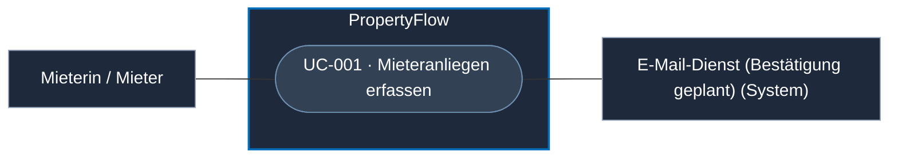
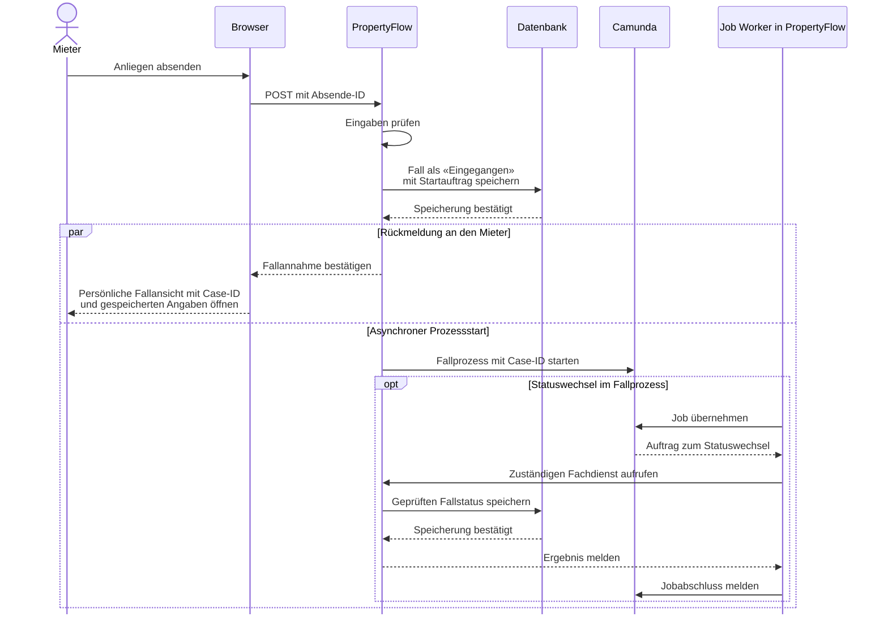

# Use Case: Mieteranliegen erfassen

## Overview

**Use Case ID:** UC-001  
**Use Case Name:** Mieteranliegen erfassen  
**Primary Actor:** Mieterin / Mieter  
**Goal:** Ein Mieteranliegen erfassen und seine dauerhafte Annahme mit Case-ID erkennen.  
**Status:** Produktiver Gesamtprozess geplant; lokale Frontend-Demo mit Mock-Daten vorhanden. Die Demo ersetzt keine produktive Datenbank-, KI-, Mail- oder Camunda-Integration. Siehe [Demo-Nachweise](../evaluation/evaluationsgrundlage.md#testabdeckung-der-frontend-demo--ergänzung-vom-13102026).

**Fachliche Grundlage:** [Fallverwaltung](../specifications/fallverwaltung.md), insbesondere FALL-01 bis FALL-04. Darstellung und Web-Routen beschreibt [Screen 01](../frontend/ansicht-01-mieter-fallansicht.md); Nachrichtenregeln beschreibt die [Fallkommunikation](../specifications/fallkommunikation.md). Persönlicher Tokenlink und sicherer Erstzugriff folgen [Fallzugriff und Sicherheit](../specifications/fallzugriff-und-sicherheit.md), insbesondere ZUG-01 bis ZUG-03.

Dieser Use Case beschreibt die Web-Erfassung. Für den Eingang per E-Mail gelten dieselben fachlichen Fallregeln. Die sichere Annahme und Zuordnung beschreibt [UC-020](UC-020-mieteranliegen-per-e-mail-entgegennehmen.md) als Zielablauf mit offenem Kanalvertrag.

## Use-Case-Diagramm

## Preconditions

- PropertyFlow ist erreichbar.
- Die Erfassungsmaske und die Einreichung stehen ohne Benutzerkonto zur Verfügung.

## Main Success Scenario

1. Die Mieterin oder der Mieter öffnet die Erfassungsmaske.
2. Das System zeigt das Formular für ein neues Anliegen; das Öffnen legt keinen Fall an.
3. Die Mieterin oder der Mieter erfasst Betreff, Beschreibung und Objekt-/Wohnungsreferenz; ohne Anmeldung zusätzlich die E-Mail-Adresse. Für die Einreichung aus einem verifizierten Mieterkonto gilt A6.
4. Die Mieterin oder der Mieter sendet das Formular ab.
5. Das System prüft die Angaben serverseitig und behandelt Wiederholungen gemäss FALL-03.
6. PropertyFlow speichert das Anliegen gemäss FALL-02 mit einer Case-ID und dem Status «Eingegangen». Mit der Speicherung werden der Prozessstart und die Bestätigungsbenachrichtigung zuverlässig veranlasst.
7. Nach bestätigter Speicherung öffnet sich die persönliche Fallansicht mit der Case-ID und den gespeicherten Angaben. PropertyFlow übergibt den Startauftrag asynchron zur Einreichung an Camunda. Camunda steuert danach die Statuswechsel im Fallprozess gemäss [FALL-06](../specifications/fallverwaltung.md#fall-06-fachlicher-status-und-technischer-workflow).
8. Der persönliche Fall-Link mit ausschliesslich einem geheimen Token als Zugangswert wird zusätzlich per E-Mail versendet. PropertyFlow ordnet den Token serverseitig dem Fall zu; die lesbare Case-ID bleibt in der Ansicht. Der Versandzustand ist vom fachlichen Annahmeerfolg getrennt. Auslöser, Inhalt und Fehlerbehandlung folgen [Benachrichtigungen und Zustellung](../specifications/benachrichtigungen-und-zustellung.md).

### Sequenzdiagramm

Der Zielablauf zeigt die dauerhafte Annahme im Web und die zeitlich
entkoppelte Übergabe an Camunda. Den Versand des persönlichen Fall-Links
beschreibt [UC-019](UC-019-fallbenachrichtigung-zustellen.md).

## Alternative Flows

### A1: Pflichtfeld fehlt oder Eingabe ist ungültig

**Trigger:** Die serverseitige Prüfung lehnt die Eingabe ab.

1. Das System nimmt das Anliegen nicht an.
2. Die betroffenen Felder erhalten verständliche Fehlermeldungen; bereits eingegebene Werte bleiben erhalten.
3. Nach der Korrektur wird der Use Case bei Schritt 4 fortgesetzt.

### A2: Technischer Fehler vor dauerhafter Annahme

**Trigger:** Es ist bekannt, dass die Speicherung nicht erfolgreich war.

1. Das System bestätigt keine erfolgreiche Erfassung und zeigt einen verständlichen Fehlerhinweis.
2. Die Mieterin oder der Mieter kann einen sicheren erneuten Versuch auslösen.

### A3: Ausgang nach dem Absenden unklar

**Trigger:** Die Antwort geht verloren oder ein Timeout lässt offen, ob bereits gespeichert wurde.

1. Die Oberfläche erklärt den unklaren Ausgang; sie behauptet weder Erfolg noch eine sicher fehlgeschlagene Speicherung.
2. Eine Wiederholung verwendet dieselbe Absende-ID gemäss FALL-03.
3. Falls bereits angenommen, liefert das System die bestehende Case-ID und erzeugt keinen zweiten Fall. Andernfalls kann die gültige Einreichung einmalig angenommen werden.

### A4: Nachgelagerte Komponente nicht verfügbar

**Trigger:** Der Fall ist gespeichert, aber Camunda-Prozessstart, Mailversand oder KI-Verarbeitung können vorübergehend nicht abgeschlossen werden.

1. Die Annahmebestätigung und Case-ID bleiben gültig.
2. Ist Camunda beim Prozessstart nicht erreichbar, holt PropertyFlow den Start im Hintergrund nach. Der neue Fall bleibt bis zum ersten durch Camunda veranlassten Übergang auf «Eingegangen». Andere ausstehende Folgeaufträge werden gemäss dem Integrationsvertrag wiederholt oder zur Bearbeitung sichtbar gemacht.
3. Der Fall bleibt nach FALL-06 aktiv und für Berechtigte lesbar. Vor dem Prozessstart und bei nicht verfügbarem Camunda sind Bearbeitungsaktionen für Mitarbeitende gesperrt. Bei verfügbarem Camunda kann der Prozess bei einem fachlichen Prüfgrund eine Mitarbeiteraufgabe bereitstellen.

### A5: Objektzuordnung noch unklar

**Trigger:** Die eingegebene Objekt-/Wohnungsreferenz kann noch nicht eindeutig den Stammdaten zugeordnet werden.

1. Das gültige Anliegen wird gemäss FALL-04 angenommen.
2. Camunda veranlasst nach Prozessstart «Mitarbeiterprüfung erforderlich» mit dem Hinweis «Zuordnung offen» gemäss FALL-05. Die Ursprungseingabe bleibt erhalten.

### A6: Einreichung aus einem verifizierten Mieterkonto

Bei einer Einreichung aus einem angemeldeten, verifizierten Mieterkonto entfällt das E-Mail-Eingabefeld. PropertyFlow übernimmt die verifizierte E-Mail-Adresse serverseitig aus dem Konto als Fall-Kontaktadresse; mitgesendete Kontaktangaben dürfen sie nicht überschreiben. Der angenommene Fall erscheint gemäss [ZUG-04](../specifications/fallzugriff-und-sicherheit.md#zug-04-rechte-und-vertrauensgrenzen) auch in der Fallübersicht des Kontos. Die dauerhafte Annahme und der persönliche Fall-Link folgen dem Hauptablauf. Kontoanzeige und Abmeldung beschreibt Screen 01.

Bei abgelaufener Anmeldung wird keine Konto-Adresse aus Browserdaten übernommen. Die Eingaben bleiben für eine erneute Anmeldung oder die bewusste Einreichung ohne Konto mit Kontaktadresse erhalten; die fehlgeschlagene kontobasierte Einreichung legt keinen Fall an.

## Postconditions

### Success Postconditions

- Der Fall wurde dauerhaft angenommen; Case-ID und Ursprungseingabe sind gespeichert.
- Der Fall befindet sich in der aktiven Phase. Der Camunda-Prozessstart kann noch ausstehen.
- Die Mieterin oder der Mieter sieht die Bestätigung und kann den angelegten Fall direkt unter dem gültigen persönlichen Tokenlink öffnen. Die Case-ID ist im Inhalt sichtbar; der GET-Fallaufruf leitet nicht auf eine andere Falladresse weiter.
- Nachgelagerte Verarbeitung und Benachrichtigung sind zuverlässig veranlasst; ihr Abschluss ist keine Voraussetzung für den Annahmeerfolg.
- Die Erstbewertung der Dringlichkeit wird im Camunda-gesteuerten Ablauf nach [DRING-05](../specifications/dringlichkeitsbewertung.md#dring-05-erst--und-neubewertung-im-prozess) veranlasst. Ohne wirksame System- oder manuelle Einstufung bleibt «Noch nicht bewertet» sichtbar.

### Failure Postconditions

- Bei sicher gescheiterter Annahme wird kein Erfolg bestätigt.
- Bei unklarem Ausgang bleibt eine sichere Wiederholung möglich; ein bereits gespeicherter Fall wird weder verworfen noch doppelt angelegt.
- Ein Fehler nach Annahme macht den gespeicherten Fall nicht zu einer fehlgeschlagenen Erfassung.

## Business Rules

### UC-001-BR-001: Verständliche Validierung

Die Eingabeprüfung folgt [FALL-02](../specifications/fallverwaltung.md#fall-02-erfolgreiche-annahme). Die Oberfläche ordnet Fehler den betroffenen Feldern zu; konkrete Labels und Hilfstexte stehen in Screen 01.

### UC-001-BR-002: Keine KI-Abhängigkeit für die Erfassung

Die Annahme und das Verhalten bei ausgefallenen Folgekomponenten richten sich nach [FALL-02](../specifications/fallverwaltung.md#fall-02-erfolgreiche-annahme), [FALL-06](../specifications/fallverwaltung.md#fall-06-fachlicher-status-und-technischer-workflow) und [FALL-09](../specifications/fallverwaltung.md#fall-09-fehler-und-grenzfälle).

### UC-001-BR-003: Eindeutige Fallidentität

Wiederholung, Ursprungsdaten und Zuordnung folgen FALL-01, FALL-03 und FALL-04. Die fachlichen Prüfkriterien FALL-AK-01 bis FALL-AK-04 werden in der zentralen [Fallverwaltung](../specifications/fallverwaltung.md#prüfkriterien) gepflegt.
