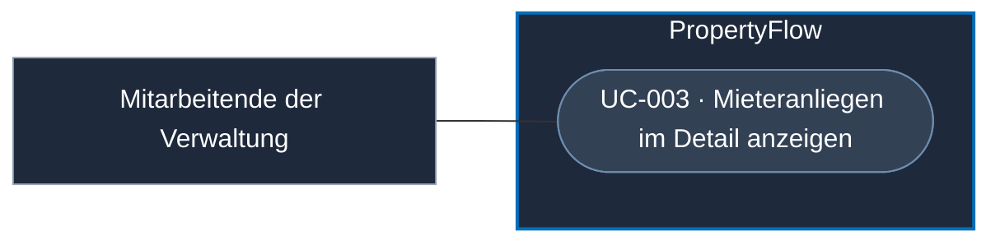

# Use Case: Mieteranliegen im Detail anzeigen

## Overview

**Use Case ID:** UC-003  
**Use Case Name:** Mieteranliegen im Detail anzeigen  
**Primary Actor:** Immobilienbewirtschaftung  
**Goal:** Ein ausgewähltes Mieteranliegen mit den für die fachliche Prüfung relevanten Informationen anzeigen.  
**Status:** Produktiver Gesamtprozess geplant; lokale Frontend-Demo mit Mock-Daten vorhanden. Die Demo ersetzt keine produktive Datenbank-, KI-, Mail- oder Camunda-Integration. Siehe [Demo-Nachweise](../evaluation/evaluationsgrundlage.md#testabdeckung-der-frontend-demo--ergänzung-vom-13102026).

## Use-Case-Diagramm

## Preconditions

- Die Mitarbeiterin oder der Mitarbeiter ist gemäss [UC-006](UC-006-mitarbeiter-anmelden.md) persönlich angemeldet und hat die Mitarbeiterrolle gemäss [ZUG-04 · Rollen und Zusatzrechte](../specifications/fallzugriff-und-sicherheit.md#rollen-und-zusatzrechte).
- Ein Mieteranliegen wurde in UC-002 ausgewählt oder direkt über seine Referenz aufgerufen.

## Main Success Scenario

1. Die Immobilienbewirtschaftung öffnet ein Mieteranliegen. PropertyFlow autorisiert den Aufruf und prüft nachfolgende Lese- und Schreibzugriffe ebenfalls serverseitig.
2. Das System zeigt die erfassten Angaben des Anliegens.
3. Das System zeigt den aktuellen Bearbeitungsstatus.
4. Das System zeigt die Nachrichten der automatischen Camunda-Verarbeitung und die wirksame Dringlichkeit.
5. Die Immobilienbewirtschaftung prüft die bereits vorliegenden Analyse- und Bearbeitungsergebnisse sowie offenen Prüfbedarf.
6. Die Immobilienbewirtschaftung kann aus einer kurzen fachlichen Eingabe eine externe Nachricht mit KI formulieren lassen, als Stream prüfen, bearbeiten und bewusst senden (UC-004).

Die Auswahl aus [Screen 02](../frontend/ansicht-02-mitarbeiter-falluebersicht.md) öffnet eine eigene Detailseite. [Screen 03](../frontend/ansicht-03-mitarbeiter-falldetail.md) hält die bestätigte Grundanordnung und Bedienung fest: Falltitel, Status und Dringlichkeit oben, Verlauf links sowie Falldaten und Aktionen rechts. «Zur Fallübersicht» erhält Suche, Filter, Sortierung und zuletzt gewählte Seite gemäss den UI2-Regeln. Die manuelle Dringlichkeitsänderung erfolgt über «Dringlichkeit ändern», Stufenauswahl und «Speichern» nach [DRING-06](../specifications/dringlichkeitsbewertung.md#dring-06-manuelle-anpassung): Systembewertungen dürfen die manuelle Einstufung nicht überschreiben; wirksame Änderungen werden nach DRING-07 historisiert und dem Mieter angezeigt. Die optionale Begründung bleibt intern. Visuelle Ausgestaltung und technische Umsetzung folgen separat.

UI3 zeigt den zuletzt in PropertyFlow bestätigten Fallstand und bietet die vom Camunda-Fallprozess freigegebenen Aktionen an. Bei ausstehendem Prozessstart oder unerreichbarem Camunda bleibt die Ansicht für Mitarbeitende lesend. PropertyFlow weist Schreibaktionen in dieser Situation auch bei einem direkten Aufruf ab. [FALL-06](../specifications/fallverwaltung.md#fall-06-fachlicher-status-und-technischer-workflow)

## Alternative Flows

### A1: Anliegen nicht gefunden

**Trigger:** Für die angeforderte Referenz existiert kein Anliegen.

1. Das System zeigt «Dieser Fall ist nicht verfügbar.» ohne Falldaten.
2. Das System bietet «Zur Fallübersicht» zurück zur Mitarbeiter-Fallübersicht.
3. Der Use Case endet.

### A2: KI-Analyse noch nicht vorhanden

**Trigger:** Für das Anliegen liegt noch kein Analyseergebnis vor.

1. Das System zeigt den gespeicherten Fallstand und kennzeichnet ein noch fehlendes Ergebnis der automatischen Verarbeitung.
2. Die automatische Analyse läuft im Camunda-Prozess. Bei Analysefehlern kann der Prozess den Fall gemäss FALL-05 zur Mitarbeiterprüfung übergeben. UI3 bietet für die Analyse einen lesenden Ergebnisstand.

### A3: Anmeldung fehlt oder Mitarbeiterberechtigung fehlt

1. PropertyFlow verweigert den Zugriff auf Falldetails und Bearbeitungsaktionen. Abgewiesene Aktionen ändern keine Falldaten.
2. Bei fehlender oder abgelaufener Anmeldung bietet PropertyFlow die Mitarbeiteranmeldung gemäss UC-006 an. Bei gültiger Anmeldung ohne Mitarbeiterberechtigung erscheint ein Zugriffshinweis.

## Postconditions

### Success Postconditions

- Die fachlich relevanten Angaben des ausgewählten Anliegens sind sichtbar.
- Die KI-Formulierungshilfe kann für eine externe Nachricht aus der Detailansicht genutzt werden (UC-004).

### Failure Postconditions

- Bei einer ungültigen Referenz werden keine Daten eines anderen Anliegens angezeigt.

## Business Rules

### UC-003-BR-001: KI-Empfehlung ist keine Entscheidung

Eine KI-Ausgabe wird als Empfehlung beziehungsweise Unterstützung dargestellt. Vorgeschriebene menschliche Prüfungen und die fachliche Verantwortung verbleiben bei der Immobilienbewirtschaftung. Mitarbeitende können Fälle abschliessen; die vereinbarten Systemabschlüsse folgen den gesonderten, serverseitig geprüften Fachregeln aus [FALL-07](../specifications/fallverwaltung.md#fall-07-abschluss-und-zeit-danach). Eine beliebige KI-Ausgabe ist keine Abschlussberechtigung. Bei Kosten bzw. verbindlicher externer Beauftragung, sehr dringlichen oder schwerwiegenden Fällen sowie starken oder eskalierten Mieterbeschwerden ist die menschliche Entscheidung nach [FALL-10](../specifications/fallverwaltung.md#fall-10-automatisierung-und-menschliche-freigabe) verpflichtend. Offener Prüfbedarf darf nicht durch einen Systemabschluss umgangen werden. Mitarbeiterprüfungen werden über interne Memos dokumentiert; es gibt keine separate Aktion «Prüfung erledigt» und keine externe Auftragsausführung. Statusänderung und Mitarbeiterabschluss folgen der bestätigten Bedienung in Screen 03.

Bei «Mitarbeiterprüfung erforderlich» kann der Mitarbeiter die freigegebene Aktion «Bearbeitung fortsetzen» bestätigen, wenn das weitere Vorgehen feststeht. Camunda übernimmt die Entscheidung und veranlasst den Übergang auf «In Bearbeitung». Der PropertyFlow-Dienst speichert den Status und hält fest, welche Prüfgründe berücksichtigt wurden. Neue Erkenntnisse können erneut eine Prüfung auslösen. [FALL-06](../specifications/fallverwaltung.md#direkter-übergang-in-die-bearbeitung)

Beim erfolgreichen Mitarbeiterabschluss speichert PropertyFlow intern «Vom Mitarbeiter geprüft: keine weitere Bearbeitung erforderlich.» mit Mitarbeiter, Zeitpunkt und Abschlussquelle gemäss FALL-07. Die bewusste Bestätigung bildet die Grundlage. Ein zusätzliches Begründungsfeld oder Pflichtmemo entfällt; eine ausführlichere Erklärung ist vor dem Abschluss freiwillig als Memo möglich. Der Vermerk ist keine Kommunikationsnachricht. Bei Systemabschlüssen bleibt der tatsächlich geprüfte Systemgrund erforderlich.

### UC-003-BR-003: Wiedereröffnung ausschliesslich durch Mitarbeitende

Ein Mitarbeiter kann einen abgeschlossenen Fall in Screen 03 bewusst wiedereröffnen gemäss FALL-07 und ZUG-04. Case-ID und bisherige Historie bleiben erhalten; die Handlung bleibt mit Zeitpunkt und Mitarbeiteridentität nachvollziehbar. Nach bestätigter Wiedereröffnung gelten die Regeln für aktive Fälle. Mieter und System dürfen den Fall nicht wiedereröffnen. «Fall wiedereröffnen» öffnet die Bestätigung mit «Wiedereröffnen» und «Abbrechen». Nach bestätigter Wiedereröffnung gilt «In Bearbeitung», bei offenem Prüfbedarf «Mitarbeiterprüfung erforderlich». Eine optionale Begründung wird danach als internes Memo erfasst.

Verspätete automatische Ergebnisse aus der Bearbeitung vor dem letzten Abschluss dürfen den wiedereröffneten Fall nicht verändern. Die Weiterbearbeitung richtet sich nach dem aktuellen Fallstand; die gespeicherte Historie bleibt erhalten. Diese fachliche Grenze steht in [FALL-07](../specifications/fallverwaltung.md#verspätete-automatische-ergebnisse-nach-wiedereröffnung); die technische Prozessfortsetzung wird später ausgearbeitet.

### UC-003-BR-002: Technische KI-Details stehen nicht im Vordergrund

Die Detailansicht priorisiert fachlich verständliche Informationen wie Dringlichkeit, Empfehlung, Zuständigkeit und Bearbeitungsstatus.

### UC-003-BR-004: Wiedervorlage und neue Mieternachrichten

Der Mitarbeiter kann in UI3 eine optionale Wiedervorlage in Tagen oder als festes Datum setzen, ändern oder löschen, wenn der Prozess die jeweilige Aktion freigibt. Camunda führt die Wartezeit im bestehenden Fallprozess und veranlasst die zugehörigen Statuswechsel. UI2 zeigt das gespeicherte Datum in einer zusätzlichen sortierbaren Spalte. Bei einer neu gespeicherten Mieternachricht hebt Camunda die laufende Wiedervorlage auf und legt den Fall sofort zur Mitarbeiterprüfung vor. Terminänderung, Löschung, Abschluss und Nachvollziehbarkeit folgen [UC-013](UC-013-wiedervorlage-verwalten.md) und [FALL-11](../specifications/fallverwaltung.md#fall-11-wiedervorlage).

### UC-003-BR-005: Objekt und Wohnung zuordnen

Bei einer vom Prozess freigegebenen Zuordnung kann der Mitarbeiter rechts in UI3 «Ändern» bei «Bestätigte Zuordnung» wählen, einen vorhandenen Vorschlag auswählen oder Freitext eingeben. Mit «Zuordnung bestätigen» übergibt er die fachliche Aktion. Solange keine bestätigte Zuordnung vorliegt, ist das Feld mit der ursprünglichen Mieterangabe vorbelegt; bei späteren Änderungen mit der aktuellen bestätigten Zuordnung. Die Vorbelegung allein bestätigt nichts. Auch die ursprüngliche Angabe kann bestätigt werden. Eine offene Zuordnung wird damit geklärt oder eine bisherige Zuordnung korrigiert. Die ursprüngliche Mieterangabe bleibt getrennt von der bestätigten Zuordnung nachvollziehbar. Berechtigung, Eingabeprüfung (1–200 Zeichen nach Entfernen äusserer Leerzeichen), Prüfung strukturierter Referenzen bei deren Verwendung, Konfliktprüfung und Speicherung folgen [FALL-04](../specifications/fallverwaltung.md#fall-04-ursprungsdaten-und-zuordnung); UI2 übernimmt den gespeicherten Stand in seine bestehende Spalte. Mitarbeitereingabe und laufender KI-Stream bleiben erhalten. Kontaktadresse und persönlicher Fall-Link folgen ihren eigenen Änderungsregeln.

## Gemeinsame fachliche Grundlage

Die Bearbeitungsaktionen aus dem Falldetail sind in eigenen Use Cases beschrieben.

- [Externe Fallnachricht veröffentlichen](UC-010-externe-fallnachricht-veroeffentlichen.md)
- [Internes Memo erfassen](UC-011-internes-memo-erfassen.md)
- [Fall fachlich steuern](UC-012-fall-fachlich-steuern.md)
- [Wiedervorlage verwalten](UC-013-wiedervorlage-verwalten.md)
- [Fall abschliessen](UC-014-fall-abschliessen.md) und [wiedereröffnen](UC-015-fall-wiedereroeffnen.md)
- [Kritische Fallentscheidung treffen](UC-027-kritische-fallentscheidung-treffen.md)
- [Antwortbedarf aufheben](UC-028-antwortbedarf-aufheben.md)

Fallidentität, fachliche Statusbedeutung und Abgrenzung zum technischen Camunda-Zustand sind in der [Fallverwaltung](../specifications/fallverwaltung.md) definiert, insbesondere FALL-01, FALL-05 und FALL-06. Die Ansicht verwendet diese fachliche Grundlage; ein technischer Incident ist kein eigener fachlicher Abschlussstatus. Die acht fachlichen Bearbeitungsstatus sind unter FALL-05 vereinbart; konkrete Prozessübergänge und das BPMN-Mapping bleiben zu konkretisieren.
