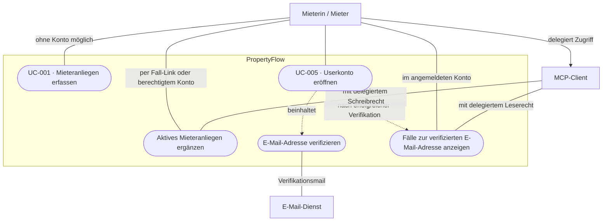
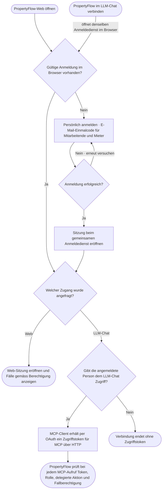

# Use Case: Userkonto eröffnen

## Overview

**Use Case ID:** UC-005  
**Use Case Name:** Userkonto eröffnen  
**Primary Actor:** Mieterin / Mieter  
**Goal:** Ein freiwilliges Mieterkonto mit verifizierter E-Mail-Adresse eröffnen und alle Fälle mit derselben aktuellen Kontaktadresse im Konto sehen.  
**Status:** Web-Ablauf mit E-Mail-Einmalcode in der lokalen Frontend-Demo umgesetzt (13.11.2026). Konten und Fälle liegen im Arbeitsspeicher; dauerhafte Speicherung und OAuth-/MCP-Delegation folgen separat.

**Fachliche Grundlage:** [ADR-005](../architecture/adr/ADR-005-zugriffsmodell.md) beschreibt Konto, Fallzuordnung und MCP-Zugriff. [ADR-004](../architecture/adr/ADR-004-tokenbasierter-mieterzugriff.md) regelt den persönlichen Fall-Link. Ein Anliegen kann gemäss [UC-001](UC-001-mieteranliegen-einreichen.md) ohne Konto eingereicht werden.

## Use-Case-Diagramm

## Flussdiagramm · Anmeldung für Web und MCP

Mieter und Mitarbeitende nutzen denselben Anmeldedienst für PropertyFlow-Web und den MCP-Client im LLM-Chat. Solange die Anmeldung im selben Browserprofil gültig ist, genügt sie für beide Zugänge. Die Web-Anwendung verwendet eine Browsersitzung. Der MCP-Client erhält nach Freigabe ein eigenes OAuth-Zugriffstoken für den MCP-Endpunkt über HTTP. Die Verwaltung richtet Mitarbeiterkonten ein. Mitarbeitende melden sich gemäss [UC-006](UC-006-mitarbeiter-anmelden.md) mit einem E-Mail-Einmalcode an.

## Preconditions

- Die Mieterin oder der Mieter hat Zugriff auf das Postfach der angegebenen E-Mail-Adresse.
- Die Kontoeröffnung ist auch ohne einen bereits bestehenden Fall möglich.

## Main Success Scenario

1. Die Mieterin oder der Mieter wählt «Userkonto eröffnen» und gibt die E-Mail-Adresse ein.
2. PropertyFlow prüft die Eingabe serverseitig und sendet einen einmal verwendbaren, zeitlich begrenzten Verifikationsnachweis an diese Adresse. Die lokale Umsetzung verwendet einen E-Mail-Einmalcode.
3. Die Mieterin oder der Mieter bestätigt den Nachweis. PropertyFlow verifiziert die Adresse und aktiviert das Mieterkonto mit einer eindeutigen internen Benutzer-ID.
4. PropertyFlow eröffnet den angemeldeten Zugang. Die Fallübersicht zeigt alle Fälle, deren aktuelle Kontaktadresse mit der verifizierten Konto-Adresse übereinstimmt. Das schliesst Fälle ein, die vor der Kontoeröffnung ohne Anmeldung erfasst wurden.

## Alternative Flows

### A1: Keine passenden Fälle

Das Konto wird eröffnet und die Fallübersicht ist leer. Künftige Fälle mit derselben Kontaktadresse erscheinen automatisch.

### A2: Adresse ist ungültig oder Verifikation kann nicht abgeschlossen werden

Die Oberfläche zeigt den passenden Hinweis und ermöglicht eine Korrektur oder einen erneuten Verifikationsversuch. Bis zur erfolgreichen Verifikation bleiben das Konto und der Zugriff über das Konto inaktiv. Bestehende Fälle sind weiterhin über ihre gültigen persönlichen Fall-Links erreichbar.

### A3: Für die Adresse besteht bereits ein Konto

PropertyFlow erstellt kein zweites Konto. Die Person kann das bestehende Konto über den vorgesehenen Anmeldeweg nutzen. Vor dem Nachweis der Postfachberechtigung legt die öffentliche Antwort weder den Kontostatus noch vorhandene Fälle offen.

## Postconditions

- Bei Erfolg besteht ein aktives Mieterkonto mit verifizierter E-Mail-Adresse. Die Kontoeröffnung erzeugt keinen neuen Fall und ändert die Daten bestehender Fälle nicht.
- Die Fallübersicht zeigt nur die gemäss ADR-005 zugehörigen Fälle. Die Berechtigung gilt auch für MCP, sobald der Mieter dem Client die entsprechende Aktion ausdrücklich delegiert.
- Ohne erfolgreiche Verifikation gewährt PropertyFlow keinen Fallzugriff über das Konto oder einen MCP-Client.

## Business Rules und Prüfkriterien

- **UC-005-BR-001:** Die Fallzuordnung ergibt sich aus der verifizierten Konto-Adresse und der aktuellen Fall-Kontaktadresse. PropertyFlow prüft sie bei jedem Listen-, Detail- und Schreibzugriff im Web und über MCP. Eine vom Client angegebene Adresse kann die Zuordnung nicht ändern.
- **UC-005-BR-002:** Das Konto erlaubt nur Mieteraktionen. Der veröffentlichte Fallverlauf bleibt lesbar. Eine externe Nachricht ist nur in einem aktiven Fall zulässig. Der MCP-Client erhält ausschliesslich die freigegebenen Aktionen.
- **UC-005-AK-01:** Zwei Fälle mit Adresse A und einen Fall mit Adresse B ohne Anmeldung einreichen. Nach Verifikation eines neuen Kontos mit Adresse A erscheinen genau die beiden Fälle mit Adresse A. Ein direkter Abruf des dritten Falls wird abgelehnt.
- **UC-005-AK-02:** Einen ungültigen, abgelaufenen oder bereits verwendeten Nachweis übermitteln. Der Versuch eröffnet keine angemeldete Sitzung und liefert keine Fallinformationen.
- **UC-005-AK-03:** Mit dem verifizierten Konto und freigegebenem MCP-Client die Fallübersicht abrufen. Web und MCP verwenden dieselbe Fallmenge und geben nur für Mieter sichtbare Inhalte aus.

## Lokale Umsetzung und Nachweise

`/registrieren` führt durch Kontoeröffnung und Verifikation, `/anmelden` dient der
späteren Anmeldung. Nach erfolgreicher Verifikation öffnet `/mieter/faelle` die Übersicht.
Ein Konto ohne passende Fälle erhält eine leere Übersicht mit «Neues Anliegen melden».
Der Code ist zehn Minuten gültig und einmal verwendbar; fünf Fehlversuche sperren ihn.
Anforderungslimits gelten gemeinsam für Registrierung und Anmeldung (einmal pro Minute,
höchstens fünfmal pro Stunde je Adresse). Ungültige Eingaben, fehlgeschlagene Zustellung
und fehlgeschlagene Verifikation aktivieren kein Konto. Die Sitzung und der CSRF-Wert
werden nach erfolgreicher Verifikation erneuert.

`TenantRegistrationTest` prüft Aktivierung, Ablauf, Einmaligkeit, Parallelzugriffe,
Anforderungslimits und bestehende Rollen. `StaffAccessWebTest` prüft UC-005-AK-01,
Zugriffssperren, mieteröffentliche Inhalte, Nachrichten und leere Konten.
`tenant-registration.test.mjs` prüft mit Mailpit den vollständigen Browserablauf
von Gast-Anliegen über Registrierung bis zur neuen Fallanlage und Abmeldung.
Start und Ausführung: [Testanleitung](../../src/test/README.md).
UC-005-AK-03 bleibt bis zur MCP-Integration offen.

**Ausgeführt am 13.11.2026:** Java: 58 bestanden, 1 optionaler Live-Ollama-Test
übersprungen; JavaScript: 6 bestanden; Browser mit Test-Mailpit: 50 bestanden,
0 Fehler. Die neue Übersicht wurde bei 390, 768 und 1440 Pixel Breite geprüft.
Browserbericht: `target/frontend-quality/ui-tests.tap`; Screenshots:
`target/account-review/registered-cases-*.png`.
