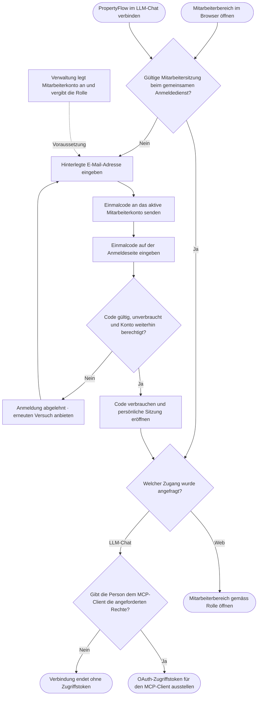

# Use Case: Mitarbeiter anmelden

## Overview

**Use Case ID:** UC-006  
**Use Case Name:** Mitarbeiter anmelden  
**Primary Actor:** Mitarbeiterin / Mitarbeiter der Immobilienverwaltung  
**Supporting Actors:** Verwaltung für die Kontobereitstellung, E-Mail-Dienst für die Zustellung und optional der MCP-Client im LLM-Chat  
**Goal:** Sich mit einem E-Mail-Einmalcode persönlich anmelden und die zugewiesenen Mitarbeiterfunktionen in PropertyFlow nutzen.  
**Status:** Fachlicher Entwurf mit abgestimmtem Anmeldeverfahren. Die technische Umsetzung steht aus.

**Fachliche Grundlage:** [ADR-005](../architecture/adr/ADR-005-zugriffsmodell.md#mitarbeiteridentität) beschreibt Mitarbeiteridentität, gemeinsamen Anmeldedienst und MCP-Autorisierung. Die Mitarbeiterübersicht folgt [UC-002](UC-002-mieteranliegen-anzeigen.md).

## Preconditions

- Ein aktives Mitarbeiterkonto mit der vorgesehenen E-Mail-Adresse und Mitarbeiterrolle wurde gemäss [UC-007](UC-007-mitarbeiterkonto-anlegen.md) eingerichtet.
- Die Person hat Zugriff auf das Postfach dieser Adresse.

## Main Success Scenario

1. Die Mitarbeiterin oder der Mitarbeiter öffnet den geschützten Mitarbeiterbereich und gibt die hinterlegte E-Mail-Adresse ein.
2. PropertyFlow prüft serverseitig, ob für diese Adresse ein aktives Mitarbeiterkonto mit Mitarbeiterrolle besteht, und veranlasst die Zustellung eines kurz gültigen Einmalcodes. Die öffentliche Antwort verrät den Kontostatus nicht.
3. Die Person gibt den Code auf der Anmeldeseite ein. Der Anmeldedienst prüft, ob der Code gültig, unverbraucht und dem weiterhin berechtigten Konto zugeordnet ist. Bei Erfolg verbraucht er den Code und eröffnet eine persönliche Sitzung.
4. PropertyFlow öffnet den Mitarbeiterbereich. Bei weiteren Aufrufen prüft der Dienst die Mitarbeiterberechtigung und die für die jeweilige Aktion geltenden Fachregeln.

## Flussdiagramm · Mitarbeiteranmeldung

## Alternative Flows

### A1: Anmeldung ist bereits gültig

Der gemeinsame Anmeldedienst erkennt die gültige Sitzung im selben Browserprofil. Die Person kann den zweiten Zugang ohne erneute Code-Eingabe verwenden. Beim Verbinden eines LLM-Chats erteilt sie dem MCP-Client die angeforderten Rechte. Erst nach der Freigabe erhält der Client sein OAuth-Zugriffstoken für den MCP-Endpunkt über HTTP.

### A2: Konto fehlt, ist gesperrt oder hat keine Mitarbeiterrolle

PropertyFlow eröffnet keine Mitarbeitersitzung. Eine Anmeldung als Mieter verleiht keine Mitarbeiterrechte. Die Verwaltung ist für die Kontobereitstellung zuständig.

### A3: Code ist ungültig, abgelaufen, bereits verwendet oder wird nicht zugestellt

Die Anmeldung bleibt aus. Die Person kann einen erneuten Versuch starten. Konkrete Gültigkeitsdauer, Wiederholungsgrenzen und Versandfehlerbehandlung gehören zum technischen Anmeldevertrag.

## Postconditions

- Bei erfolgreicher Anmeldung kann PropertyFlow die Person anhand ihrer stabilen Benutzer-ID identifizieren. Die Mitarbeiterrolle und die geltenden Fachregeln bestimmen die Berechtigung.
- Bei erteilter MCP-Freigabe kann der Client im Namen der Person innerhalb der delegierten Rechte handeln. PropertyFlow prüft bei jedem Aufruf Konto, Rolle, delegierte Aktion und Fallberechtigung. Kritische Aktionen folgen [FALL-10](../specifications/fallverwaltung.md#fall-10-automatisierung-und-menschliche-freigabe).

## Prüfkriterien

- **UC-006-AK-01:** Ein durch die Verwaltung angelegtes Mitarbeiterkonto meldet sich mit gültigem Einmalcode an. Der Mitarbeiterbereich ist gemäss Rolle zugänglich. Derselbe Code kann keine zweite Sitzung eröffnen.
- **UC-006-AK-02:** Ein unbekanntes, gesperrtes oder reines Mieterkonto erhält auch bei direktem Aufruf einer Mitarbeiterfunktion keinen Mitarbeiterzugriff.
- **UC-006-AK-03:** Nach der Web-Anmeldung verbindet die Person im selben Browserprofil den LLM-Chat. Bei gültiger Sitzung entfällt ein zweiter Einmalcode. Ein abgelehnter Zugriff ergibt kein MCP-Token. Bei erteilter Freigabe sind nur die delegierten Aktionen möglich.
