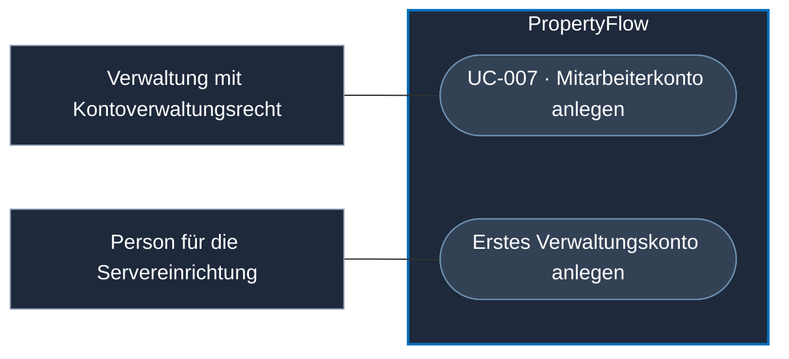
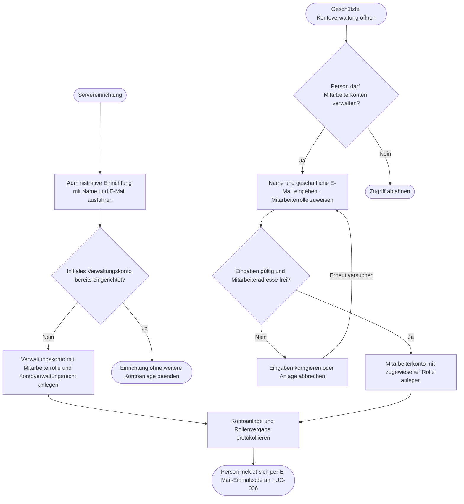

# Use Case: Mitarbeiterkonto anlegen

## Overview

**Use Case ID:** UC-007  
**Use Case Name:** Mitarbeiterkonto anlegen  
**Primary Actor:** Angemeldete Person der Verwaltung mit der Berechtigung «Mitarbeiterkonten verwalten»  
**Supporting Actor:** Verantwortliche Person für die Servereinrichtung beim Anlegen des ersten Verwaltungskontos  
**Goal:** Ein persönliches Mitarbeiterkonto mit geschäftlicher E-Mail-Adresse und zugewiesener Rolle bereitstellen.  
**Status:** Die Kontoanlage ist als Zielablauf spezifiziert. Die Frontend-Demo lädt ein Mitarbeiter-Testkonto aus der lokalen Konfiguration. [Demo-Anleitung](../../dev/README.md#mitarbeiterkonto-konfigurieren-und-mieterkonto-eröffnen)

**Fachliche Grundlage:** [ADR-005](../architecture/adr/ADR-005-zugriffsmodell.md#mitarbeiteridentität) beschreibt das Zugriffsmodell. Die erste Anmeldung der Person folgt [UC-006](UC-006-mitarbeiter-anmelden.md).

## Use-Case-Diagramm

## Preconditions

- Im regulären Betrieb ist die Person angemeldet und hat das Zusatzrecht [«Mitarbeiterkonten verwalten»](../specifications/fallzugriff-und-sicherheit.md#rollen-und-zusatzrechte).
- Bei der Ersteinrichtung führt eine Person mit Zugriff auf die Servereinrichtung den administrativen Befehl aus. Die initiale Einrichtung des Verwaltungskontos steht noch aus.
- Die geschäftliche E-Mail-Adresse der Person, für die das Konto bestimmt ist, liegt vor.

## Main Success Scenario · Mitarbeiterkonto anlegen

1. Die berechtigte Person öffnet die geschützte Kontoverwaltung in PropertyFlow.
2. Sie erfasst den Namen und die geschäftliche E-Mail-Adresse und weist die Mitarbeiterrolle zu.
3. PropertyFlow prüft serverseitig die Berechtigung zur Kontoverwaltung, die Eingaben und die Eindeutigkeit der Adresse unter Mitarbeiterkonten.
4. PropertyFlow speichert das Konto mit stabiler Benutzer-ID und zugewiesener Rolle. Das Audit hält fest, wer das Konto wann angelegt und welche Rolle die Person vergeben hat.
5. PropertyFlow bestätigt die Anlage. Die Mitarbeiterin oder der Mitarbeiter meldet sich anschliessend gemäss UC-006 mit einem E-Mail-Einmalcode an.

## Ersteinrichtung · Erstes Verwaltungskonto anlegen

1. Die für die Servereinrichtung verantwortliche Person startet die administrative Einrichtung und gibt Namen und geschäftliche E-Mail-Adresse der vorgesehenen Person an.
2. PropertyFlow prüft, ob die initiale Einrichtung bereits abgeschlossen ist. Konto, Rolle, Berechtigung zur Kontoverwaltung und Abschluss der Ersteinrichtung werden gemeinsam dauerhaft gespeichert. Dadurch führt auch eine wiederholte oder parallele Ausführung zu höchstens einem initialen Verwaltungskonto.
3. PropertyFlow protokolliert die Anlage als administrative Einrichtung. Die Person meldet sich über denselben Anmeldeweg gemäss UC-006 an. Ab dann kann sie reguläre Mitarbeiterkonten über die geschützte Kontoverwaltung anlegen.

## Flussdiagramm · Kontoanlage und Ersteinrichtung

## Alternative Flows

- **Berechtigung fehlt.** Der Dienst lehnt auch einen direkten Aufruf zur Kontoanlage ab.
- **Eingabe ungültig oder Mitarbeiteradresse bereits vergeben.** PropertyFlow meldet den Fehler in der geschützten Kontoverwaltung. Das bestehende Konto und dessen Rolle bleiben erhalten.
- **Ersteinrichtung erneut ausgeführt.** PropertyFlow meldet den bereits abgeschlossenen Einrichtungsschritt. Dabei werden weder weitere Konten angelegt noch bestehende Rollen geändert.
- **Speicherung fehlgeschlagen.** PropertyFlow bestätigt keine Anlage. Bei der Ersteinrichtung bleibt ein erneuter Versuch möglich.

## Postconditions und Prüfkriterien

- **UC-007-AK-01:** Ein berechtigter Verwaltungsbenutzer legt ein Mitarbeiterkonto an. Benutzer-ID, Mitarbeiterrolle und Audit-Eintrag sind nachvollziehbar. Die Person kann sich danach gemäss UC-006 anmelden.
- **UC-007-AK-02:** Ein Mieterkonto oder ein Mitarbeiterkonto ohne Kontoverwaltungsrecht versucht die Anlage direkt über den Dienst. Der Dienst lehnt ab und speichert kein Konto.
- **UC-007-AK-03:** Dieselbe geschäftliche E-Mail-Adresse wird erneut für ein Mitarbeiterkonto eingereicht. Es bleibt bei einem Konto und seiner bisherigen Rolle.
- **UC-007-AK-04:** Der Einrichtungsbefehl wird bei einer neuen Installation zweimal parallel gestartet und anschliessend erneut ausgeführt. Es gibt genau ein initiales Verwaltungskonto mit Kontoverwaltungsrecht. Ein fehlgeschlagener erster Versuch kann sicher wiederholt werden.
