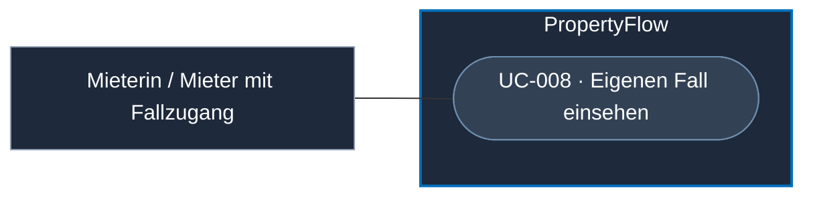

# Use Case: Eigenen Fall einsehen

## Overview

**Use Case ID:** UC-008  
**Use Case Name:** Eigenen Fall einsehen  
**Primary Actor:** Mieterin / Mieter mit persönlichem Fall-Link oder verifiziertem Mieterkonto  
**Goal:** Den aktuellen Bearbeitungsstand und den sichtbaren Verlauf eines berechtigten Falls einsehen.  
**Status:** Der Web-Zugriff per Fall-Link und Mieterkonto ist in der lokalen Demo mit Fällen im Arbeitsspeicher umgesetzt. Dauerhafte Speicherung, produktive Token-Verwaltung und MCP-Delegation folgen separat.

**Fachliche Grundlage:** [ZUG-03](../specifications/fallzugriff-und-sicherheit.md#zug-03-direkter-linkaufruf-und-tokenprüfung), [ZUG-04](../specifications/fallzugriff-und-sicherheit.md#zug-04-rechte-und-vertrauensgrenzen), [KOM-01](../specifications/fallkommunikation.md#kom-01-interne-und-externe-nachrichten), [DRING-07](../specifications/dringlichkeitsbewertung.md#dring-07-änderungshistorie-und-mietertransparenz) und [UI1](../frontend/ansicht-01-mieter-fallansicht.md).

## Use-Case-Diagramm

## Preconditions

- Der Fall wurde angenommen.
- Die Person verfügt über den persönlichen Fall-Link oder ist mit einem verifizierten Mieterkonto angemeldet.

## Main Success Scenario

1. Der Mieter öffnet den persönlichen Fall-Link oder wählt einen Fall unter «Meine Fälle» aus.
2. PropertyFlow prüft den Link-Token oder vergleicht die nach der gemeinsamen E-Mail-Regel geprüfte Fall-Kontaktadresse exakt mit der verifizierten Konto-Adresse.
3. PropertyFlow zeigt die Case-ID, den gespeicherten Bearbeitungsstatus, die wirksame Dringlichkeit sowie die veröffentlichten externen Nachrichten und freigegebenen Dringlichkeitsereignisse. Ein offener Antwortbedarf bleibt erkennbar.
4. Solange die Ansicht sichtbar ist, aktualisiert sie den gespeicherten Stand gemäss UI1.

## Alternative Flows

- **Fall abgeschlossen.** Die Ansicht bleibt für die berechtigte Person lesbar. Bei bestätigter Wiedereröffnung wird die Nachrichteneingabe wieder angeboten. [KOM-04](../specifications/fallkommunikation.md#kom-04-nachrichtensperre-nach-fallabschluss)
- **Zugang fehlt oder ist ungültig.** PropertyFlow verweigert den Abruf ohne Falldaten. Fehlt die Sitzung auf dem Kontozugang, führt dieser zur Anmeldung. [ZUG-08](../specifications/fallzugriff-und-sicherheit.md#zug-08-fehlerverhalten)
- **Aktualisierung schlägt vorübergehend fehl.** Die Ansicht zeigt den letzten bestätigten Stand und weist auf den Aktualisierungsfehler hin. [UI1](../frontend/ansicht-01-mieter-fallansicht.md#451-automatische-aktualisierung-von-nachrichten-status-und-dringlichkeit)

## Postconditions

- Die berechtigte Person sieht den zuletzt bestätigten fachlichen Stand. Der Leseabruf verändert den Fall und seinen Prozesszustand nicht.

## Business Rules und Prüfkriterien

- **UC-008-BR-001:** Der gültige Link gilt für genau einen Fall. Jeder Aufruf über die Link-Route prüft den Token. Der Kontozugang setzt eine geprüfte Fall-Kontaktadresse voraus, die nach Vereinheitlichung exakt mit der verifizierten Konto-Adresse übereinstimmt. [ZUG-03](../specifications/fallzugriff-und-sicherheit.md#zug-03-direkter-linkaufruf-und-tokenprüfung) · [ZUG-04](../specifications/fallzugriff-und-sicherheit.md#mieterzugriff)
- **UC-008-BR-002:** Das Lesemodell enthält ausschliesslich für den Mieter freigegebene Inhalte und Ereignisse. Interne Memos und ihre Metadaten werden serverseitig ausgefiltert. [KOM-01](../specifications/fallkommunikation.md#kom-01-interne-und-externe-nachrichten)
- **UC-008-AK-01:** Einen berechtigten Fall per Link und per passendem Mieterkonto öffnen. Beide zeigen den mieteröffentlichen Verlauf. Ein direkter Abruf eines fremden Falls oder mit ungültigem Token liefert keine Falldaten.
- **UC-008-AK-02:** Einen abgeschlossenen Fall mit gültigem Zugriff öffnen. Der Verlauf bleibt sichtbar. Der Abruf allein erzeugt keinen Eintrag und öffnet den Fall nicht wieder.
- **UC-008-AK-03:** Ein bestehender Testfall mit `mıeter@example.test` (punktloses `ı`) erscheint für das Konto mit verifiziertem `mieter@example.test` weder in «Meine Fälle» noch im Direktabruf. Ein Ergänzungsversuch über dieses Konto verändert den Fall nicht. [ZUG-AK-15](../specifications/fallzugriff-und-sicherheit.md#zug-ak-15)
