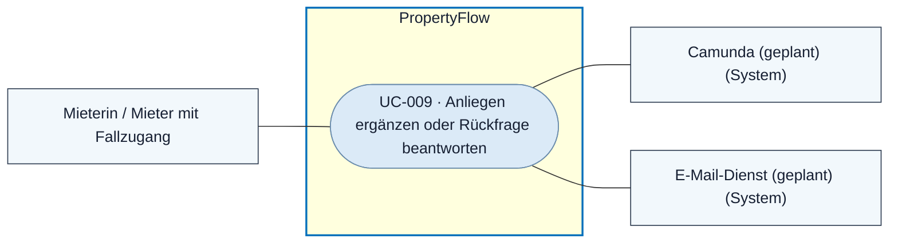
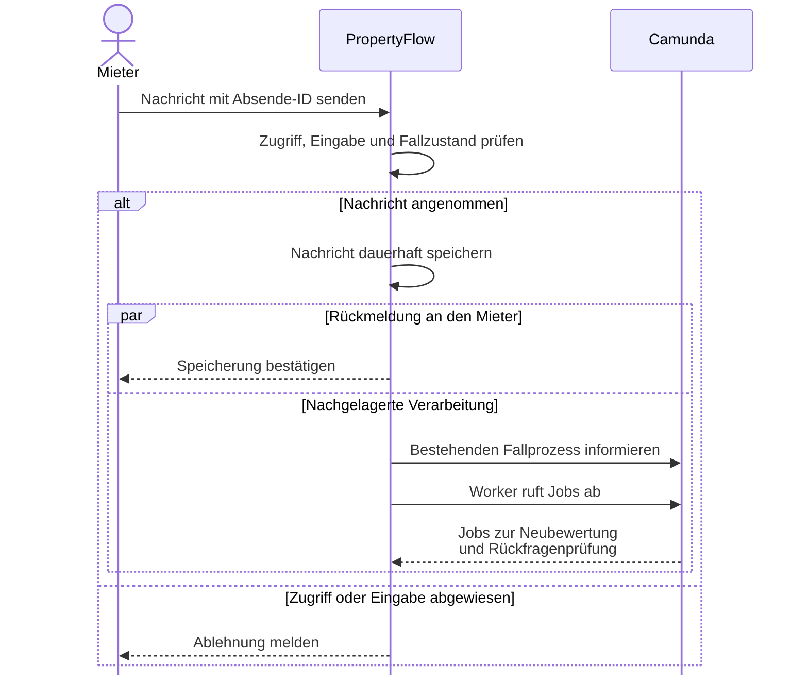

# Use Case: Mieteranliegen ergänzen oder Rückfrage beantworten

## Overview

**Use Case ID:** UC-009  
**Use Case Name:** Mieteranliegen ergänzen oder Rückfrage beantworten  
**Primary Actor:** Mieterin / Mieter mit Zugang zum Fall  
**Supporting Actors:** Camunda für die nachgelagerte Verarbeitung, E-Mail-Dienst für die Benachrichtigung  
**Goal:** Eine Ergänzung oder Antwort im bestehenden Fall hinterlegen und ihre Speicherung erkennen.  
**Status:** Schreiben über Fall-Link und Mieterkonto ist in der lokalen Demo mit Fällen im Arbeitsspeicher umgesetzt. Dauerhafte Speicherung, fachliche Camunda-Verarbeitung und Fallbenachrichtigung sind vorgesehen.

**Fachliche Grundlage:** [UI1](../frontend/ansicht-01-mieter-fallansicht.md#44-ablauf-beim-senden-einer-weiteren-nachricht), [ZUG-04](../specifications/fallzugriff-und-sicherheit.md#zug-04-rechte-und-vertrauensgrenzen), [KOM-03/04](../specifications/fallkommunikation.md#kom-03-asynchrone-fallkommunikation) und [DRING-05](../specifications/dringlichkeitsbewertung.md#dring-05-erst--und-neubewertung-im-prozess).

## Use-Case-Diagramm

## Preconditions

- Der Fall ist aktiv. Die Person besitzt einen gültigen persönlichen Fall-Link oder ein berechtigtes Mieterkonto gemäss [UC-008](UC-008-eigenen-fall-einsehen.md).

## Main Success Scenario

1. Der Mieter erfasst eine Ergänzung oder Antwort und wählt «Nachricht senden».
2. PropertyFlow prüft die Berechtigung, die Eingabe, die Absende-ID und den Fallzustand. Der Dienst speichert die Nachricht als externe Mieternachricht beim bestehenden Fall.
3. PropertyFlow bestätigt die Speicherung im Fallverlauf. Die Verarbeitung durch Camunda und die Bestätigungs-E-Mail sind nachgelagert. [BEN-01/03](../specifications/benachrichtigungen-und-zustellung.md#ben-01-auslöser-und-ausschlüsse)
4. Der bestehende Fallprozess veranlasst die Dringlichkeitsneubewertung und prüft jede offene Rückfrage einzeln. Nur eindeutig beantwortete Fragen gelten als erledigt. [UC-016](UC-016-dringlichkeit-automatisch-bewerten.md) · [UC-017](UC-017-mieterantwort-auswerten.md)

## Sequenzdiagramm · Speichern und später auswerten

## Alternative Flows

- **Eingabe ungültig oder Zugriff verweigert.** PropertyFlow weist die Aktion ohne Speicherung zurück.
- **Fall zwischenzeitlich abgeschlossen.** PropertyFlow weist neue Nachrichten zurück. Erkennt UI1 den bestätigten Abschluss, blendet sie die Eingabe aus und verwirft den ungesendeten Text. [KOM-04](../specifications/fallkommunikation.md#kom-04-nachrichtensperre-nach-fallabschluss)
- **Ausgang der Anfrage unklar.** Der Mieter kann denselben Inhalt mit derselben Absende-ID wiederholen. Ein geänderter Inhalt mit derselben bereits erfolgreich verwendeten ID führt zum Konflikt. [KOM · Wiederholung](../specifications/fallkommunikation.md#wiederholung-einer-nachricht-mit-abweichendem-inhalt--präzisierung-vom-13102026)
- **Auswertung ausstehend oder fehlgeschlagen.** Die gespeicherte Nachricht bleibt im Verlauf. Eine nicht zuverlässig beantwortete Rückfrage bleibt offen.

## Postconditions

- Der bestehende Fall enthält genau einen neuen Verlaufseintrag für die erfolgreich angenommene Nachricht. Der Folgeauftrag bezieht sich auf diesen Fall.

## Business Rules und Prüfkriterien

- **UC-009-BR-001:** PropertyFlow bestimmt Fall und Absender serverseitig. Mieternachrichten sind extern. Ein aktiver Fall kann auch ohne offene Rückfrage ergänzt werden. [ZUG-04](../specifications/fallzugriff-und-sicherheit.md#zug-04-rechte-und-vertrauensgrenzen) · [KOM-01](../specifications/fallkommunikation.md#kom-01-interne-und-externe-nachrichten)
- **UC-009-BR-002:** Die Auswertung läuft auch während einer Wiedervorlage. Die Statusfortsetzung folgt FALL-05, und manuelle Dringlichkeitseinstufungen behalten Vorrang. [FALL-05](../specifications/fallverwaltung.md#status-nach-beantwortung-aller-rückfragen) · [DRING-06](../specifications/dringlichkeitsbewertung.md#dring-06-manuelle-anpassung)
- **UC-009-AK-01:** Eine Nachricht senden und mit derselben Absende-ID identisch wiederholen. Der Verlauf enthält genau einen Eintrag. Ein abweichender Inhalt mit derselben ID wird zurückgewiesen.
- **UC-009-AK-02:** Während einer Wiedervorlage auf zwei offene Fragen antworten und nur eine davon eindeutig beantworten. Die Nachricht ist gespeichert und nach der Auswertung ist genau die beantwortete Frage erledigt.
