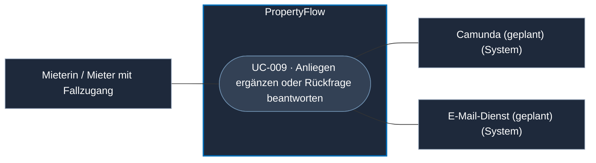
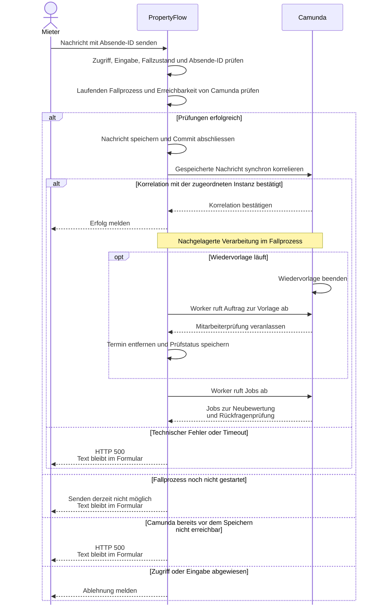

# Use Case: Mieteranliegen ergänzen oder Rückfrage beantworten

## Overview

**Use Case ID:** UC-009  
**Use Case Name:** Mieteranliegen ergänzen oder Rückfrage beantworten  
**Primary Actor:** Mieterin / Mieter mit Zugang zum Fall  
**Supporting Actors:** Camunda für die synchrone Korrelation und die nachgelagerte Verarbeitung, E-Mail-Dienst für die Benachrichtigung 
**Goal:** Eine Ergänzung oder Antwort im bestehenden Fall hinterlegen und die bestätigte Übergabe an den Fallprozess erkennen. 
**Status:** Schreiben über Fall-Link und Mieterkonto ist in der lokalen Demo mit Fällen im Arbeitsspeicher umgesetzt. Dauerhafte Speicherung, fachliche Camunda-Verarbeitung und Fallbenachrichtigung sind vorgesehen.

Für den Zielablauf setzen Ergänzungen einen laufenden Fallprozess und erreichbares Camunda voraus. PropertyFlow meldet den Erfolg erst nach Speicherung und bestätigter Korrelation. Bei technischem Fehler oder Timeout erhält der Browser `500` und behält den Text im Formular. [SS-003](../architecture/schnittstellenentwurf-block-3.md#ss-003--camunda-integrationsvertrag)

**Fachliche Grundlage:** [UI1](../frontend/ansicht-01-mieter-fallansicht.md#44-ablauf-beim-senden-einer-weiteren-nachricht), [ZUG-04](../specifications/fallzugriff-und-sicherheit.md#zug-04-rechte-und-vertrauensgrenzen), [KOM-03/04](../specifications/fallkommunikation.md#kom-03-asynchrone-fallkommunikation) und [DRING-05](../specifications/dringlichkeitsbewertung.md#dring-05-erst--und-neubewertung-im-prozess).

## Use-Case-Diagramm

## Preconditions

- Der Fall ist aktiv. Die Person besitzt einen gültigen persönlichen Fall-Link oder ein berechtigtes Mieterkonto gemäss [UC-008](UC-008-eigenen-fall-einsehen.md).
- Beim Absenden läuft der zugeordnete Fallprozess und Camunda ist erreichbar.

## Main Success Scenario

1. Der Mieter erfasst eine Ergänzung oder Antwort und wählt «Nachricht senden».
2. PropertyFlow prüft die Berechtigung, die Eingabe, die Absende-ID und den Fallzustand. Der Dienst nimmt die Nachricht erst an, wenn der zugeordnete Fallprozess läuft und Camunda erreichbar ist. Er speichert sie als externe Mieternachricht beim bestehenden Fall.
3. Nach dem Commit übergibt PropertyFlow den Eingang der gespeicherten Nachricht an den bestehenden Camunda-Fallprozess und wartet synchron auf die Bestätigung der Korrelation mit der zugeordneten Instanz. Erst danach meldet PropertyFlow dem Browser Erfolg.
4. Bei laufender Wiedervorlage hebt Camunda sie nach der Korrelation auf und veranlasst sofort die Mitarbeiterprüfung. Die Browserantwort kann bereits erfolgen, während PropertyFlow den neuen Fallstand noch speichert. Die Bestätigungs-E-Mail folgt nachgelagert. [UC-013](UC-013-wiedervorlage-verwalten.md) · [BEN-01/03](../specifications/benachrichtigungen-und-zustellung.md#ben-01-auslöser-und-ausschlüsse)
5. Die Dringlichkeitsneubewertung und die Einzelprüfung offener Rückfragen folgen den Regeln des aktuellen Fallprozesses. Nur eindeutig beantwortete Fragen gelten als erledigt. Eine bereits laufende Mitarbeiterprüfung hat Vorrang gemäss FALL-06. [UC-016](UC-016-dringlichkeit-automatisch-bewerten.md) · [UC-017](UC-017-mieterantwort-auswerten.md)

## Sequenzdiagramm · Speichern und Verarbeitung auslösen

## Alternative Flows

- **Eingabe ungültig oder Zugriff verweigert.** PropertyFlow weist die Aktion ohne Speicherung zurück.
- **Nachricht zu lang.** PropertyFlow weist die Nachricht ohne Speicherung ab. Der vollständige Text bleibt mit einem Hinweis zur Grenze von 2’000 Zeichen im Formular.
- **Fallprozess noch nicht gestartet.** PropertyFlow weist die Nachricht ohne Speicherung ab und meldet, dass das Senden vorübergehend nicht möglich ist. Der Text bleibt im Formular und kann später erneut gesendet werden.
- **Camunda bei der Vorprüfung nicht erreichbar.** PropertyFlow antwortet mit `500`. Die Nachricht bleibt ungespeichert, der Text bleibt im Formular.
- **Technischer Fehler oder Timeout bei der Korrelation nach dem Commit.** PropertyFlow antwortet mit `500`. Der vollständige Text bleibt im Formular und der bereits gespeicherte Verlaufseintrag bleibt bestehen. Bei einem Timeout kann Camunda die Nachricht bereits korreliert haben.
- **Fall zwischenzeitlich abgeschlossen.** PropertyFlow weist neue Nachrichten zurück. Erkennt UI1 den bestätigten Abschluss, blendet sie die Eingabe aus und verwirft den ungesendeten Text. [KOM-04](../specifications/fallkommunikation.md#kom-04-nachrichtensperre-nach-fallabschluss)
- **Ausgang der Anfrage unklar.** Der Mieter kann denselben Inhalt mit derselben Absende-ID wiederholen. Ein geänderter Inhalt mit derselben bereits erfolgreich verwendeten ID führt zum Konflikt. [KOM · Wiederholung](../specifications/fallkommunikation.md#wiederholung-einer-nachricht-mit-abweichendem-inhalt--präzisierung-vom-13102026)
- **Auswertung ausstehend oder fehlgeschlagen.** Die gespeicherte Nachricht bleibt im Verlauf. Eine nicht zuverlässig beantwortete Rückfrage bleibt offen.

## Postconditions

- Bei bestätigtem Erfolg enthält der bestehende Fall genau einen Verlaufseintrag für die Nachricht. Camunda hat den Eingang mit der zugeordneten Fallprozessinstanz korreliert.

## Business Rules und Prüfkriterien

- **UC-009-BR-001:** PropertyFlow bestimmt Fall und Absender serverseitig. Mieternachrichten sind extern. Ein aktiver Fall kann auch ohne offene Rückfrage ergänzt werden. [ZUG-04](../specifications/fallzugriff-und-sicherheit.md#zug-04-rechte-und-vertrauensgrenzen) · [KOM-01](../specifications/fallkommunikation.md#kom-01-interne-und-externe-nachrichten)
- **UC-009-BR-002:** Nach der Korrelation einer während der Wiedervorlage gespeicherten Mieternachricht veranlasst Camunda sofort die Mitarbeiterprüfung gemäss FALL-11. Der Fallprozess wartet dafür weder auf den Termin noch auf das Auswertungsergebnis. Manuelle Dringlichkeitseinstufungen behalten Vorrang. [FALL-11](../specifications/fallverwaltung.md#fall-11-wiedervorlage) · [DRING-06](../specifications/dringlichkeitsbewertung.md#dring-06-manuelle-anpassung)
- **UC-009-BR-003:** PropertyFlow setzt für die Annahme einer neuen Ergänzung oder Antwort serverseitig einen laufenden Fallprozess und erreichbares Camunda voraus. [SS-003](../architecture/schnittstellenentwurf-block-3.md#ss-003--camunda-integrationsvertrag)
- **UC-009-BR-004:** Eine neue Ergänzung oder Antwort umfasst höchstens 2’000 UTF-16-Codeeinheiten gemäss [KOM-03](../specifications/fallkommunikation.md#längengrenze-für-mieternachrichten).
- **UC-009-AK-01:** Eine Nachricht senden und mit derselben Absende-ID identisch wiederholen. Der Verlauf enthält genau einen Eintrag. Ein abweichender Inhalt mit derselben ID wird zurückgewiesen.
- **UC-009-AK-02:** Während einer Wiedervorlage auf zwei offene Fragen antworten und nur eine davon eindeutig beantworten. Sobald Camunda den gespeicherten Eingang verarbeitet, entfällt der Termin und der Fall erhält «Mitarbeiterprüfung erforderlich», auch bei verzögerter Auswertung. Nach fachlich zulässiger Übernahme der Auswertung ist genau die beantwortete Frage erledigt.
- **UC-009-AK-03:** Eine Ergänzung vor dem Prozessstart absenden. In einem separaten Durchlauf mit laufendem Fallprozess Camunda bereits vor dem Absenden abschalten und `500` prüfen. Bei beiden Versuchen bleibt der Verlauf unverändert und der Text im Formular. Sobald der Fallprozess läuft und Camunda erreichbar ist, sendet der Mieter denselben Text erneut. Nach bestätigter Korrelation enthält der Verlauf genau einen neuen Eintrag.
- **UC-009-AK-04:** Bei einem laufenden Fallprozess eine Ergänzung mit 2’001 UTF-16-Codeeinheiten absenden. Das Formular zeigt den vollständigen Text und einen Längenhinweis. Der Verlauf bleibt unverändert. Auf 2’000 Codeeinheiten kürzen und erneut senden. Der Verlauf enthält genau einen neuen Eintrag. [KOM-AK-12](../specifications/fallkommunikation.md#kom-ak-12--längengrenze-für-mieternachrichten)
- **UC-009-AK-05:** Die Bestätigung der Camunda-Korrelation nach dem Commit zurückhalten. Der Browser erhält erst nach der Bestätigung eine Erfolgsmeldung. In separaten Durchläufen einen technischen Fehler und einen Timeout auslösen. Beide führen zu `500`, der vollständige Text bleibt im Formular und der bereits gespeicherte Verlaufseintrag bleibt erhalten.
