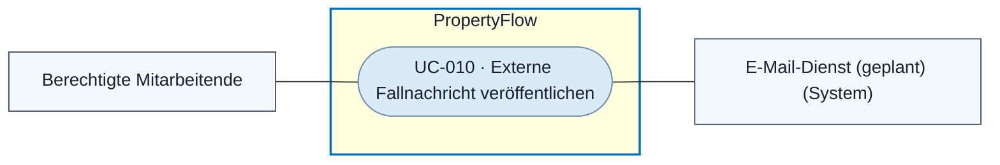
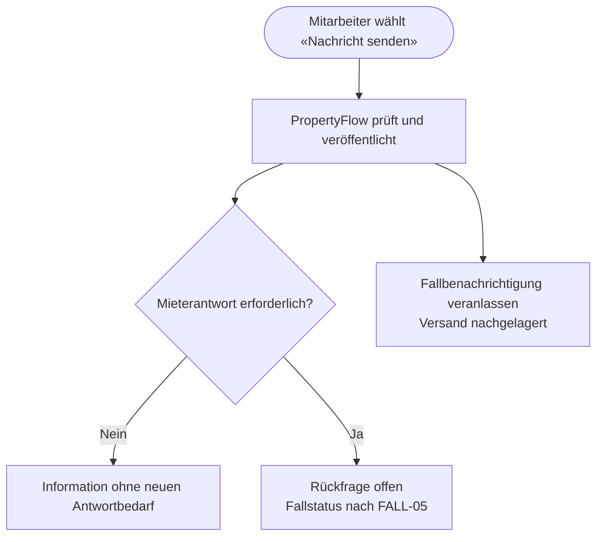

# Use Case: Externe Fallnachricht veröffentlichen

## Overview

**Use Case ID:** UC-010  
**Use Case Name:** Externe Fallnachricht veröffentlichen  
**Primary Actor:** Berechtigte Person der Immobilienbewirtschaftung  
**Supporting Actor:** E-Mail-Dienst für die nachgelagerte Fallbenachrichtigung  
**Goal:** Eine Information oder gezielte Rückfrage für den Mieter im Fallverlauf veröffentlichen.  
**Status:** Veröffentlichung und Antwortbedarf sind in der lokalen Demo mit Fällen im Arbeitsspeicher umgesetzt. Dauerhafte Speicherung, Fallbenachrichtigung und Camunda-Abstimmung sind vorgesehen.

**Fachliche Grundlage:** [KOM-01](../specifications/fallkommunikation.md#kom-01-interne-und-externe-nachrichten), [FALL-05](../specifications/fallverwaltung.md#fall-05-fachlicher-lebenszyklus), [BEN-01](../specifications/benachrichtigungen-und-zustellung.md#ben-01-auslöser-und-ausschlüsse) und [UI3](../frontend/ansicht-03-mitarbeiter-falldetail.md#kommunikation-und-verlauf).

## Use-Case-Diagramm

## Preconditions

- Die Person ist als Mitarbeiter angemeldet und hat den aktiven Fall geöffnet. [ZUG-04 · Rollen und Zusatzrechte](../specifications/fallzugriff-und-sicherheit.md#rollen-und-zusatzrechte) · [UC-006](UC-006-mitarbeiter-anmelden.md) · [UC-003](UC-003-mieteranliegen-details-anzeigen.md)

## Main Success Scenario

1. Der Mitarbeiter verfasst die Nachricht selbst oder prüft einen Vorschlag aus [UC-004](UC-004-ki-analyse-durchfuehren.md).
2. Er belässt «Intern» ausgeschaltet, setzt bei einer Rückfrage «Mieterantwort erforderlich» und wählt bewusst «Nachricht senden».
3. PropertyFlow prüft die Mitarbeiterberechtigung, den Fallzustand, die Eingabe und die Absende-ID. Der Dienst speichert und veröffentlicht die Nachricht mit der gewählten Kennzeichnung.
4. Die Nachricht erscheint im Mitarbeiter- und Mieterfallverlauf. Bei einer Rückfrage führt der fachliche Ablauf zu «Wartet auf Mieterantwort», soweit der aktuelle Fallstand dies nach FALL-05 zulässt.
5. PropertyFlow veranlasst die E-Mail-Benachrichtigung. Der Versand folgt der Veröffentlichung. [UC-019](UC-019-fallbenachrichtigung-zustellen.md)

## Flussdiagramm · Information oder Rückfrage veröffentlichen

## Alternative Flows

- **Speicherung fehlgeschlagen oder Ausgang unklar.** PropertyFlow bestätigt keinen unbelegten Erfolg. Text und Auswahl bleiben für eine sichere Wiederholung erhalten. [UI3](../frontend/ansicht-03-mitarbeiter-falldetail.md#rückmeldung-nach-senden-oder-memo-speicherung)
- **Fall geschlossen oder Berechtigung fehlt.** Der Dienst lehnt das Veröffentlichen ab. [KOM-04](../specifications/fallkommunikation.md#kom-04-nachrichtensperre-nach-fallabschluss)
- **Vorrangiger Prüfbedarf.** Die veröffentlichte Rückfrage bleibt offen und der bestehende Prüfstatus bleibt gemäss FALL-05 massgeblich.

## Postconditions

- Die Nachricht ist für die berechtigten Personen sichtbar. Bei gesetztem Antwortbedarf kann der Mieter gemäss [UC-009](UC-009-mieteranliegen-ergaenzen.md) antworten.

## Business Rules und Prüfkriterien

- **UC-010-BR-001:** Die Veröffentlichung erfordert die ausdrückliche Sendeaktion. Der Mitarbeiter bestimmt den Antwortbedarf. Eine Informationsnachricht hebt keine bereits offene Rückfrage auf. [KOM-01](../specifications/fallkommunikation.md#antwortbedarf-einer-externen-mitarbeiternachricht)
- **UC-010-BR-002:** Die erfolgreiche Speicherung veranlasst den Benachrichtigungsauftrag. Wiederholungen derselben Operation erzeugen weder einen weiteren Eintrag noch einen zusätzlichen Auftrag für dasselbe Ereignis. [BEN-03](../specifications/benachrichtigungen-und-zustellung.md#ben-03-speicherung-und-zuverlässige-übergabe)
- **UC-010-AK-01:** Eine Information und danach eine Rückfrage veröffentlichen. Beide erscheinen im Mieterfallverlauf. Der Antwortbedarf ist nur an der Rückfrage erkennbar.
- **UC-010-AK-02:** Dieselbe Sendeoperation wiederholen und einen vorübergehenden Mailausfall auslösen. Die veröffentlichte Nachricht bleibt sichtbar und für die Wiederholung entsteht kein zusätzlicher Versandauftrag.
