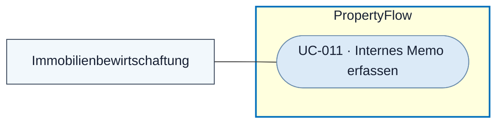

# Use Case: Internes Memo erfassen

## Overview

**Use Case ID:** UC-011  
**Use Case Name:** Internes Memo erfassen  
**Primary Actor:** Berechtigte Person der Immobilienbewirtschaftung  
**Goal:** Eine interne Abklärung, fachliche Prüfung oder Massnahme am Fall dokumentieren.  
**Status:** Das Speichern und Anzeigen von Mitarbeitermemos ist in der lokalen Demo mit Fällen im Arbeitsspeicher umgesetzt. Dauerhafte Speicherung und persönliche Audit-Zuordnung sind Teil des Zielablaufs.

**Fachliche Grundlage:** [KOM-01](../specifications/fallkommunikation.md#kom-01-interne-und-externe-nachrichten), [KOM-02](../specifications/fallkommunikation.md#kom-02-llm-kommunikation-ohne-interne-memos), [KOM-04](../specifications/fallkommunikation.md#kom-04-nachrichtensperre-nach-fallabschluss) und [UI3](../frontend/ansicht-03-mitarbeiter-falldetail.md#kommunikation-und-verlauf).

## Use-Case-Diagramm

## Preconditions

- Die Person ist als Mitarbeiter angemeldet und hat den aktiven Fall geöffnet. [ZUG-04 · Rollen und Zusatzrechte](../specifications/fallzugriff-und-sicherheit.md#rollen-und-zusatzrechte) · [UC-006](UC-006-mitarbeiter-anmelden.md) · [UC-003](UC-003-mieteranliegen-details-anzeigen.md)

## Main Success Scenario

1. Der Mitarbeiter schaltet «Intern» ein, erfasst den Text und wählt «Memo speichern».
2. PropertyFlow prüft Mitarbeiterberechtigung, Fallzustand, Eingabe und Absende-ID. Der Dienst speichert das Memo mit interner Sichtbarkeit, Absender und Zeitpunkt.
3. Der Mitarbeiter sieht den bestätigten Eintrag im internen Verlauf. Die Oberfläche leert die Eingabe und setzt die Auswahl zurück.

## Alternative Flows

- **Leere Eingabe, fehlende Berechtigung oder abgeschlossener Fall.** Der Dienst weist die Aktion ohne neuen Eintrag zurück.
- **Speicherung fehlgeschlagen oder Ausgang unklar.** Text und Auswahl bleiben bis zur bestätigten Speicherung erhalten. Eine identische Wiederholung mit derselben Absende-ID kann den ursprünglichen Erfolg bestätigen. [KOM · Wiederholung](../specifications/fallkommunikation.md#wiederholung-einer-nachricht-mit-abweichendem-inhalt--präzisierung-vom-13102026)
- **Autorisiertes Systemmemo.** Im Zielablauf kann eine berechtigte Systemkomponente denselben fachlichen Dienst nutzen. Die Systemherkunft wird zusammen mit Zeitpunkt und Sichtbarkeit nachvollziehbar gespeichert. [KOM-01](../specifications/fallkommunikation.md#kom-01-interne-und-externe-nachrichten)

## Postconditions

- Das Memo steht im berechtigten internen Verlauf. Der bisherige Fallstatus und offener Prüfbedarf bleiben durch die Memo-Speicherung allein unverändert.

## Business Rules und Prüfkriterien

- **UC-011-BR-001:** Memos bleiben ausschliesslich intern. Sie lösen keine Mieterbenachrichtigung aus und werden weder direkt noch über systemseitige Ableitungen in den Kontext der KI-Kommunikationsformulierung übernommen. [KOM-02](../specifications/fallkommunikation.md#kom-02-llm-kommunikation-ohne-interne-memos) · [BEN-01](../specifications/benachrichtigungen-und-zustellung.md#ben-01-auslöser-und-ausschlüsse)
- **UC-011-BR-002:** Ein Memo setzt keinen Mieterantwortbedarf. Die Schreibsperre abgeschlossener Fälle gilt für Mitarbeitende und Systemkomponenten. [KOM-04](../specifications/fallkommunikation.md#kom-04-nachrichtensperre-nach-fallabschluss)
- **UC-011-AK-01:** Ein Memo speichern und den Fall als Mitarbeiter und als Mieter aufrufen. Nur die Mitarbeitersicht enthält Memo und Metadaten. Die Speicherung allein veranlasst keine Fallbenachrichtigung und ändert den Status nicht.
- **UC-011-AK-02:** Eine identische erfolgreiche Memo-Speicherung wiederholen. Es bleibt bei einem Eintrag. Einen neuen Memo-Schreibversuch nach Fallabschluss ausführen. Der Dienst weist ihn zurück.
