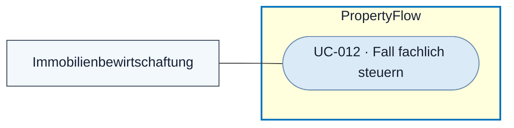

# Use Case: Fall fachlich steuern

## Overview

**Use Case ID:** UC-012  
**Use Case Name:** Fall fachlich steuern  
**Primary Actor:** Mitarbeitende der Immobilienbewirtschaftung  
**Goal:** Den Bearbeitungsstatus, die Dringlichkeit oder die Objekt-/Wohnungszuordnung eines aktiven Falls fachlich begründet anpassen.  
**Status:** Die drei manuellen Aktionen sind in der lokalen Frontend-Demo vorhanden. Dauerhafte Speicherung, Stammdatenanbindung und Abstimmung mit dem Fallprozess gehören zum Zielbild.

## Use-Case-Diagramm

## Preconditions

- Die Person ist persönlich angemeldet und hat die Mitarbeiterrolle. Der aktive Fall ist im Mitarbeiterdetail geöffnet. [UC-003](UC-003-mieteranliegen-details-anzeigen.md) · [ZUG-04 · Rollen und Zusatzrechte](../specifications/fallzugriff-und-sicherheit.md#rollen-und-zusatzrechte)

## Main Success Scenario

1. Der Mitarbeiter prüft den aktuellen Fallstand und öffnet die gewünschte Aktion in UI3.
2. Er wählt einen zulässigen aktiven Bearbeitungsstatus oder eine der vier Dringlichkeitsstufen. Bei der Objektzuordnung wählt er einen Vorschlag oder gibt die Zuordnung frei ein. Für Status und Dringlichkeit kann er eine interne Begründung erfassen.
3. Der Mitarbeiter bestätigt die Änderung. PropertyFlow prüft die Rolle, den aktuellen Fallstand und die Eingabe. Bei einer strukturierten Objektzuordnung prüft der Dienst zusätzlich die Zusammengehörigkeit von Objekt und Wohnung.
4. PropertyFlow speichert die Änderung mit dem fachlichen Nachweis. Fallübersicht und Falldetail zeigen den bestätigten Stand. Sichtbare Status- und wirksame Dringlichkeitsänderungen lösen eine Benachrichtigung nach BEN-01 aus.

## Alternative Flows

- Bei Abbruch, unzulässiger Eingabe oder fehlender Berechtigung bleibt der bisherige Stand erhalten.
- Bei einem Versionskonflikt lädt UI3 den aktuellen Stand und zeigt den Konflikt. Nachrichteneingabe und laufende KI-Formulierung bleiben erhalten.
- Für Wiedervorlage, Abschluss und Wiedereröffnung verwendet der Mitarbeiter die jeweiligen Aktionen. [UC-013](UC-013-wiedervorlage-verwalten.md) · [UC-014](UC-014-fall-abschliessen.md) · [UC-015](UC-015-fall-wiedereroeffnen.md)

## Postconditions

- Der bestätigte Wert und seine Änderungshistorie sind nachvollziehbar. Die ursprüngliche Objekt-/Wohnungsangabe des Mieters bleibt erhalten. PropertyFlow stimmt Statusänderungen mit dem führenden Fallprozess ab.

## Business Rules und Prüfkriterien

- **UC-012-BR-001** Der bewusste Wechsel auf «In Bearbeitung» übernimmt die bisher offenen Prüfgründe als berücksichtigt in den internen Änderungsnachweis. Neue Erkenntnisse können erneut eine Prüfung erfordern. [FALL-06](../specifications/fallverwaltung.md#fall-06-fachlicher-status-und-technischer-workflow)
- **UC-012-BR-002** Eine manuelle Dringlichkeitsstufe hat Vorrang vor automatischen Ergebnissen. Eine Begründung bleibt intern. [DRING-06](../specifications/dringlichkeitsbewertung.md#dring-06-manuelle-anpassung)
- **UC-012-BR-003** Eine bestätigte Objektzuordnung klärt den zugehörigen Prüfhinweis. Kontaktadresse, Fall-Link und andere Prüfgründe bleiben erhalten. [FALL-04](../specifications/fallverwaltung.md#fall-04-ursprungsdaten-und-zuordnung)
- **UC-012-AK-01** Nach einer bestätigten Zuordnung zeigen UI2 und UI3 denselben Wert. Die ursprüngliche Angabe bleibt in der Detailansicht nachvollziehbar.
- **UC-012-AK-02** Zwei Mitarbeitende bearbeiten dieselbe Einstellung parallel. Der zweite Speicherversuch auf veraltetem Stand lässt den bestätigten Wert und seine Historie unverändert.
- **UC-012-AK-03** Nach manueller Einstufung wird ein abweichendes automatisches Ergebnis verarbeitet. Die manuelle Stufe bleibt wirksam.
