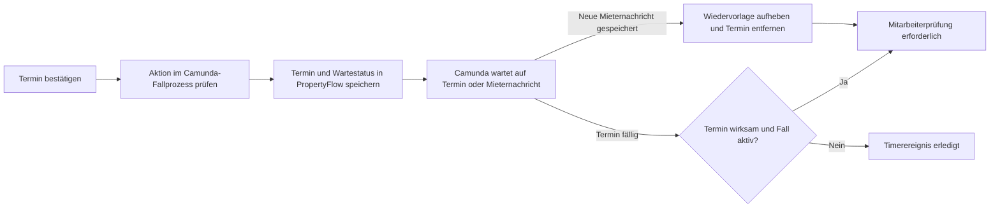

# Use Case: Wiedervorlage verwalten

## Overview

**Use Case ID:** UC-013  
**Use Case Name:** Wiedervorlage verwalten  
**Primary Actor:** Mitarbeitende der Immobilienbewirtschaftung  
**Supporting Actor:** Camunda-Fallprozess  
**Goal:** Einen aktiven Fall zu einem gewählten Termin erneut prüfen oder die Bearbeitung vorher wieder aufnehmen.  
**Status:** Setzen, Ändern und Löschen sind in der lokalen Frontend-Demo vorhanden. Dauerhafte Speicherung und Camunda-Timer gehören zum Zielbild.

## Use-Case-Diagramm

## Preconditions

- Der Fall ist aktiv und die Person ist mit Mitarbeiterrolle angemeldet. Der führende Camunda-Fallprozess ist erreichbar und gibt die gewählte Aktion frei. [ZUG-04 · Rollen und Zusatzrechte](../specifications/fallzugriff-und-sicherheit.md#rollen-und-zusatzrechte) · [FALL-06](../specifications/fallverwaltung.md#fall-06-fachlicher-status-und-technischer-workflow)

## Main Success Scenario

1. Der Mitarbeiter gibt eine Anzahl Tage oder ein festes Datum ein und bestätigt den Termin. Eine interne Begründung ist optional.
2. PropertyFlow prüft Berechtigung, Eingabe und Fallstand und übermittelt die Aktion an Camunda. Camunda veranlasst, dass der PropertyFlow-Dienst Termin und Status «Wartet auf Wiedervorlage» speichert. UI3 und die sortierbare Spalte in UI2 zeigen den bestätigten Termin.
3. Camunda führt die Wartezeit als Timer im bestehenden Fallprozess. Geht eine neue Mieternachricht ein, endet die Wartezeit gemäss dem Alternativablauf.
4. Bei Fälligkeit veranlasst Camunda die erneute Prüfung. PropertyFlow prüft, ob der Termin noch wirksam und der Fall aktiv ist, und speichert dann «Mitarbeiterprüfung erforderlich».

## Alternative Flows

- **Termin ändern oder löschen.** Eine Änderung ersetzt den Termin und führt zu «Wartet auf Wiedervorlage». Löschen beendet die Wartezeit und führt zu «In Bearbeitung». Für beide Aktionen gelten dieselben Prüfungen und die optionale interne Begründung.
- **Neue Mieternachricht.** Sobald Camunda den Eingang einer neu gespeicherten Mieternachricht im bestehenden Fallprozess verarbeitet, beendet es die laufende Wiedervorlage und veranlasst sofort «Mitarbeiterprüfung erforderlich». PropertyFlow entfernt den aktuellen Termin und hält den bisherigen Termin und den Auslöser in der Historie fest. Die Mitarbeiterprüfung beginnt unabhängig vom Termin und von der automatischen Auswertung. [UC-009](UC-009-mieteranliegen-ergaenzen.md) · [FALL-11](../specifications/fallverwaltung.md#fall-11-wiedervorlage)
- **Abschluss oder überholter Timer.** Der Abschluss beendet die offene Wiedervorlage. Ein überholtes oder wiederholtes Timerereignis löst keine weitere Wiedervorlage aus.
- **Konflikt oder Abbruch.** Der bestätigte Termin, Status und Änderungsnachweis bleiben erhalten.
- **Camunda nicht erreichbar.** PropertyFlow übernimmt keine Mitarbeiteränderung der Wiedervorlage. Der zuletzt bestätigte Stand bleibt lesbar.

## Postconditions

- Termin und Status entsprechen der bestätigten Aktion oder dem wirksamen Ereignis. Die Änderung bleibt mit Zeitpunkt und Auslöser nachvollziehbar.

## Business Rules und Prüfkriterien

- **UC-013-BR-001** «Wartet auf Wiedervorlage» setzt einen gespeicherten Termin voraus. Setzen, Ändern und Löschen halten bereits berücksichtigte Prüfgründe intern fest und lassen offene Mieterfragen bestehen. [FALL-11](../specifications/fallverwaltung.md#fall-11-wiedervorlage)
- **UC-013-BR-002** Die optionale Begründung wird mit der bestätigten Aktion intern gespeichert. [FALL-11](../specifications/fallverwaltung.md#fall-11-wiedervorlage)
- **UC-013-AK-01** Nach Setzen und Ändern stimmt das Datum in UI2 und UI3 überein. Nach Löschen steht der Fall auf «In Bearbeitung».
- **UC-013-AK-02** Ein wiederholter Timerablauf oder ein Ablauf nach Terminänderung, Löschung, Aufhebung durch Mieternachricht oder Fallabschluss erzeugt keine zusätzliche Statusänderung. Treffen Nachricht und Timer nahezu gleichzeitig ein, wird der Fall genau einmal zur Mitarbeiterprüfung vorgelegt.
- **UC-013-AK-03** Kurz vor Fälligkeit eine neue Mieternachricht ohne dringlichen Inhalt speichern und die automatische Auswertung zurückhalten. Camunda hebt die Wiedervorlage sofort auf. PropertyFlow speichert «Mitarbeiterprüfung erforderlich» und entfernt den aktuellen Termin in UI2 und UI3. Die Historie zeigt den bisherigen Termin und den Auslöser. Eine Wiederholung derselben Nachricht löst keine weitere Vorlage aus.
