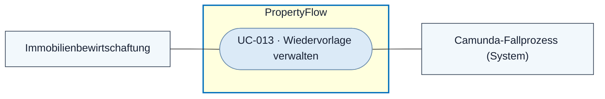
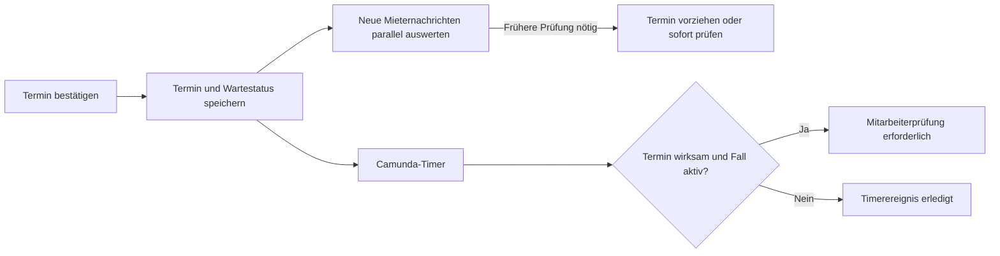

# Use Case: Wiedervorlage verwalten

## Overview

**Use Case ID:** UC-013  
**Use Case Name:** Wiedervorlage verwalten  
**Primary Actor:** Mitarbeitende der Immobilienbewirtschaftung  
**Supporting Actor:** Camunda-Fallprozess  
**Goal:** Einen aktiven Fall zu einem gewählten Termin erneut prüfen oder die Bearbeitung vorher wieder aufnehmen.  
**Status:** Setzen, Ändern und Löschen sind in der lokalen Frontend-Demo vorhanden. Dauerhafte Speicherung und Camunda-Timer gehören zum Zielbild.

## Use-Case-Diagramm

## Preconditions

- Der Fall ist aktiv und die Person ist mit Mitarbeiterrolle angemeldet. Für den automatischen Ablauf ist dem Fall ein führender Camunda-Prozess zugeordnet. [ZUG-04 · Rollen und Zusatzrechte](../specifications/fallzugriff-und-sicherheit.md#rollen-und-zusatzrechte) · [FALL-06](../specifications/fallverwaltung.md#fall-06-fachlicher-status-und-technischer-workflow)

## Main Success Scenario

1. Der Mitarbeiter gibt eine Anzahl Tage oder ein festes Datum ein und bestätigt den Termin. Eine interne Begründung ist optional.
2. PropertyFlow prüft Berechtigung, Eingabe und Fallstand und speichert Termin und Status «Wartet auf Wiedervorlage». UI3 und die sortierbare Spalte in UI2 zeigen den Termin.
3. Camunda führt die Wartezeit als Timer im bestehenden Fallprozess. Neue Mieternachrichten werden parallel ausgewertet.
4. Bei Fälligkeit prüft PropertyFlow, ob der Termin noch wirksam und der Fall aktiv ist. Der Fall erhält «Mitarbeiterprüfung erforderlich».

## Alternative Flows

- **Termin ändern oder löschen.** Eine Änderung ersetzt den Termin und führt zu «Wartet auf Wiedervorlage». Löschen beendet die Wartezeit und führt zu «In Bearbeitung». Für beide Aktionen gelten dieselben Prüfungen und die optionale interne Begründung.
- **Neue Erkenntnisse.** Die Auswertung kann den Termin vorziehen oder bei unmittelbarem Prüfbedarf sofort eine Mitarbeiterprüfung auslösen. Ohne früheren Handlungsbedarf bleibt der Termin bestehen.
- **Abschluss oder überholter Timer.** Der Abschluss beendet die offene Wiedervorlage. Ein überholtes oder wiederholtes Timerereignis löst keine weitere Wiedervorlage aus.
- **Konflikt oder Abbruch.** Der bestätigte Termin, Status und Änderungsnachweis bleiben erhalten.

## Postconditions

- Termin und Status entsprechen der bestätigten Aktion oder dem wirksamen Ereignis. Die Änderung bleibt mit Zeitpunkt und Auslöser nachvollziehbar.

## Business Rules und Prüfkriterien

- **UC-013-BR-001** «Wartet auf Wiedervorlage» setzt einen gespeicherten Termin voraus. Setzen, Ändern und Löschen halten bereits berücksichtigte Prüfgründe intern fest und lassen offene Mieterfragen bestehen. [FALL-11](../specifications/fallverwaltung.md#fall-11-wiedervorlage-und-parallele-nachrichtenverarbeitung)
- **UC-013-BR-002** Die optionale Begründung wird mit der bestätigten Aktion intern gespeichert. [FALL-11](../specifications/fallverwaltung.md#fall-11-wiedervorlage-und-parallele-nachrichtenverarbeitung)
- **UC-013-AK-01** Nach Setzen und Ändern stimmt das Datum in UI2 und UI3 überein. Nach Löschen steht der Fall auf «In Bearbeitung».
- **UC-013-AK-02** Ein wiederholter Timerablauf oder ein Ablauf nach Terminänderung, Löschung oder Fallabschluss erzeugt keine zusätzliche Statusänderung.
- **UC-013-AK-03** Eine neue Mieternachricht wird vor dem Termin verarbeitet. Ein früherer Termin oder eine sofortige Prüfung folgt nur aus entsprechendem neuem Handlungsbedarf.
