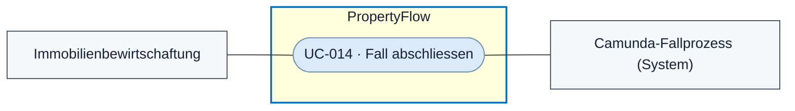
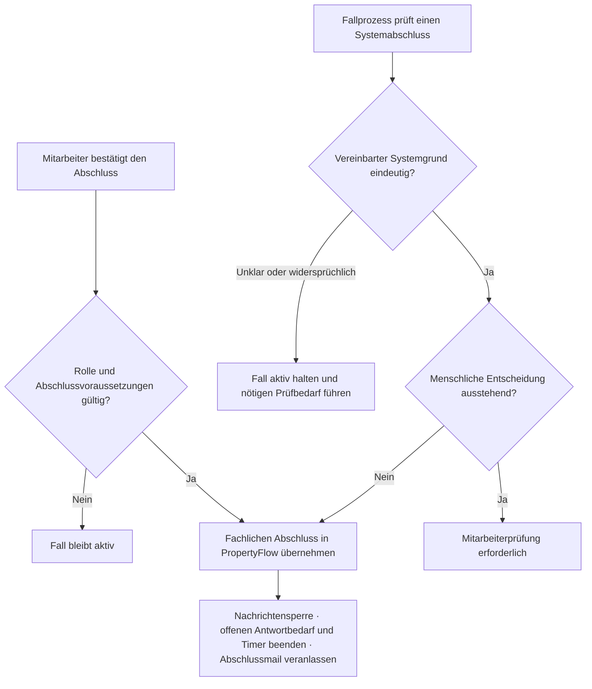

# Use Case: Fall abschliessen

## Overview

**Use Case ID:** UC-014  
**Use Case Name:** Fall abschliessen  
**Primary Actor:** Mitarbeitende der Immobilienbewirtschaftung  
**Supporting Actor:** PropertyFlow im Camunda-Fallprozess bei ausdrücklich vereinbarten Systemabschlüssen  
**Goal:** Einen aktiven Fall nachvollziehbar abschliessen, wenn für die Immobilienverwaltung kein weiterer Bearbeitungsbedarf besteht.  
**Status:** Der manuelle Abschluss ist in der lokalen Frontend-Demo vorhanden. Automatische Abschlüsse, dauerhafte Speicherung, Camunda-Abstimmung und Fallbenachrichtigungen gehören zum Zielbild.

## Use-Case-Diagramm

## Preconditions

- Der Fall ist aktiv. Für den manuellen Abschluss ist die handelnde Person angemeldet und hat die Mitarbeiterrolle. [ZUG-04 · Rollen und Zusatzrechte](../specifications/fallzugriff-und-sicherheit.md#rollen-und-zusatzrechte)

## Main Success Scenario

1. Der Mitarbeiter beurteilt den aktuellen Fall und wählt «Fall abschliessen» in UI3.
2. Er bestätigt den Abschluss im Dialog. PropertyFlow prüft Rolle, Fallstand und die geltenden fachlichen Voraussetzungen.
3. Nach fachlich vorgesehenem Abschluss und konsistenter Übernahme in PropertyFlow erhält der Fall «Abgeschlossen». PropertyFlow speichert Zeitpunkt, Quelle, handelnde Person und den festen internen Mitarbeitervermerk.
4. PropertyFlow beendet offene Wiedervorlagen und den offenen Mieterantwortbedarf, sperrt neue interne und externe Nachrichten und veranlasst die Abschluss-E-Mail.

## Alternative Flows

- **Behebung bestätigt.** Eine gespeicherte Mieternachricht bestätigt im Fallkontext eindeutig die Behebung und dass keine weitere Hilfe benötigt wird. Der zuständige Dienst prüft den Abschlussgrund und die menschlichen Entscheidungsgrenzen.
- **Kein Bearbeitungsbedarf der Verwaltung.** Eine hinterlegte Fachregel ordnet das konkrete Anliegen eindeutig der Eigenverantwortung des Mieters zu. Der zuständige Dienst prüft die Regel und den Fallkontext. Bei beiden Systemabschlüssen dokumentiert PropertyFlow den geprüften Grund und seine Grundlage.
- **Menschliche Entscheidung erforderlich.** Bei unklarer oder widersprüchlicher Einordnung oder ausstehender menschlicher Entscheidung bleibt der Fall aktiv. PropertyFlow führt den erforderlichen Prüfbedarf nach FALL-05 und FALL-10.
- **Abbruch oder Fehler.** Der bisherige Fallstand und offene Antwortbedarf bleiben erhalten. Eine zuvor bereits veröffentlichte Abschlussmitteilung bleibt im Verlauf.

## Flussdiagramm · Abschlusswege

## Postconditions

- Berechtigte Personen können den abgeschlossenen Fall und seine Historie weiterhin lesen. Offene Rückfragen enden durch den Abschluss und bleiben als solche im Verlauf nachvollziehbar. [KOM-04](../specifications/fallkommunikation.md#kom-04-nachrichtensperre-nach-fallabschluss)

## Business Rules und Prüfkriterien

- **UC-014-BR-001** Die serverseitig geprüften Abschlussgründe und die aktuell geltende Pflicht zur menschlichen Entscheidung bestimmen die Zulässigkeit des Abschlusses. [FALL-07](../specifications/fallverwaltung.md#fall-07-abschluss-und-zeit-danach) · [FALL-10](../specifications/fallverwaltung.md#fall-10-automatisierung-und-menschliche-freigabe)
- **UC-014-BR-002** Nach erfolgreichem Abschluss entsteht pro Abschluss ein logischer Mailauftrag. [BEN-05](../specifications/benachrichtigungen-und-zustellung.md#ben-05-fallabschluss-und-sicherheit)
- **UC-014-AK-01** Nach manuellem Abschluss sind der Abschlussnachweis und der Status gespeichert. Ein direkter Schreibaufruf für eine Nachricht oder ein Memo wird abgelehnt. Ein bestehender Fall-Link bleibt zum Lesen nutzbar.
- **UC-014-AK-02** Die beiden vereinbarten Systemgründe führen bei eindeutiger Prüfung zum Abschluss. Bei ausstehender menschlicher Entscheidung bleibt der Fall trotz Behebungsbestätigung aktiv.
- **UC-014-AK-03** Ein wiederholter Abschluss erzeugt weder einen zweiten Abschlussnachweis noch einen weiteren logischen Mailauftrag.
