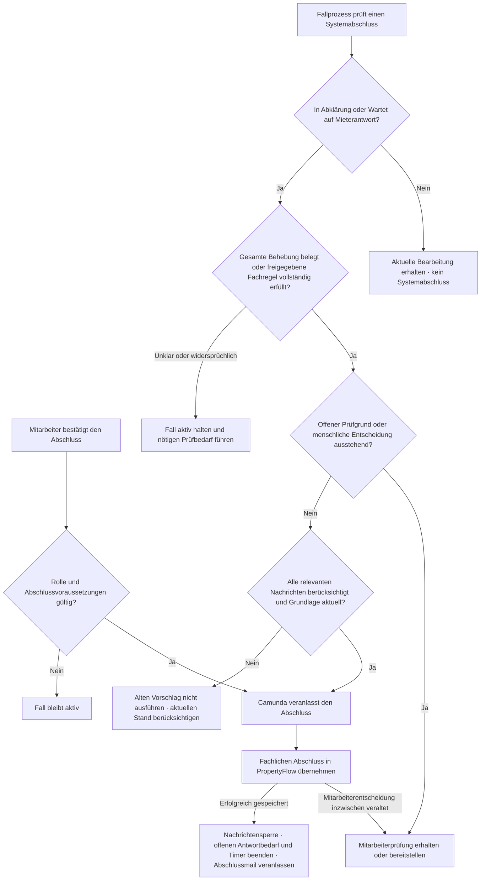

# Use Case: Fall abschliessen

## Overview

**Use Case ID:** UC-014  
**Use Case Name:** Fall abschliessen  
**Primary Actor:** Mitarbeitende der Immobilienbewirtschaftung  
**Supporting Actor:** Camunda-Fallprozess\
**Goal:** Einen aktiven Fall nachvollziehbar abschliessen, wenn für die Immobilienverwaltung kein weiterer Bearbeitungsbedarf besteht.  
**Status:** Der manuelle Abschluss ist in der lokalen Frontend-Demo vorhanden. Automatische Abschlüsse, dauerhafte Speicherung, Camunda-Abstimmung und Fallbenachrichtigungen gehören zum Zielbild.

## Use-Case-Diagramm

## Preconditions

- Der Fall ist aktiv. Für den Mitarbeiterabschluss ist die handelnde Person angemeldet und hat die Mitarbeiterrolle. Der erreichbare Camunda-Fallprozess gibt die Aktion frei. [ZUG-04 · Rollen und Zusatzrechte](../specifications/fallzugriff-und-sicherheit.md#rollen-und-zusatzrechte) · [FALL-06](../specifications/fallverwaltung.md#fall-06-fachlicher-status-und-technischer-workflow)

## Main Success Scenario

1. Der Mitarbeiter beurteilt den aktuellen Fall und wählt «Fall abschliessen» in UI3.
2. Er bestätigt den Abschluss im Dialog. PropertyFlow prüft Rolle, Fallstand und die geltenden fachlichen Voraussetzungen und übermittelt die Entscheidung an Camunda.
3. Camunda veranlasst den fachlichen Abschluss. Der PropertyFlow-Dienst prüft die bestätigte Entscheidungsgrundlage unmittelbar bei der Speicherung erneut und speichert «Abgeschlossen» mit Zeitpunkt, Quelle, handelnder Person und dem festen internen Mitarbeitervermerk.
4. PropertyFlow beendet offene Wiedervorlagen und den offenen Mieterantwortbedarf, sperrt neue interne und externe Nachrichten und veranlasst die Abschluss-E-Mail.

## Alternative Flows

- **Behebung bestätigt.** Eine gespeicherte Mieternachricht belegt eindeutig die bereits eingetretene Behebung des gesamten offenen Sachverhalts ohne weiteren Hilfebedarf. Vorläufige Besserung, angekündigte Massnahmen, Restschäden oder aktuelle Widersprüche genügen nicht. Die gemeinsamen Voraussetzungen und Beispiele stehen in [FALL-07](../specifications/fallverwaltung.md#regeln-für-den-automatischen-fallabschluss).
- **Kein Bearbeitungsbedarf der Verwaltung.** Eine ausdrücklich für Systemabschluss freigegebene, gültige Fachregel mit Kennung, Version und Geltungsbereich deckt das ganze Anliegen ab. Sämtliche Voraussetzungen sind belegt; keine Ausnahme, widersprüchliche Grundlage oder begründeter Mietereinwand liegt vor. Ohne passende Regel erfolgt kein automatischer Abschluss. Bei beiden Systemgründen gelten ausschliesslich «In Abklärung» oder «Wartet auf Mieterantwort», aktuelle Belege und keine offenen Prüfgründe gemäss [FALL-07](../specifications/fallverwaltung.md#regeln-für-den-automatischen-fallabschluss). PropertyFlow dokumentiert Grund, Belege und gegebenenfalls Regelreferenz; fehlender Verwaltungsbedarf behauptet keine Reparatur.
- **Menschliche Entscheidung erforderlich.** Bei unklarer oder widersprüchlicher Einordnung oder ausstehender menschlicher Entscheidung bleibt der Fall aktiv. PropertyFlow führt den erforderlichen Prüfbedarf nach FALL-05 und FALL-10.
- **Mitarbeiterprüfung läuft bereits.** Bei «Mitarbeiterprüfung erforderlich» ist jeder Systemabschluss gesperrt. Auch eine eindeutige Behebungsbestätigung oder ein ursprünglich vom System ausgelöster Prüfbedarf erlaubt keine Ausnahme. Nur eine bewusste Mitarbeiterentscheidung kann die Prüfung verlassen; die automatische Auswertung ergänzt ihre Grundlage. [FALL-06](../specifications/fallverwaltung.md#vorrang-einer-laufenden-mitarbeiterprüfung)
- **KI-Auswertung läuft noch.** Sie blockiert einen bewussten Mitarbeiterabschluss am aktuellen Fallstand einschliesslich neuer gespeicherter Mieternachrichten nicht. Nach erfolgreichem Abschluss bleiben verspätete Ergebnisse unwirksam. [FALL-07](../specifications/fallverwaltung.md#mitarbeiterabschluss-während-laufender-ki-auswertung)
- **Mitarbeiterentscheidung veraltet.** Vor User-Task-Abschluss wird die Aktion abgewiesen und dieselbe Aufgabe bleibt offen. Wird der Konflikt erst danach bei der fachlichen Abschlussspeicherung erkannt, führt Camunda zurück zur Mitarbeiterprüfung und stellt genau eine neue Aufgabe für den aktuellen Stand bereit. Alte Abschlussfreigabe und alter Aufgabenschlüssel gelten dafür nicht. Kein erfolgreicher Abschlussnachweis und kein Abschlussmailauftrag; der Fall bleibt aktiv. Ein technischer Speicherfehler allein löst diesen Rückweg nicht aus. [FALL-07](../specifications/fallverwaltung.md#mitarbeiterabschluss-während-laufender-ki-auswertung)
- **Abbruch oder Fehler.** Der bisherige Fallstand und offene Antwortbedarf bleiben erhalten. Eine zuvor bereits veröffentlichte Abschlussmitteilung bleibt im Verlauf.
- **Camunda nicht erreichbar.** Der bisherige Fallstand bleibt lesbar. Ein Abschluss wird erst nach Übernahme des durch Camunda veranlassten Übergangs als erfolgreich angezeigt.

## Flussdiagramm · Abschlusswege

## Postconditions

- Berechtigte Personen können den abgeschlossenen Fall und seine Historie weiterhin lesen. Offene Rückfragen enden durch den Abschluss und bleiben als solche im Verlauf nachvollziehbar. [KOM-04](../specifications/fallkommunikation.md#kom-04-nachrichtensperre-nach-fallabschluss)

## Business Rules und Prüfkriterien

- **UC-014-BR-001** Die serverseitig geprüften Abschlussgründe und die aktuell geltende Pflicht zur menschlichen Entscheidung bestimmen die Zulässigkeit des Abschlusses. [FALL-07](../specifications/fallverwaltung.md#fall-07-abschluss-und-zeit-danach) · [FALL-10](../specifications/fallverwaltung.md#fall-10-automatisierung-und-menschliche-freigabe)
- **UC-014-BR-002** Nach erfolgreichem Abschluss entsteht pro Abschluss ein logischer Mailauftrag. [BEN-05](../specifications/benachrichtigungen-und-zustellung.md#ben-05-fallabschluss-und-sicherheit)
- **UC-014-AK-01** Nach manuellem Abschluss sind der Abschlussnachweis und der Status gespeichert. Ein direkter Schreibaufruf für eine Nachricht oder ein Memo wird abgelehnt. Ein bestehender Fall-Link bleibt zum Lesen nutzbar.
- **UC-014-AK-02** Die beiden vereinbarten Systemgründe führen bei eindeutiger Prüfung zum Abschluss. Bei ausstehender menschlicher Entscheidung bleibt der Fall trotz Behebungsbestätigung aktiv.
- **UC-014-AK-03** Ein wiederholter Abschluss erzeugt weder einen zweiten Abschlussnachweis noch einen weiteren logischen Mailauftrag.
- **UC-014-AK-04** Beide Systemabschlussgründe bei bereits laufender Mitarbeiterprüfung prüfen, auch ohne weiteren FALL-10-Grund. Kein automatischer Abschluss ist zulässig. Dies gilt bei systemseitigem wie menschlichem Ursprung des Prüfbedarfs und bei einer Mitarbeiterprüfung, die erst nach Vorbereitung des automatischen Abschlusses begonnen hat. Ein bestätigter Mitarbeiterabschluss am aktuellen Fallstand bleibt möglich (FALL-AK-21).
- **UC-014-AK-05** Laufende KI-Auswertung, veraltete Aktion vor User-Task-Abschluss, Konflikt bei der späteren Abschlussspeicherung, wiederholte Konflikte und verspätete Ergebnisse gemäss FALL-AK-22 prüfen. Ein fachlicher Konflikt erzeugt keinen Abschluss; ein identischer bereits erfolgreicher Abschluss erzeugt beim Retry keine erneute Mitarbeiterprüfung.
- **UC-014-AK-06** Systemabschlüsse nach FALL-AK-23 bis FALL-AK-26 prüfen: zulässige Status, Behebung des gesamten Anliegens, gültige und vollständig belegte Fachregel, verbleibender Hilfebedarf, widersprechende beziehungsweise neue Nachrichten und wiederholte Ausführung. Die Klassifikation als möglicher Abschlussgrund allein ist keine Veröffentlichungsfreigabe für einen Antworttext.
