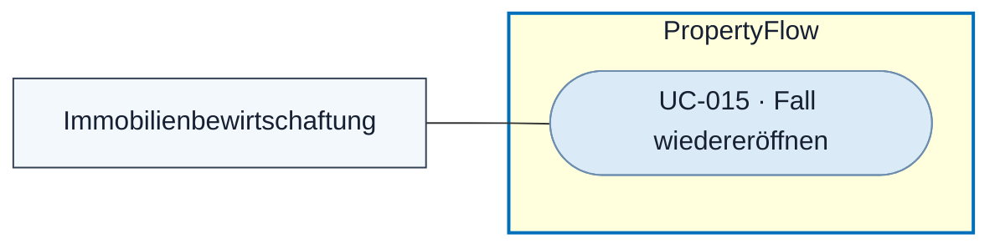

# Use Case: Fall wiedereröffnen

## Overview

**Use Case ID:** UC-015  
**Use Case Name:** Fall wiedereröffnen  
**Primary Actor:** Mitarbeitende der Immobilienbewirtschaftung  
**Goal:** Die Bearbeitung eines abgeschlossenen Falls unter derselben Case-ID fortsetzen.  
**Status:** Die manuelle Wiedereröffnung ist in der lokalen Frontend-Demo vorhanden. Dauerhafte Speicherung und die technische Fortsetzung mit Camunda gehören zum Zielbild.

## Use-Case-Diagramm

## Preconditions

- Der Fall ist abgeschlossen. Die handelnde Person ist persönlich angemeldet und hat die Mitarbeiterrolle. [FALL-07](../specifications/fallverwaltung.md#fall-07-abschluss-und-zeit-danach) · [ZUG-04 · Rollen und Zusatzrechte](../specifications/fallzugriff-und-sicherheit.md#rollen-und-zusatzrechte)

## Main Success Scenario

1. Der Mitarbeiter öffnet den abgeschlossenen Fall und wählt «Fall wiedereröffnen» in UI3.
2. Er bestätigt die Aktion im Dialog. PropertyFlow prüft die Rolle und den aktuellen Fallstand.
3. PropertyFlow speichert die Wiedereröffnung mit Zeitpunkt und handelnder Person. Der neue Status lautet «In Bearbeitung». Bei offenem Prüfbedarf erhält der Fall «Mitarbeiterprüfung erforderlich».
4. Berechtigte Mieter und Mitarbeitende können wieder externe Nachrichten erfassen. Die Mieteransicht zeigt nach ihrer nächsten Aktualisierung die leere Nachrichteneingabe. Der Mitarbeiter kann bei Bedarf ein internes Memo mit der Begründung ergänzen.

## Alternative Flows

- Bei Abbruch, Versionskonflikt oder fehlgeschlagener Speicherung bleibt der bestätigte Fallstand erhalten.
- Verspätete automatische Ergebnisse aus der Bearbeitung vor dem letzten Abschluss werden ohne fachliche Wirkung verworfen. [FALL-07](../specifications/fallverwaltung.md#verspätete-automatische-ergebnisse-nach-wiedereröffnung)

## Postconditions

- Der aktive Fall behält Case-ID, Ursprungsdaten, Verlauf und Abschlussnachweis. Vor dem Abschluss offene Rückfragen bleiben mit ihrer Beendigungsursache in der Historie. [KOM-04](../specifications/fallkommunikation.md#kom-04-nachrichtensperre-nach-fallabschluss)

## Business Rules und Prüfkriterien

- **UC-015-BR-001** Die Wiedereröffnung setzt eine ausdrückliche, berechtigte Mitarbeiteraktion voraus. [FALL-07](../specifications/fallverwaltung.md#fall-07-abschluss-und-zeit-danach)
- **UC-015-BR-002** Nach bestätigter Wiedereröffnung gelten die aktiven Fachregeln und der Vorrang manueller Dringlichkeit. Die technische Camunda-Fortsetzung wird im Prozessentwurf konkretisiert. [FALL-07](../specifications/fallverwaltung.md#verspätete-automatische-ergebnisse-nach-wiedereröffnung)
- **UC-015-AK-01** Der Mitarbeiter bestätigt die Wiedereröffnung. Case-ID und Historie bleiben erhalten. Die Mieteransicht zeigt nach Aktualisierung den aktiven Status und die Nachrichteneingabe.
- **UC-015-AK-02** Ein direkter Versuch durch einen Mieter oder eine Systemkomponente wird abgelehnt. Ein später eintreffender alter Timer, Abschlussvorschlag oder Bewertungsjob verändert den wiedereröffneten Fall nicht.
