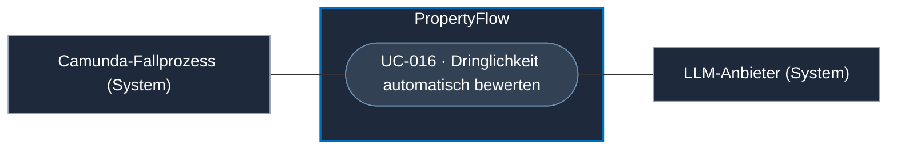
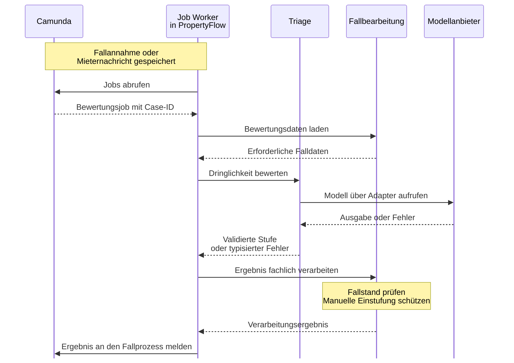

# Use Case: Dringlichkeit automatisch bewerten

## Overview

**Use Case ID:** UC-016  
**Use Case Name:** Dringlichkeit automatisch bewerten  
**Primary Actor:** Camunda-Fallprozess  
**Supporting Actor:** PropertyFlow-Worker und Modellanbieter  
**Goal:** Nach der Fallannahme oder einer neuen Mieternachricht eine nachvollziehbare Systembewertung der Dringlichkeit erhalten.  
**Status:** Der Triage-Java-Vertrag und der Modelladapter sind als isolierter Prototyp vorhanden. Die Anbindung an den Fallprozess und die dauerhafte Übernahme der Ergebnisse sind geplant. [Triage-Vertrag](../ai-usage/ki-service-vertrag.md)

## Use-Case-Diagramm

## Preconditions

- Ein Fall wurde dauerhaft angenommen oder eine neue Mieternachricht zu einem aktiven Fall wurde dauerhaft gespeichert. Der Bewertungsauftrag ist dem bestehenden Fallprozess zugeordnet. [DRING-05](../specifications/dringlichkeitsbewertung.md#dring-05-erst--und-neubewertung-im-prozess)

## Main Success Scenario

1. Camunda stellt nach der Fallannahme oder der Speicherung einer weiteren Mieternachricht den Auftrag bereit. PropertyFlow quittiert die Speicherung unabhängig von der Bewertung.
2. Der Worker ruft die Triage innerhalb von PropertyFlow mit den für die Bewertung nötigen Daten auf. Die Triage validiert die Ausgabe des Modelladapters.
3. Der zuständige PropertyFlow-Dienst prüft den aktuellen Fallstand und speichert die Systembewertung nachvollziehbar. Ohne manuelle Einstufung kann das bestätigte Ergebnis die wirksame Dringlichkeit setzen oder ändern.
4. Bei einer wirksamen Änderung speichert PropertyFlow die Historie und veranlasst eine Fallbenachrichtigung. Der Worker meldet das Verarbeitungsergebnis an den Fallprozess.

## Alternative Flows

- **Analyse fehlgeschlagen.** Die bisherige wirksame Stufe bleibt bestehen. Camunda veranlasst für den aktiven Fall die Mitarbeiterprüfung gemäss FALL-05. PropertyFlow speichert den Prüfgrund und den veranlassten Status. Die Mitarbeiterbearbeitung setzt die passende Prozessaufgabe voraus.
- **Manuelle Einstufung oder unveränderte Stufe.** Die wirksame Stufe bleibt erhalten. Der Bewertungsversuch bleibt intern nachvollziehbar.
- **Wiederholung, Abschluss oder überholte Bewertung.** PropertyFlow prüft die Gültigkeit am aktuellen Fallstand. Wiederholte oder verspätete Ergebnisse aus der Bearbeitung vor dem letzten Abschluss erzeugen keine zusätzliche wirksame Änderung.

## Sequenzdiagramm · Bewertung im Fallprozess

## Postconditions

- Die Systembewertung oder ihr Fehlschlag ist nachvollziehbar. Mieter sehen die wirksame Stufe und die freigegebene Änderungshistorie.

## Business Rules und Prüfkriterien

- **UC-016-BR-001** Die gültigen Stufen sind «Kritisch», «Hoch», «Normal» und «Niedrig». Ohne verwendbare System- oder manuelle Einstufung gilt «Noch nicht bewertet». [DRING-01](../specifications/dringlichkeitsbewertung.md#dring-01-fachliche-stufen) · [DRING-02](../specifications/dringlichkeitsbewertung.md#dring-02-noch-nicht-bewertet)
- **UC-016-BR-002** Manuelle Einstufungen haben Vorrang. Die Stufenänderung und ihre Quelle werden nachvollziehbar gespeichert. Abgeschlossene Fälle bleiben bezüglich Dringlichkeit lesend. [DRING-06 bis DRING-08](../specifications/dringlichkeitsbewertung.md#dring-06-manuelle-anpassung)
- **UC-016-AK-01** Ein Modell-Timeout lässt den Fall und die bisherige Stufe bestehen. Am aktiven Fall ist «KI-Analyse fehlgeschlagen» als interner Prüfgrund sichtbar. [FALL-05](../specifications/fallverwaltung.md#fall-05-fachlicher-lebenszyklus)
- **UC-016-AK-02** Nach einer gespeicherten Mieternachricht erfolgt eine Neubewertung im bestehenden Prozess. Bei einer inzwischen manuell gesetzten Stufe bleibt diese wirksam.
- **UC-016-AK-03** Dasselbe Ergebnis wird erneut zugestellt. Für eine bereits übernommene Änderung entstehen weder ein zweites Historienereignis noch ein zweiter logischer Mailauftrag.
