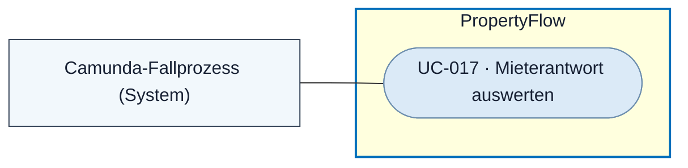
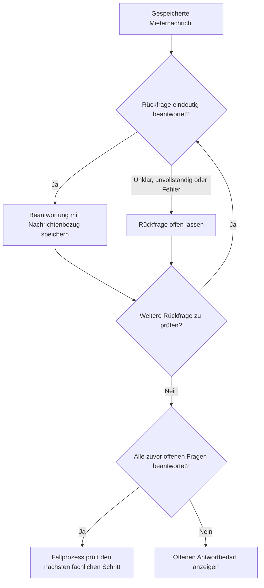

# Use Case: Mieterantwort auswerten

## Overview

**Use Case ID:** UC-017  
**Use Case Name:** Mieterantwort auswerten  
**Primary Actor:** Camunda-Fallprozess  
**Supporting Actor:** PropertyFlow-Worker und zuständige Anwendungsdienste  
**Goal:** Für jede offene Rückfrage feststellen, ob die neue Mieternachricht sie eindeutig beantwortet.  
**Status:** Die fachlichen Regeln sind vereinbart. Die automatische inhaltliche Auswertung und ihre Camunda-Anbindung gehören zum Zielbild.

## Use-Case-Diagramm

## Preconditions

- Eine neue externe Mieternachricht ist am aktiven Fall gespeichert. Für die inhaltliche Zuordnung steht mindestens eine veröffentlichte Rückfrage mit offenem Antwortbedarf zur Prüfung an. [UC-009](UC-009-mieteranliegen-ergaenzen.md) · [KOM-03](../specifications/fallkommunikation.md#inhaltliche-prüfung-offener-rückfragen)

## Main Success Scenario

1. Der bestehende Camunda-Fallprozess veranlasst die Prüfung der gespeicherten Nachricht. Der zuständige PropertyFlow-Dienst lädt die offenen Rückfragen und die zugehörigen externen Inhalte.
2. Der Dienst beurteilt jede Rückfrage einzeln. Eine Nachricht kann mehrere Fragen beantworten, wenn die Antwort für jede dieser Fragen eindeutig ist.
3. PropertyFlow speichert die bestätigte Beantwortung mit Bezug zur Frage, zur Antwort und zum Verarbeitungszeitpunkt. Fallansichten zeigen den aktuellen Antwortbedarf.
4. Sind alle zuvor offenen Fragen beantwortet, setzt der Fallprozess die Bearbeitung fort. Für einen weiterhin aktiven Fall folgt «Mitarbeiterprüfung erforderlich», sofern kein zulässiger Systemabschluss erfolgt und keine Wiedervorlage läuft.

## Alternative Flows

- **Teilantwort, themenfremde oder unklare Antwort.** Nur eindeutig beantwortete Rückfragen werden erledigt. Die übrigen bleiben offen.
- **Auswertungsfehler.** PropertyFlow führt die betroffenen Fragen weiterhin als offen. Die gespeicherte Mieternachricht bleibt im Verlauf.
- **Wiedervorlage läuft.** Die Auswertung erfolgt parallel zum Timer. Neue Erkenntnisse können die Wiedervorlage vorziehen oder eine sofortige Prüfung auslösen. [UC-013](UC-013-wiedervorlage-verwalten.md)
- **Antwortbedarf bereits beendet.** Eine verspätete oder wiederholte Auswertung reaktiviert keinen beendeten Antwortbedarf und speichert keine zusätzliche Erledigung.

## Flussdiagramm · Rückfragen einzeln prüfen

## Postconditions

- Der aktuelle Antwortbedarf ist pro Frage nachvollziehbar. Die ursprünglich veröffentlichte Nachricht und ihre Kennzeichnung bleiben erhalten.

## Business Rules und Prüfkriterien

- **UC-017-BR-001** Der blosse Nachrichteneingang genügt für die Erledigung einer Frage nicht. Die Speicherung, Dringlichkeitsneubewertung und inhaltliche Erledigung haben jeweils ihre eigenen fachlichen Regeln. [KOM-03](../specifications/fallkommunikation.md#inhaltliche-prüfung-offener-rückfragen) · [DRING-05](../specifications/dringlichkeitsbewertung.md#dring-05-erst--und-neubewertung-im-prozess)
- **UC-017-BR-002** Der Folgestatus nach vollständiger Beantwortung berücksichtigt den aktuellen Fallstand, eine laufende Wiedervorlage und die Regeln zum Systemabschluss. [FALL-05](../specifications/fallverwaltung.md#status-nach-beantwortung-aller-rückfragen)
- **UC-017-AK-01** Bei zwei offenen Fragen beantwortet die Nachricht eine Frage eindeutig und die andere nur teilweise. Genau die erste Frage ist erledigt. Nach einer Wiederholung bleibt es bei derselben Erledigung.
- **UC-017-AK-02** Die letzte offene Frage wird eindeutig beantwortet. Der aktive Fall erhält ohne laufende Wiedervorlage oder zulässigen Abschluss «Mitarbeiterprüfung erforderlich».
- **UC-017-AK-03** Ein Auswertungsfehler verändert den offenen Antwortbedarf nicht. Während einer Wiedervorlage erfolgt die Prüfung vor dem Timerablauf.
