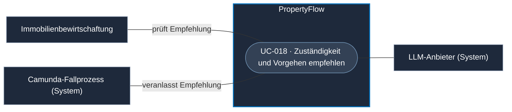

# Use Case: Zuständigkeit und Vorgehen empfehlen

## Overview

**Use Case ID:** UC-018  
**Use Case Name:** Zuständigkeit und Vorgehen empfehlen  
**Primary Actor:** Immobilienbewirtschaftung  
**Supporting Actors:** Camunda-Fallprozess und LLM-Anbieter 
**Goal:** Für ein Mieteranliegen eine nachvollziehbare Zuständigkeits- und Handlungsempfehlung zur fachlichen Prüfung erhalten.  
**Status:** Empfehlung als Schritt im Camunda-Fallprozess vorgesehen. Die Regeln für automatische Katalogrückfragen sind am 14.11.2026 in [KOM-05](../specifications/fallkommunikation.md#kom-05-automatische-rueckfragen) bestätigt; ihre Umsetzung steht aus. Die konkreten Wissensquellen und der ausführbare technische Vertrag bleiben offen. Die möglichen Ausgänge mit direkter Antwort, Rückfrage oder Mitarbeiterprüfung zeigt [ADR-002](../architecture/adr/ADR-002-camunda8-workflow-orchestrierung.md#beispiel--zuständigkeit-und-vorgehen-empfehlen).

**Fachliche Grundlage:** [Vision](../vision.md#3-zuständigkeits--und-handlungsempfehlung-anhand-einer-wissensbasis) · [ADR-002 · Job Worker](../architecture/adr/ADR-002-camunda8-workflow-orchestrierung.md#job-worker) · [Modulstruktur](../architecture/module-structure.md#recommendation) · [Projekt-Kontext zu KI und RAG](../project-context.md#61-ki-und-rag)

## Use-Case-Diagramm

## Preconditions

- Das Mieteranliegen wurde dauerhaft angenommen.
- PropertyFlow kann für die Empfehlung freigegebene Wissensquellen heranziehen.
- Die Person, die das Ergebnis im Mitarbeiterbereich prüft, ist nach [UC-006](UC-006-mitarbeiter-anmelden.md) angemeldet und für den Fall berechtigt. [ZUG-04 · Rollen und Zusatzrechte](../specifications/fallzugriff-und-sicherheit.md#rollen-und-zusatzrechte)

## Main Success Scenario

1. Camunda stellt im Fallprozess den Auftrag für die Empfehlung bereit. Ein Job Worker in PropertyFlow übernimmt den Auftrag und ruft das interne Modul `recommendation` auf.
2. PropertyFlow bestimmt, welche Fallinformationen für die Empfehlung erforderlich sind. Es sucht in freigegebenen Richtlinien, Regelwerken und geeigneten früheren Fällen nach relevanten Informationen.
3. PropertyFlow erzeugt mit dem Modell eine begründete Empfehlung zur Zuständigkeit und zum Vorgehen. Es prüft die Ausgabe und hält die verwendeten Quellen nachvollziehbar fest.
4. Die Immobilienbewirtschaftung sieht die Empfehlung im [Falldetail gemäss UC-003](UC-003-mieteranliegen-details-anzeigen.md) und kann sie prüfen, korrigieren oder ablehnen.

## Alternative Flows

- **Eindeutiger Vorschlag für einen Systemabschluss.** Das LLM liefert den Grund mit Belegstellen; für «kein Bearbeitungsbedarf der Verwaltung» ist eine ausdrücklich freigegebene und vollständig anwendbare Fachregel mit Kennung und Version erforderlich. Der Dienst prüft die [bestätigten Systemabschlussregeln](../specifications/fallverwaltung.md#regeln-für-den-automatischen-fallabschluss), insbesondere «In Abklärung» oder «Wartet auf Mieterantwort», aktuelle Grundlage und fehlenden Prüfbedarf. Die inhaltliche Erkennung benötigt Evaluation; Modell-Sicherheit allein ist kein Nachweis. Die Freigabe eines Abschlussgrundes oder einer Katalogrückfrage erlaubt keine beliebige automatische Antwort. Deren Veröffentlichungsregeln bleiben separat zu präzisieren.
- **Es fehlen gezielt erfragbare Sachangaben.** Während einer laufenden automatischen Abklärung oder Antwortauswertung kann PropertyFlow die in [KOM-05](../specifications/fallkommunikation.md#kom-05-automatische-rueckfragen) erlaubten Katalogrückfragen veröffentlichen. Das LLM schlägt passende Frage-IDs vor; der Dienst prüft den aktuellen Fallstand und liefert den freigegebenen Text samt Antwortbedarf. Der Ablauf folgt [UC-021](UC-021-ki-rueckfrage-vorschlagen.md). Dies ist die begrenzte Ausnahme zur Mitarbeiterprüfung bei fehlenden Angaben.
- **Die Grundlage bleibt unklar oder widersprüchlich.** Fehlende oder unzuverlässige Fachquellen, eine unzuverlässige Fragewahl oder eine notwendige Frage ausserhalb des freigegebenen Katalogs führen zur Mitarbeiterprüfung. Dasselbe gilt bei offenen Prüfgründen, insbesondere offener Objektzuordnung, fehlgeschlagener Analyse oder klärungsbedürftigem Versand. Während Mitarbeiterbearbeitung oder Wiedervorlage wird keine automatische Rückfrage veröffentlicht.
- **Die Information ist bereits bekannt oder die Empfehlung überholt.** Bekannte oder beantwortete Angaben, bereits offene Fragen und bewusst aufgehobener Antwortbedarf erzeugen keine neue Rückfrage. Doppelte, veraltete oder nach Abschluss eintreffende Ergebnisse werden gemäss KOM-05 verworfen, bei aktuellem Bedarf neu bewertet oder führen zum weiteren Warten. Sie erzeugen für sich keinen Mitarbeiterprüfgrund.
- **Wissenssuche oder Modell fällt aus.** Die Fallannahme bleibt möglich. Bei festgestelltem Analysefehler veranlasst der laufende Camunda-Prozess die Mitarbeiterprüfung gemäss FALL-05.
- **Vorgeschriebene menschliche Entscheidung.** Die Immobilienbewirtschaftung prüft den Fall nach FALL-10 und trifft die erforderliche Entscheidung.

## Postconditions

- Die geprüfte Empfehlung ist für die berechtigte Fallbearbeitung nachvollziehbar oder die fehlende Grundlage bleibt sichtbar.
- Die Fallbearbeitung und allfällige verbindliche Entscheidungen folgen den fachlichen Regeln.

## Business Rules und Prüfkriterien

- **UC-018-BR-001:** PropertyFlow verwendet freigegebene Wissensquellen und stellt dem Modell nur die benötigten Daten bereit. Die Empfehlung bleibt auf Modell, Prompt-Fassung und verwendete Quellen zurückführbar.
- **UC-018-BR-002:** Für die Umsetzung einer Empfehlung gelten die Freigabe- und Abschlussregeln aus [FALL-10](../specifications/fallverwaltung.md#fall-10-automatisierung-und-menschliche-freigabe) und [FALL-07](../specifications/fallverwaltung.md#fall-07-abschluss-und-zeit-danach).
- **UC-018-BR-003:** Eine automatische Rückfrage benötigt die konkrete Freigabe nach [KOM-05](../specifications/fallkommunikation.md#kom-05-automatische-rueckfragen). Die Auswahl von Frage-IDs verwendet ausschliesslich den nach KOM-02 zulässigen Kontext; auch eine spätere menschliche Freigabe erlaubt keine internen Memos oder daraus abgeleiteten Inhalte im Kommunikations-LLM.
- **UC-018-AK-01:** Eine Empfehlung mit freigegebener Quelle im Falldetail prüfen. Das Ergebnis ist als Empfehlung erkennbar und die zugrunde liegende Quelle ist nachvollziehbar.
- **UC-018-AK-02:** Die Wissenssuche ausfallen lassen. Der Fall bleibt gespeichert und der laufende Camunda-Prozess stellt die Mitarbeiteraufgabe bereit.
- **UC-018-AK-03:** Bei einem zugeordneten Fall in automatischer Abklärung eine fehlende, vom Katalog abgedeckte Sachangabe und eine widersprüchliche Fachgrundlage unterscheiden. Nur der erste Fall darf bei erfüllten KOM-05-Bedingungen zur automatischen Rückfrage führen; der zweite benötigt Mitarbeiterprüfung.
