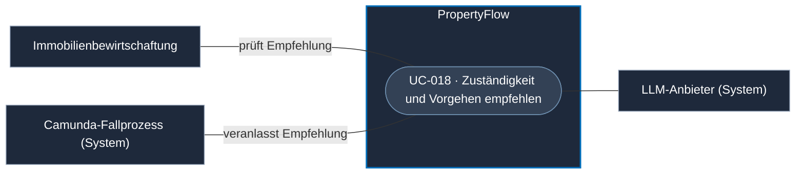

# Use Case: Zuständigkeit und Vorgehen empfehlen

## Overview

**Use Case ID:** UC-018  
**Use Case Name:** Zuständigkeit und Vorgehen empfehlen  
**Primary Actor:** Immobilienbewirtschaftung  
**Supporting Actors:** Camunda-Fallprozess und LLM-Anbieter 
**Goal:** Für ein Mieteranliegen eine nachvollziehbare Zuständigkeits- und Handlungsempfehlung zur fachlichen Prüfung erhalten.  
**Status:** Empfehlung als Schritt im Camunda-Fallprozess vorgesehen. Die genaue Auslösebedingung im BPMN-Modell, die konkreten Wissensquellen und der technische Vertrag sind offen. Die möglichen Ausgänge mit direkter Antwort, Rückfrage oder Mitarbeiterprüfung zeigt [ADR-002](../architecture/adr/ADR-002-camunda8-workflow-orchestrierung.md#beispiel--zuständigkeit-und-vorgehen-empfehlen).

**Fachliche Grundlage:** [Vision](../vision.md#3-zuständigkeits--und-handlungsempfehlung-anhand-einer-wissensbasis) · [ADR-002 · Job Worker](../architecture/adr/ADR-002-camunda8-workflow-orchestrierung.md#job-worker) · [Modulstruktur](../architecture/module-structure.md#recommendation) · [Projekt-Kontext zu KI und RAG](../project-context.md#61-ki-und-rag)

## Use-Case-Diagramm

## Preconditions

- Das Mieteranliegen wurde dauerhaft angenommen.
- PropertyFlow kann für die Empfehlung freigegebene Wissensquellen heranziehen.
- Die Person, die das Ergebnis im Mitarbeiterbereich prüft, ist nach [UC-006](UC-006-mitarbeiter-anmelden.md) angemeldet und für den Fall berechtigt. [ZUG-04 · Rollen und Zusatzrechte](../specifications/fallzugriff-und-sicherheit.md#rollen-und-zusatzrechte)

## Main Success Scenario

1. Camunda stellt im Fallprozess den Auftrag für die Empfehlung bereit. Ein Job Worker in PropertyFlow übernimmt den Auftrag und ruft das interne Modul `recommendation` auf.
2. PropertyFlow bestimmt, welche Fallinformationen für die Empfehlung erforderlich sind. Es sucht in freigegebenen Richtlinien, Regelwerken und geeigneten früheren Fällen nach relevanten Informationen.
3. PropertyFlow erzeugt mit dem Modell eine begründete Empfehlung zur Zuständigkeit und zum Vorgehen. Es prüft die Ausgabe und hält die verwendeten Quellen nachvollziehbar fest.
4. Die Immobilienbewirtschaftung sieht die Empfehlung im [Falldetail gemäss UC-003](UC-003-mieteranliegen-details-anzeigen.md) und kann sie prüfen, korrigieren oder ablehnen.

## Alternative Flows

- **Eindeutige und zulässige Aktion.** PropertyFlow kann nach serverseitiger Prüfung eine direkte Antwort mit Systemabschluss oder eine Rückfrage bei offenem Fall ausführen. Die Beispiele und Voraussetzungen stehen in [ADR-002](../architecture/adr/ADR-002-camunda8-workflow-orchestrierung.md#beispiel--zuständigkeit-und-vorgehen-empfehlen). Die Regeln für die automatische Veröffentlichung sind im Kommunikationsvertrag zu präzisieren.
- **Fallangaben oder Quellen fehlen, sind unklar oder widersprüchlich.** Der Fall bleibt aktiv. Die Immobilienbewirtschaftung prüft den Fall und entscheidet über das weitere Vorgehen.
- **Wissenssuche oder Modell fällt aus.** Die Fallannahme bleibt möglich. Der laufende Camunda-Prozess kann den Fall zur Mitarbeiterprüfung übergeben.
- **Vorgeschriebene menschliche Entscheidung.** Die Immobilienbewirtschaftung prüft den Fall nach FALL-10 und trifft die erforderliche Entscheidung.

## Postconditions

- Die geprüfte Empfehlung ist für die berechtigte Fallbearbeitung nachvollziehbar oder die fehlende Grundlage bleibt sichtbar.
- Die Fallbearbeitung und allfällige verbindliche Entscheidungen folgen den fachlichen Regeln.

## Business Rules und Prüfkriterien

- **UC-018-BR-001:** PropertyFlow verwendet freigegebene Wissensquellen und stellt dem Modell nur die benötigten Daten bereit. Die Empfehlung bleibt auf Modell, Prompt-Fassung und verwendete Quellen zurückführbar.
- **UC-018-BR-002:** Für die Umsetzung einer Empfehlung gelten die Freigabe- und Abschlussregeln aus [FALL-10](../specifications/fallverwaltung.md#fall-10-automatisierung-und-menschliche-freigabe) und [FALL-07](../specifications/fallverwaltung.md#fall-07-abschluss-und-zeit-danach).
- **UC-018-AK-01:** Eine Empfehlung mit freigegebener Quelle im Falldetail prüfen. Das Ergebnis ist als Empfehlung erkennbar und die zugrunde liegende Quelle ist nachvollziehbar.
- **UC-018-AK-02:** Die Wissenssuche ausfallen lassen. Der Fall bleibt gespeichert und der laufende Camunda-Prozess stellt die Mitarbeiteraufgabe bereit.
