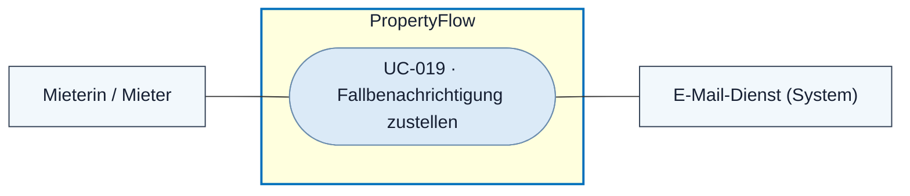
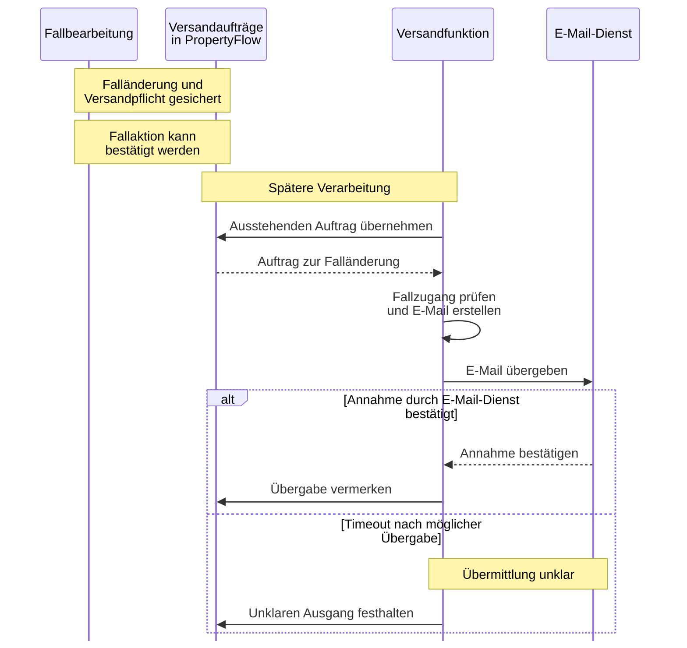

# Use Case: Fallbenachrichtigung zustellen

## Overview

**Use Case ID:** UC-019  
**Use Case Name:** Fallbenachrichtigung zustellen  
**Primary Actor:** Mieterin oder Mieter als Empfänger  
**Supporting Actor:** E-Mail-Dienst  
**Goal:** Über eine gespeicherte, für den Mieter sichtbare Änderung informiert werden und die zugehörige Fallansicht öffnen können.  
**Status:** Fachlich vereinbart. Der produktive Versand von Fallbenachrichtigungen steht aus.

**Fachliche Grundlage:** [Benachrichtigungen und Zustellung](../specifications/benachrichtigungen-und-zustellung.md) · [Persönlicher Fall-Link](../architecture/adr/ADR-004-tokenbasierter-mieterzugriff.md)

## Use-Case-Diagramm

## Preconditions

- Ein nach BEN-01 benachrichtigungspflichtiges Ereignis ist dauerhaft gespeichert.
- Der Fall hat eine Kontaktadresse.

## Main Success Scenario

1. PropertyFlow veranlasst für das gespeicherte Ereignis einen nachvollziehbaren Versandauftrag.
2. Die Versandfunktion bestimmt die fallbezogene Kontaktadresse und prüft den persönlichen Zugang.
3. Sie erstellt aus einer festen Vorlage einen kurzen Hinweis mit Case-ID, gültigem Fall-Link und Vertraulichkeitshinweis. Bei einer veröffentlichten Rückfrage mit Antwortbedarf macht die Vorlage den Handlungsbedarf deutlich.
4. Die Versandfunktion übergibt die E-Mail nachgelagert an den E-Mail-Dienst und hält dessen Annahme fest.
5. Der Mieter kann den persönlichen Link öffnen und den aktuellen, für ihn freigegebenen Fallstand lesen.

### Sequenzdiagramm

Der Versand folgt der Speicherung der Falländerung. Falländerung und Versandpflicht müssen auch nach einem Neustart nachvollziehbar sein. Das Diagramm zeigt die fachliche Abfolge.

## Alternative Flows

- **Vorübergehender Versandfehler.** Die Versandpflicht bleibt nachvollziehbar und der Auftrag kann wiederholt werden. Die gespeicherte Falländerung bleibt wirksam.
- **Unklarer Übermittlungsausgang, Rückläufer oder dauerhafter Fehler.** PropertyFlow hält den Zustand nachvollziehbar fest. Bei klärungsbedürftigem Versand gilt für aktive Fälle der Prüfhinweis aus FALL-05. Ein abgeschlossener Fall bleibt abgeschlossen.
- **Fallzugang ungültig oder Versandkopie unlesbar.** Die Versandfunktion blockiert die E-Mail mit Fall-Link und macht den Klärungsbedarf sichtbar.

## Postconditions

- PropertyFlow kann den Versandauftrag und seinen Bearbeitungsstand nachvollziehen.
- Die bestätigte Annahme durch den E-Mail-Dienst ist als Übergabe erfasst. Ein Nachweis der Posteingangszustellung ist ein eigener Zustand.

## Business Rules und Prüfkriterien

- **UC-019-BR-001:** Je vereinbartem Ereignis und vorgesehenem Empfänger entsteht ein logischer Versandauftrag. Interne Memos, KI-Teilantworten und reine Lesezugriffe lösen keine Fallbenachrichtigung aus.
- **UC-019-BR-002:** Die E-Mail verwendet die Fall-Kontaktadresse und den gültigen Fall-Link. Vollständige Nachrichten, interne Memos und technische Fehlerdetails bleiben aus der Vorlage ausgeschlossen.
- **UC-019-AK-01:** Eine veröffentlichte Rückfrage mit Antwortbedarf löst einen Versandauftrag aus. Die E-Mail verweist mit Case-ID und gültigem Link auf die Fallansicht und macht den Antwortbedarf deutlich.
- **UC-019-AK-02:** Den E-Mail-Dienst während einer Falländerung abschalten und PropertyFlow neu starten. Die Änderung und der Auftrag bleiben erhalten. Eine Wiederholung desselben Ereignisses erzeugt keinen zusätzlichen logischen Auftrag.
- **UC-019-AK-03:** Einen ungültigen Zugang und einen unklaren Übermittlungsausgang prüfen. Der Versandstatus macht die jeweilige Situation nachvollziehbar.
