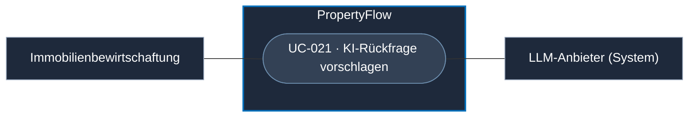

# Use Case: KI-Rückfrage vorschlagen

## Overview

**Use Case ID:** UC-021  
**Use Case Name:** KI-Rückfrage vorschlagen  
**Primary Actor:** Immobilienbewirtschaftung  
**Goal:** Für ein unvollständiges Anliegen gezielte Katalogrückfragen zu fehlenden fachlich relevanten Angaben auswählen und bei erfüllten Freigaberegeln automatisch veröffentlichen. 
**Status:** Optionale Erweiterung der Vision. Die fachlichen Regeln für Auswahl, Freigabe und Veröffentlichung sind am 14.11.2026 in [KOM-05](../specifications/fallkommunikation.md#kom-05-automatische-rueckfragen) bestätigt. Die Erweiterung ist noch nicht implementiert; Worker-Vertrag und technische Ausführung folgen separat.

**Fachliche Grundlage:** [Vision](../vision.md#ki-gestützte-rückfragen) · [KOM-05 · Automatische Rückfragen](../specifications/fallkommunikation.md#kom-05-automatische-rueckfragen) · [KOM-02](../specifications/fallkommunikation.md#kom-02-llm-kommunikation-ohne-interne-memos) · [Evaluationsfall zur unvollständigen Meldung](../evaluation/evaluationsgrundlage.md#eval-03--heizungsausfall-und-kontextabhängigkeit)

Die Auswahl geht von einem Informationsbedarf im Fall aus und folgt dem freigegebenen Katalog in KOM-05. Das LLM wählt Frage-IDs; der Dienst liefert den freigegebenen Fragetext und den Antwortbedarf ohne freien LLM-Zusatz. [UC-004](UC-004-ki-analyse-durchfuehren.md) beschreibt gesondert die vom Mitarbeiter gestartete Formulierung einer bewusst eingegebenen Sachanweisung.

## Use-Case-Diagramm

## Preconditions

- Ein aktiver Fall ist gespeichert.
- Für die fachliche Beurteilung fehlen wesentliche Informationen.
- Der zur Frageauswahl verwendete Kontext entspricht KOM-02.
- Für die automatische Veröffentlichung läuft eine automatische Abklärung oder Antwortauswertung. Die aktuelle Prozessfreigabe und sämtliche Voraussetzungen aus KOM-05 sind erfüllt; es bestehen weder Mitarbeiterbearbeitung noch Wiedervorlage oder offene Prüfgründe.

## Main Success Scenario

1. PropertyFlow stellt den aktuellen zulässigen Fallkontext zusammen und berücksichtigt bekannte Angaben sowie offene, beantwortete und bewusst aufgehobene Rückfragen.
2. Das Modell schlägt passende Frage-IDs aus dem freigegebenen Katalog für fehlende, notwendige Sachangaben vor.
3. Der zuständige Dienst prüft Auswahl, Katalogfassung, aktuelle Fallversion, Prozessfreigabe und Prüfgründe. Er verhindert doppelte Fragen und die Reaktivierung bewusst aufgehobenen Antwortbedarfs.
4. Bei erfüllten Regeln veröffentlicht PropertyFlow den freigegebenen Katalogtext mit Antwortbedarf idempotent im vorgesehenen Camunda-/PropertyFlow-Ablauf. Freie LLM-Ergänzungen werden nicht veröffentlicht. Erst die erfolgreiche Veröffentlichung erzeugt den offenen Antwortbedarf.
5. Der Fall wartet auf die Mieterantwort. Die spätere Auswertung prüft jede offene Frage einzeln nach KOM-03; bereits veröffentlichte Texte werden nicht nachträglich überschrieben.

## Alternative Flows

- **Die erforderlichen Angaben liegen bereits vor oder die Frage ist bereits offen.** Es entsteht keine doppelte Rückfrage. Bereits beantwortete Fragen werden nicht erneut gestellt; bewusst aufgehobener Antwortbedarf wird nicht reaktiviert. Eine noch offene Frage kann weiter auf Antwort warten.
- **Die Fragewahl ist unzuverlässig, die Grundlage widersprüchlich oder eine notwendige Frage nicht im Katalog.** Der Fall bleibt gespeichert; Camunda veranlasst Mitarbeiterprüfung. Eine freie LLM-Formulierung ersetzt keine fehlende Katalogfreigabe.
- **Ein Prüfgrund oder eine verpflichtende menschliche Entscheidung steht aus.** Keine automatische Veröffentlichung. Das gilt insbesondere für offene Objektzuordnung, Analysefehler, klärungsbedürftigen Versand und die Grenzen aus FALL-10. Eine Katalogfrage zum Raum klärt nur den Ort innerhalb eines bereits zugeordneten Objekts; sie bestätigt keine Objektzuordnung.
- **Mitarbeiterbearbeitung oder Wiedervorlage läuft.** Es wird keine automatische Rückfrage veröffentlicht. Zulässige manuelle Kommunikation bleibt möglich; laufende Mitarbeiterprüfung und Wiedervorlage behalten gemäss FALL-05/FALL-11 ihren Vorrang.
- **Ergebnis ist doppelt, veraltet oder der Fall inzwischen abgeschlossen.** Keine Veröffentlichung und kein künstlicher Mitarbeiterprüfgrund. Abhängig vom aktuellen Fallstand wird das Ergebnis verworfen, der Bedarf neu bewertet oder weiter auf eine bereits offene Frage gewartet.
- **Die Mieterantwort ist unvollständig.** Jede eindeutig beantwortete Frage wird einzeln erledigt; andere Fragen bleiben offen. Eine starre Anzahl automatischer Fragerunden ist nicht vereinbart. Blosser Antwortausstand oder eine Teilantwort erzeugt für sich keinen neuen Prüfgrund.
- **Alle zuvor offenen Rückfragen sind beantwortet.** Ohne zulässigen Systemabschluss und ohne laufende Wiedervorlage folgt Mitarbeiterprüfung gemäss FALL-05. Neue Katalogfragen dürfen diesen Übergang nicht umgehen.

## Postconditions

- Zulässige Katalogrückfragen sind mit ihrem Antwortbedarf veröffentlicht, oder der Fallprozess führt gemäss KOM-05 zur Mitarbeiterprüfung, weiteren Auswertung oder zum Warten.
- Nur tatsächlich veröffentlichte Rückfragen erzeugen Antwortbedarf. Fehlgeschlagene, doppelte oder verworfene Veröffentlichungsversuche erzeugen keine zusätzliche Nachricht.

## Business Rules und Prüfkriterien

- **UC-021-BR-001:** Die Frageauswahl betrifft sachlich notwendige, fehlende Angaben. Katalog, zulässige Ausführung und Ausschlüsse werden zentral in [KOM-05](../specifications/fallkommunikation.md#kom-05-automatische-rueckfragen) gepflegt.
- **UC-021-BR-002:** PropertyFlow stellt den für die Rückfrage erlaubten Kontext vor dem Modellaufruf zusammen. Interne Memos, interne Änderungsbegründungen und daraus abgeleitete Inhalte bleiben ausgeschlossen. Eine spätere menschliche Freigabe erlaubt keine Ausnahme von dieser Kontextgrenze.
- **UC-021-BR-003:** Das LLM erteilt keine Veröffentlichungsfreigabe und setzt keinen Antwortbedarf. Der Dienst prüft die aktuelle Freigabe und übernimmt ausschliesslich die freigegebenen Katalogtexte und deren Antwortbedarf. Versionsprüfung und Idempotenz gelten auch bei paralleler oder wiederholter Verarbeitung.
- **UC-021-AK-01:** Einen zugeordneten Fall zum Heizungsausfall ohne Angaben zu Zeitpunkt und betroffenem Raum prüfen. Bei erfüllten KOM-05-Bedingungen werden die passenden Fragen RQ-001 und RQ-002 mit ihren freigegebenen Texten veröffentlicht. Bereits vorhandene Angaben werden nicht erneut erfragt.
- **UC-021-AK-02:** Eine Fallakte mit internem Memo und interner Änderungsbegründung verarbeiten. Die Modellanfrage enthält weder diese Inhalte noch daraus abgeleitete Angaben.
- **UC-021-AK-03:** Offene Objektzuordnung, Analyse- oder Versandfehler und verpflichtende menschliche Entscheidungen prüfen. Keiner dieser Fälle darf eine automatische Katalogrückfrage veröffentlichen; laufende Mitarbeiterbearbeitung und Wiedervorlage werden nicht verdrängt.
- **UC-021-AK-04:** Eine unbekannte Frage-ID, eine unzuverlässige Auswahl oder widersprüchliche Grundlage verarbeiten. Es wird kein freier LLM-Text veröffentlicht; der Fall geht zur Mitarbeiterprüfung.
- **UC-021-AK-05:** Einen Veröffentlichungsauftrag wiederholen und parallel mit einer Falländerung oder einem Abschluss verarbeiten. Es entsteht höchstens eine zulässige Veröffentlichung. Überholte Ergebnisse veröffentlichen nichts und erzeugen für sich keinen Prüfgrund.
- **UC-021-AK-06:** Eine offene, eine beantwortete und eine bewusst aufgehobene Rückfrage erneut vorschlagen lassen. Keine wird dupliziert oder reaktiviert. Eine Teilantwort erledigt nur die tatsächlich beantwortete Frage und erzwingt keine starre Grenze der Fragerunden.
- **UC-021-AK-07:** Nach Beantwortung aller zuvor offenen Rückfragen eine weitere Frage vorschlagen lassen. Ohne zulässigen Systemabschluss und ohne laufende Wiedervorlage greift dennoch der vereinbarte Übergang zur Mitarbeiterprüfung; die zusätzliche Frage wird nicht automatisch veröffentlicht.
