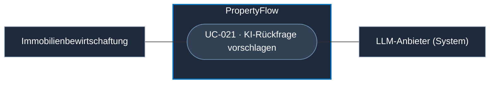

# Use Case: KI-Rückfrage vorschlagen

## Overview

**Use Case ID:** UC-021  
**Use Case Name:** KI-Rückfrage vorschlagen  
**Primary Actor:** Immobilienbewirtschaftung  
**Goal:** Für ein unvollständiges Anliegen einen gezielten Rückfragevorschlag zu fehlenden fachlich relevanten Angaben erhalten.  
**Status:** Optionale Erweiterung der Vision. Auslösung, Freigabe und Veröffentlichung sind offen.

**Fachliche Grundlage:** [Vision](../vision.md#ki-gestützte-rückfragen) · [KOM-02](../specifications/fallkommunikation.md#kom-02-llm-kommunikation-ohne-interne-memos) · [Evaluationsfall zur unvollständigen Meldung](../evaluation/evaluationsgrundlage.md#eval-03--heizungsausfall-und-kontextabhängigkeit)

Der Vorschlag geht von einem Informationsbedarf im Fall aus. [UC-004](UC-004-ki-analyse-durchfuehren.md) beschreibt die vom Mitarbeiter gestartete Formulierung einer bewusst eingegebenen Sachanweisung.

## Use-Case-Diagramm

## Preconditions

- Ein aktiver Fall ist gespeichert.
- Für die fachliche Beurteilung fehlen wesentliche Informationen.
- Der zur Formulierung verwendete Kontext entspricht KOM-02.

## Main Success Scenario

1. PropertyFlow bestimmt, welche Angaben für die weitere Beurteilung fehlen.
2. Es formuliert mit dem Modell eine auf diese Angaben gerichtete Rückfrage. Bereits bekannte Informationen bleiben berücksichtigt.
3. PropertyFlow prüft die Ausgabe und stellt die fachlich geeignete Frage als Vorschlag bereit. Wie daraus eine veröffentlichte Rückfrage wird, ist separat festzulegen.

## Alternative Flows

- **Die erforderlichen Angaben liegen bereits vor.** Es gibt keinen neuen Rückfragevorschlag für diese Angaben.
- **Das Modell fällt aus oder gibt einen unbrauchbaren Vorschlag aus.** Der Fall bleibt gespeichert. Der laufende Camunda-Prozess kann eine Mitarbeiterprüfung vorsehen.
- **Menschliche Prüfung ist vorgeschrieben.** Die Regeln nach FALL-10 gelten weiterhin.

## Postconditions

- Ein gezielter Rückfragevorschlag liegt zur weiteren Prüfung vor oder der laufende Fallprozess ermöglicht die weitere Prüfung durch Mitarbeitende.
- Die fachliche Wirkung einer tatsächlich veröffentlichten Rückfrage folgt den Regeln für Fallkommunikation und Antwortbedarf.

## Business Rules und Prüfkriterien

- **UC-021-BR-001:** Der Vorschlag fragt nach sachlich notwendigen Informationen und behandelt unbekannte Angaben als offen.
- **UC-021-BR-002:** PropertyFlow stellt den für die Rückfrage erlaubten Kontext vor dem Modellaufruf zusammen. Interne Memos, interne Änderungsbegründungen und daraus abgeleitete Inhalte bleiben ausgeschlossen.
- **UC-021-AK-01:** Eine Meldung zum Heizungsausfall ohne Angaben zu Zeitpunkt und Umfang prüfen. Der Vorschlag fragt gezielt nach den benötigten Angaben.
- **UC-021-AK-02:** Eine Fallakte mit internem Memo und interner Änderungsbegründung verarbeiten. Die Modellanfrage enthält weder diese Inhalte noch daraus abgeleitete Angaben.
