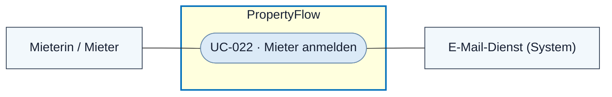

# Use Case: Mieter anmelden

## Overview

**Use Case ID:** UC-022  
**Primary Actor:** Mieterin / Mieter  
**Goal:** Ein bestehendes, verifiziertes Mieterkonto öffnen und Zugriff auf die eigenen Fälle erhalten.  
**Status:** Anmeldung per E-Mail-Einmalcode in der lokalen Frontend-Demo umgesetzt. Dauerhafte Kontenspeicherung ist geplant.

## Use-Case-Diagramm

## Preconditions

- Ein verifiziertes Mieterkonto besteht gemäss [UC-005](UC-005-userkonto-eroeffnen.md).
- Die Person hat Zugriff auf das Postfach der Konto-Adresse.

## Main Success Scenario

1. Die Person öffnet die Anmeldung und fordert einen Code an ihre Konto-Adresse an.
2. PropertyFlow prüft das bestehende Mieterkonto und sendet den Einmalcode gemäss [ZUG-04 · E-Mail-Einmalcode](../specifications/fallzugriff-und-sicherheit.md#e-mail-einmalcode-für-registrierung-und-anmeldung).
3. Die Person gibt den Code ein. Nach erfolgreicher Codeprüfung eröffnet PropertyFlow eine persönliche Sitzung.
4. PropertyFlow öffnet «Meine Fälle» gemäss [UC-008](UC-008-eigenen-fall-einsehen.md).

## Alternative Flows

- Bei unbekannter Adresse entsteht durch die Anmeldung kein Konto. Die Kontoeröffnung läuft über [UC-005](UC-005-userkonto-eroeffnen.md). Für die öffentliche Rückmeldung gelten die [gemeinsamen Einmalcode-Regeln](../specifications/fallzugriff-und-sicherheit.md#e-mail-einmalcode-für-registrierung-und-anmeldung).
- Schlägt die Codeprüfung fehl, bleibt «Meine Fälle» gesperrt. Die Person kann gemäss den gemeinsamen Einmalcode-Regeln einen neuen Code anfordern.
- Ein Konto ohne passende Fälle erhält eine leere Übersicht.

## Postconditions

- Die Sitzung gewährt Zugriff im Rahmen der Mieterrechte und der aktuellen Fallzuordnung.

## Business Rules und Prüfkriterien

- **UC-022-BR-001:** PropertyFlow bezieht die Konto-Adresse aus der geprüften Sitzung. Die Fallzuordnung folgt [ZUG-04 · Mieterzugriff](../specifications/fallzugriff-und-sicherheit.md#mieterzugriff). Die Rechte des Kontos richten sich nach [ZUG-04 · Rollen und Zusatzrechte](../specifications/fallzugriff-und-sicherheit.md#rollen-und-zusatzrechte).
- **UC-022-AK-01:** Ein gültiger Code öffnet «Meine Fälle» mit den zur verifizierten Adresse passenden Fällen. Die Wiederholung desselben Codes eröffnet keine zweite Sitzung.
- **UC-022-AK-02:** Ein Anmeldeversuch mit unbekannter Adresse legt weder ein Konto an noch legt er Falldaten offen.
