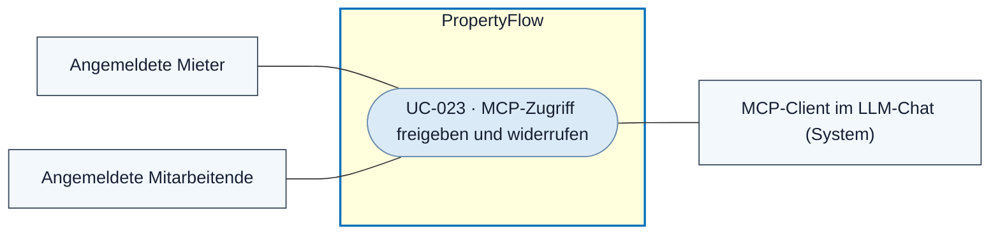

# Use Case: MCP-Zugriff freigeben und widerrufen

## Overview

**Use Case ID:** UC-023  
**Primary Actor:** Angemeldeter Mieter oder Mitarbeiter  
**Supporting Actor:** MCP-Client im LLM-Chat  
**Goal:** Einem Client ausgewählte PropertyFlow-Aktionen erlauben und diese Berechtigung wieder entziehen können.  
**Status:** Zielablauf gemäss ADR-005 und ZUG-04. OAuth-Delegation, Tool-Auswahl und Bedienung der Widerrufsfunktion sind zu konkretisieren.

## Use-Case-Diagramm

## Preconditions

- Die Person hat ein berechtigtes persönliches Konto gemäss [UC-005](UC-005-userkonto-eroeffnen.md) oder [UC-006](UC-006-mitarbeiter-anmelden.md).
- Der MCP-Client fordert Rechte für PropertyFlow an.

## Main Success Scenario

1. Der Client führt die Person zum gemeinsamen Anmeldedienst. Eine gültige Anmeldung im selben Browserprofil genügt.
2. Die Person prüft die angeforderten Rechte und erteilt die Delegation. Der Client erhält ein OAuth-Zugriffstoken für den MCP-Endpunkt.
3. Bei jedem Aufruf prüft der Anwendungsdienst Token, aktuelles Konto, Rolle, Client-Delegation, Fallzugriff und die gewünschte Aktion. Bei einer kritischen Aktion prüft er auch die menschliche Freigabe für genau diese Handlung.
4. Widerruft die Person später die Delegation, weist PropertyFlow weitere Aufrufe mit dieser Delegation ab.

## Alternative Flows

- Lehnt die Person die Delegation ab, erhält der Client kein Zugriffstoken.
- Bei ungültigem Token, fehlender Berechtigung oder fehlender Freigabe erhält der Client keine geschützten Daten und die Aktion bleibt ohne fachliche Wirkung.

## Postconditions

- Eine gültige Delegation erlaubt die freigegebenen Aktionen innerhalb der aktuellen Kontorechte. Ein Widerruf wirkt ab dem nächsten Zugriff.

## Business Rules und Prüfkriterien

- **UC-023-BR-001:** Web und MCP rufen dieselben fachlichen Anwendungsdienste auf. PropertyFlow prüft die aktuellen [Kontorechte](../specifications/fallzugriff-und-sicherheit.md#rollen-und-zusatzrechte), die [MCP-Delegation](../specifications/fallzugriff-und-sicherheit.md#gemeinsame-anmeldung-und-mcp-delegation) und die Freigabegrenzen gemäss [FALL-10](../specifications/fallverwaltung.md#fall-10-automatisierung-und-menschliche-freigabe). Für das Verhältnis von lokaler Abmeldung und Delegation gilt [ZUG-04 · Web-Abmeldung](../specifications/fallzugriff-und-sicherheit.md#web-abmeldung).
- **UC-023-BR-002:** Das Audit erfasst bei Schreibversuchen Benutzer-ID, Kanal, Client, Aktion, Fallreferenz, Zeitpunkt und Ergebnis gemäss [ADR-005](../architecture/adr/ADR-005-zugriffsmodell.md#autorisierung-über-mcp).
- **UC-023-AK-01:** Ein Client mit delegiertem Leserecht kann einen berechtigten Fall lesen. Schreibversuche und Abrufe fremder Fälle werden abgewiesen.
- **UC-023-AK-02:** Nach Widerruf wird der nächste MCP-Aufruf mit dem bisherigen Token abgewiesen.
- **UC-023-AK-03:** Eine kritische Aktion ohne passende menschliche Freigabe bleibt ohne fachliche Wirkung. Der abgewiesene Schreibversuch ist im Audit nachvollziehbar.
