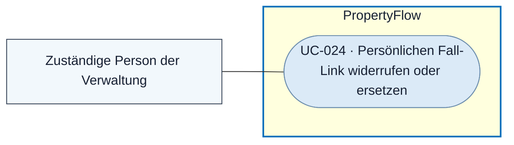

# Use Case: Persönlichen Fall-Link widerrufen oder ersetzen

## Overview

**Use Case ID:** UC-024  
**Primary Actor:** Für den administrativen Fallzugang zuständige Person der Verwaltung  
**Goal:** Einen verlorenen oder kompromittierten Zugang zum Fall gezielt sperren und bei Bedarf einen neuen Link bereitstellen.  
**Status:** Wirkung von Widerruf und Ersatz fachlich vereinbart. Identitätsprüfung, administrative Berechtigung und konkrete Bedienung sind offen.

## Use-Case-Diagramm

## Preconditions

- Ein Fall und sein persönlicher Link sind bekannt.
- Für einen Ersatz werden die Identität geeignet geprüft und die Kontaktadresse bestätigt.

## Main Success Scenario

1. Die Verwaltung prüft die Anfrage und bestimmt den betroffenen Fallzugang.
2. PropertyFlow widerruft den Zugang. Beim Ersatz erzeugt PropertyFlow zusätzlich einen neuen, unabhängigen Token und ermöglicht dessen Versand an die bestätigte Kontaktadresse.
3. Beim nächsten Lese- oder Schreibzugriff weist PropertyFlow den bisherigen Token ab. Vor späteren Benachrichtigungen prüft der Versanddienst den aktuellen Zugang.

## Alternative Flows

- Bei unzureichender Identitätsprüfung oder unklarer Kontaktadresse bleibt ein Ersatz aus. Ein Adresswechsel folgt [UC-025](UC-025-fall-kontaktadresse-aendern.md).
- Beim reinen Widerruf bleibt der Fall ohne gültigen persönlichen Link, bis die zuständige Stelle einen Ersatz veranlasst.

## Postconditions

- Der bisherige Token ist für alle Besitzer gesperrt. Case-ID, Verlauf und Fallstatus bleiben erhalten.

## Business Rules und Prüfkriterien

- **UC-024-BR-001:** Der persönliche Link gilt zeitlich unbegrenzt. Widerruf und Ersatz folgen [ZUG-05](../specifications/fallzugriff-und-sicherheit.md#zug-05-dauerhafte-gültigkeit-widerruf-und-ersatz). Der administrative Ablauf ist ausserhalb der Fallbearbeitung in UI3 vorgesehen.
- **UC-024-AK-01:** Den Link ersetzen und den alten Token in einem bereits geöffneten Tab zum Lesen und Schreiben verwenden. Beide Zugriffe werden abgewiesen. Der neue Link führt zum selben Fall.
- **UC-024-AK-02:** Ein ausstehender Versandauftrag verwendet nach Widerruf oder Ersatz keinen gesperrten Link.
