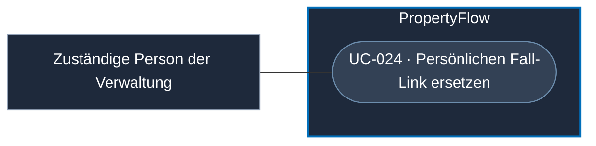

# Use Case: Persönlichen Fall-Link ersetzen

## Overview

**Use Case ID:** UC-024  
**Primary Actor:** Für den administrativen Fallzugang zuständige Person der Verwaltung  
**Goal:** Einen verlorenen oder kompromittierten Fall-Link durch einen neuen Link zum selben Fall ersetzen. 
**Status:** Gleichzeitige Aktivierung des neuen Links und Sperrung des alten Links fachlich vereinbart. Identitätsprüfung, administrative Berechtigung, konkrete Bedienung und Verfügbarkeit bei einem Camunda-Ausfall sind offen.

## Use-Case-Diagramm

## Preconditions

- Die Verwaltung kann den betroffenen Fall und den bisherigen persönlichen Zugang eindeutig bestimmen.
- Für einen Ersatz werden die Identität geeignet geprüft und die Kontaktadresse bestätigt.

## Main Success Scenario

1. Die Verwaltung prüft die Anfrage und bestimmt den betroffenen Fallzugang.
2. PropertyFlow erzeugt einen neuen, unabhängigen Token. In derselben Datenbanktransaktion aktiviert es den neuen Zugang und sperrt den bisherigen. Beide Änderungen werden mit demselben Commit wirksam.
3. PropertyFlow ermöglicht den Versand des neuen Links an die bestätigte Kontaktadresse. Bei späteren Benachrichtigungen lädt der Versanddienst den aktuell gültigen Fall-Link.

## Alternative Flows

- Bei unzureichender Identitätsprüfung oder unklarer Kontaktadresse bleibt der bisherige Zugang gültig. Ein Adresswechsel folgt [UC-025](UC-025-fall-kontaktadresse-aendern.md).
- Scheitert die Speicherung des Ersatzes, bleibt der bisherige Zugang gültig. PropertyFlow bestätigt den Ersatz erst nach erfolgreichem Commit.

## Postconditions

- Nach dem Commit öffnet der neue Link denselben Fall. PropertyFlow weist Zugriffe mit dem bisherigen Token ab. Case-ID, Verlauf und Fallstatus bleiben erhalten.

## Business Rules und Prüfkriterien

- **UC-024-BR-001:** Der persönliche Link gilt zeitlich unbegrenzt. Die Sperrung des bisherigen Zugangs erfolgt ausschliesslich zusammen mit der Aktivierung des Ersatzlinks gemäss [ZUG-05](../specifications/fallzugriff-und-sicherheit.md#zug-05-dauerhafte-gültigkeit-und-direkter-ersatz). Der Ersatz ist ein administrativer Vorgang ausserhalb der Fallbearbeitung in UI3.
- **UC-024-AK-01:** Den Link ersetzen und den alten Token in einem bereits geöffneten Tab zum Lesen und Schreiben verwenden. Beide Zugriffe werden abgewiesen. Der neue Link führt zum selben Fall.
- **UC-024-AK-02:** Eine Benachrichtigung vor dem Versand anhalten und den Link erfolgreich ersetzen. Beim Versand enthält die Benachrichtigung den aktuell gültigen Ersatzlink zum selben Fall.
- **UC-024-AK-03:** Den Ersatz mit unzureichender Identitätsprüfung und separat mit einem erzwungenen Speicherfehler versuchen. In beiden Fällen bleibt der bisherige Link gültig und PropertyFlow bestätigt keinen Ersatz.
