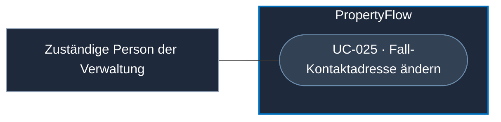

# Use Case: Fall-Kontaktadresse ändern

## Overview

**Use Case ID:** UC-025  
**Primary Actor:** Für die Adressänderung zuständige Person der Verwaltung  
**Goal:** Die aktuelle Kontaktadresse eines Falls nach einem geprüften Wechsel korrigieren und die Fallzuordnung entsprechend aktualisieren.  
**Status:** Wirkung auf den Kontozugriff vereinbart. Identitätsprüfung, Berechtigung, Bedienung, Umgang mit dem persönlichen Link und Verfügbarkeit bei einem Camunda-Ausfall sind zu konkretisieren.

## Use-Case-Diagramm

## Preconditions

- Der betroffene Fall ist bestimmt.
- Die neue Kontaktadresse wurde nach dem vorgesehenen administrativen Verfahren geprüft. Das Verfahren ist noch festzulegen.

## Main Success Scenario

1. Die zuständige Person veranlasst die geprüfte Änderung der Kontaktadresse am Fall.
2. PropertyFlow speichert die neue aktuelle Kontaktadresse. Die ursprünglichen Einreichungsdaten und die Case-ID bleiben erhalten.
3. Bei der nächsten Anfrage bestimmt PropertyFlow den kontobasierten Fallzugriff anhand der neuen Adresse. Das zur neuen Kontaktadresse passende verifizierte Mieterkonto kann auf den Fall zugreifen.

## Alternative Flows

- Solange die Prüfung aussteht oder die Änderung fehlschlägt, bleibt die bisherige gespeicherte Adresse massgeblich.

## Postconditions

- Die neue Adresse bestimmt den kontobasierten Fallzugriff im Web und über MCP.

## Business Rules und Prüfkriterien

- **UC-025-BR-001:** Der Dienst prüft die aktuelle Fall-Kontaktadresse gegen die verifizierte Konto-Adresse. Eingaben aus Browser und MCP ändern diese Zuordnung nur über den geprüften Verwaltungsablauf. [ZUG-04 und ZUG-05](../specifications/fallzugriff-und-sicherheit.md#zug-04-rechte-und-vertrauensgrenzen)
- **UC-025-AK-01:** Nach geprüftem Wechsel von Adresse A auf B verliert Konto A beim nächsten kontobasierten Abruf den Zugriff. Das verifizierte Konto B sieht denselben Fall mit unveränderter Case-ID.
- **UC-025-AK-02:** Ein manipulierter Formular- oder Tool-Aufruf ändert weder die Kontaktadresse noch die Fallzuordnung.
