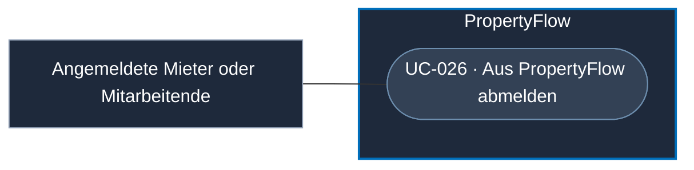

# Use Case: Aus PropertyFlow abmelden

## Overview

**Use Case ID:** UC-026  
**Primary Actor:** Angemeldeter Mieter oder Mitarbeiter  
**Goal:** Die aktuelle Browsersitzung beenden und den kontobasierten Zugriff auf diesem Browser sperren.  
**Status:** Lokale Web-Abmeldung in der Frontend-Demo umgesetzt.

## Use-Case-Diagramm

## Preconditions

- Eine persönliche Web-Sitzung besteht.

## Main Success Scenario

1. Die Person wählt «Abmelden» im Seitenkopf.
2. PropertyFlow beendet die aktuelle Sitzung gemäss [ZUG-04 · Web-Abmeldung](../specifications/fallzugriff-und-sicherheit.md#web-abmeldung).
3. PropertyFlow zeigt das öffentliche Erfassungsformular. Ein erneuter kontobasierter Zugriff erfordert eine Anmeldung.

## Alternative Flows

- Bei einem fehlenden oder ungültigen CSRF-Nachweis bleibt die Sitzung gemäss ZUG-04 bestehen.
- Nach Ablauf der Sitzung verlangt der nächste geschützte Aufruf eine neue Anmeldung.

## Postconditions

- Die bisherige Sitzung kann auch in anderen offenen Tabs keine Kontorechte mehr ausüben.

## Business Rules und Prüfkriterien

- **UC-026-BR-001:** Für die Sitzung, ungesendete Eingaben, persönliche Fall-Links und MCP-Delegationen gilt [ZUG-04 · Web-Abmeldung](../specifications/fallzugriff-und-sicherheit.md#web-abmeldung). [UI1](../frontend/ansicht-01-mieter-fallansicht.md#angemeldetes-konto-und-abmeldung) beschreibt die Bedienung und die Zielansicht.
- **UC-026-AK-01:** In einem Tab abmelden und in einem zweiten Tab eine kontogeschützte Seite erneut aufrufen. PropertyFlow verlangt eine Anmeldung.
- **UC-026-AK-02:** Nach der Abmeldung lässt sich ein weiterhin gültiger persönlicher Fall-Link mit seinen fallbezogenen Rechten öffnen.
