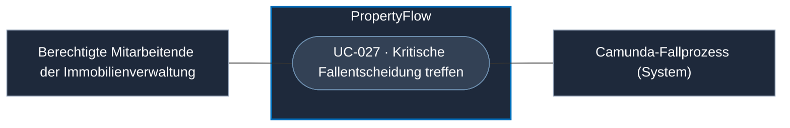

# Use Case: Kritische Fallentscheidung treffen

## Overview

**Use Case ID:** UC-027  
**Primary Actor:** Berechtigter Mitarbeiter der Immobilienverwaltung  
**Supporting Actor:** Camunda-Fallprozess\
**Goal:** Über eine fachlich kritische Handlung entscheiden und die Entscheidung am konkreten Fall nachvollziehbar festhalten.  
**Status:** Die Entscheidungsgrenzen sind vereinbart. Bedienung und technischer Freigabevertrag sind offen.

## Use-Case-Diagramm

## Preconditions

- Ein aktiver Fall benötigt gemäss [FALL-10](../specifications/fallverwaltung.md#fall-10-automatisierung-und-menschliche-freigabe) eine menschliche Entscheidung, etwa wegen Kosten, einer verbindlichen Beauftragung, hoher Schwere oder einer eskalierten Beschwerde.
- Der Mitarbeiter hat die nötige [Rolle](../specifications/fallzugriff-und-sicherheit.md#rollen-und-zusatzrechte) und Zugriff auf den Fall.
- Der führende Camunda-Fallprozess ist erreichbar und wartet auf die Mitarbeiterentscheidung. [FALL-06](../specifications/fallverwaltung.md#fall-06-fachlicher-status-und-technischer-workflow)

## Main Success Scenario

1. PropertyFlow zeigt den fachlichen Prüfgrund und den aktuellen Fallstand im Mitarbeiterdetail.
2. Der Mitarbeiter prüft die Angaben und entscheidet über die konkrete Handlung. Eine KI-Empfehlung kann dabei als Grundlage dienen.
3. PropertyFlow prüft die Berechtigung und übermittelt die Entscheidung an Camunda. Camunda veranlasst die Übernahme. PropertyFlow hält Entscheidung, handelnden Mitarbeiter, Zeitpunkt, Bezug zur Handlung und fachlichen Grund fest.
4. Die Verwaltung setzt eine allfällige externe Beauftragung ausserhalb von PropertyFlow um. Für einen Fallabschluss gilt zusätzlich [UC-014](UC-014-fall-abschliessen.md).

## Alternative Flows

- Bei fehlender Entscheidung bleibt der Prüfgrund offen. Die weitere Bearbeitung folgt den Regeln für Mitarbeiterprüfung.
- Ist eine Freigabe für eine andere Handlung vorhanden, bleibt die angefragte kritische Handlung gesperrt.
- Bei unerreichbarem Camunda bleibt der letzte bestätigte Fallstand lesbar. PropertyFlow bestätigt keine neue Fallentscheidung als übernommen.

## Postconditions

- Die konkrete Entscheidung ist intern nachvollziehbar. Eine spätere Handlung erhält ihre eigene fachliche Prüfung.

## Business Rules und Prüfkriterien

- **UC-027-BR-001:** Die endgültige Entscheidung bei den in FALL-10 aufgeführten Gründen trifft ein berechtigter Mensch. Eine neue Mieternachricht hebt eine ausstehende Pflichtprüfung für sich allein nicht auf.
- **UC-027-AK-01:** Ein Systemabschluss mit weiterhin offenem Pflichtprüfgrund wird abgelehnt. Der Fall bleibt zur Mitarbeiterprüfung verfügbar.
- **UC-027-AK-02:** Eine Freigabe zu Handlung A reicht für Handlung B nicht aus. Die Entscheidung zu A ist mit Person, Zeitpunkt und Bezug prüfbar.
