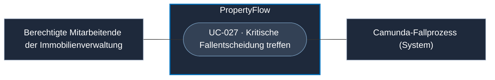

# Use Case: Kritische Fallentscheidung treffen

## Overview

**Use Case ID:** UC-027  
**Primary Actor:** Berechtigter Mitarbeiter der Immobilienverwaltung  
**Supporting Actor:** Camunda-Fallprozess\
**Goal:** Bei einem kritischen Prüfgrund nach FALL-10 entscheidet ein Mensch über das weitere Vorgehen, und die Entscheidung ist am Fall nachvollziehbar.  
**Status:** Umgesetzt über die Mitarbeiterprüfung und «Bearbeitung fortsetzen» ([UC-012](UC-012-fall-fachlich-steuern.md)). Ein eigenständiger Freigabe-, Ablehnungs- oder Klärungsablauf ist nicht vorgesehen (Entscheid vom 25.11.2026).

## Use-Case-Diagramm

## Entscheid vom 25.11.2026

Eine kritische Entscheidung wird nicht als eigene Aktion mit eigener Camunda
User Task geführt. Der Bedarf nach einer menschlichen Entscheidung entsteht,
wenn das System einen Grund nach
[FALL-10](../specifications/fallverwaltung.md#fall-10-automatisierung-und-menschliche-freigabe)
erkennt, etwa eine kritische Dringlichkeit oder eine Auswertung, die eine
menschliche Entscheidung verlangt. Der Fall erhält dann «Mitarbeiterprüfung
erforderlich». Damit ist der Mensch bereits am Zug: Er prüft den Fall,
dokumentiert sein Vorgehen und setzt die Bearbeitung fort.

Ein separater Ablauf, in dem ein Mitarbeiter eine Handlung zuerst anlegt und
danach selbst freigibt, brächte keinen zusätzlichen Schutz. Ein
Vier-Augen-Prinzip ist fachlich nicht gefordert. Externe Massnahmen wie ein
Technikeraufgebot organisiert die Verwaltung weiterhin ausserhalb von
PropertyFlow.

## Preconditions

- Das System hat für einen aktiven Fall einen Prüfgrund nach FALL-10 gespeichert. Der Fall steht auf «Mitarbeiterprüfung erforderlich». [FALL-06](../specifications/fallverwaltung.md#fall-06-fachlicher-status-und-technischer-workflow)
- Der Mitarbeiter hat die nötige [Rolle](../specifications/fallzugriff-und-sicherheit.md#rollen-und-zusatzrechte) und Zugriff auf den Fall.
- Der führende Camunda-Fallprozess ist erreichbar und wartet in der Aufgabe «Fall prüfen und Vorgehen entscheiden».

## Main Success Scenario

1. PropertyFlow zeigt im Mitarbeiterdetail den Prüfgrund in der Box «Prüfbedarf», den aktuellen Fallstand und eine allfällige KI-Empfehlung.
2. Der Mitarbeiter prüft den Fall und entscheidet über das Vorgehen. Eine ausserhalb organisierte Massnahme, etwa «Sanitär-Notdienst angerufen», hält er als Begründung bei «Bearbeitung fortsetzen» oder als internes Memo fest.
3. Der Mitarbeiter wählt «Bearbeitung fortsetzen». PropertyFlow prüft Berechtigung, Fallversion, Prüfgrundlage und die angezeigte User Task und schliesst genau diese Aufgabe synchron in Camunda ab ([UC-012](UC-012-fall-fachlich-steuern.md)).
4. Der Fall wechselt auf «In Bearbeitung». PropertyFlow speichert handelnden Mitarbeiter, Zeitpunkt, Aufgabe, Fallversion und Begründung im internen Nachweis.

## Alternative Flows

- Solange niemand entscheidet, bleibt der Fall auf «Mitarbeiterprüfung erforderlich». Ein automatischer Abschluss ist gesperrt.
- Der Mitarbeiter kann statt der Fortsetzung eine Rückfrage an den Mieter stellen ([UC-010](UC-010-externe-fallnachricht-veroeffentlichen.md)), eine Wiedervorlage setzen ([UC-013](UC-013-wiedervorlage-verwalten.md)) oder den Fall abschliessen ([UC-014](UC-014-fall-abschliessen.md)).
- Entsteht nach der Fortsetzung ein neuer kritischer Prüfgrund, kommt der Fall erneut zur Mitarbeiterprüfung. Die frühere Fortsetzung gilt dafür nicht.
- Bei unerreichbarem Camunda bleibt der letzte bestätigte Fallstand lesbar. PropertyFlow bestätigt keine Fortsetzung als übernommen.

## Postconditions

- Die menschliche Entscheidung ist mit Person, Zeitpunkt, geprüfter Aufgabe und Begründung intern nachvollziehbar.
- Eine Fortsetzung ist keine pauschale Freigabe für spätere Kosten, Folgehandlungen oder einen Systemabschluss.

## Business Rules und Prüfkriterien

Der durchgehende Ablauf ist mit `CriticalReviewCamundaTest` gegen die echte
Engine geprüft: Die KI meldet «Kritisch», der Fall geht ohne Rückfrage und ohne
Abschluss zur Mitarbeiterprüfung, und erst die Fortsetzung mit der Begründung
«Sanitär-Notdienst angerufen» setzt ihn auf «In Bearbeitung». Der Prüfgrund gilt
danach als von dieser Entscheidung berücksichtigt.

- **UC-027-BR-001:** Die endgültige Entscheidung bei den in FALL-10 aufgeführten Gründen trifft ein berechtigter Mensch. Eine neue Mieternachricht hebt eine ausstehende Pflichtprüfung für sich allein nicht auf.
- **UC-027-AK-01:** Ein Systemabschluss mit weiterhin offenem Pflichtprüfgrund wird abgelehnt. Der Fall bleibt zur Mitarbeiterprüfung verfügbar. Prüfung: `AutomaticClosurePostgresTest.independentMandatoryReviewReasonPreventsAnOtherwiseCurrentPublication`.
- **UC-027-AK-02:** Ein neuer Prüfgrund nach der Prüfgrundlage macht die bisherige Bestätigung ungültig und verlangt eine neue Prüfung. Prüfung: `StaffDecisionPostgresTest.newReviewReasonInvalidatesConfirmedContextEvenBeforeCaseVersionChanges`, `StaffDecisionCamundaTest.changeAfterCompletionCreatesNewReviewAndOldTabCannotCompleteIt`.
- **UC-027-AK-03:** Ein Aufruf zu einer veralteten Aufgabe wird abgewiesen. Die neue Aufgabe und der Fall bleiben unverändert. Prüfung: `StaffDecisionPostgresTest.staleTaskAtCanonicalHttpPathLeavesTheNewTaskAndCaseUntouched`.
- **UC-027-AK-04:** Die Fortsetzung speichert Mitarbeiter, Zeitpunkt, Aufgabe und Begründung. Ein endgültig abgewiesener Abschluss der Aufgabe verwirft die Begründung und erzeugt keinen bestätigten Nachweis. Prüfung: `StaffDecisionPostgresTest.nativeCompletionIsSeparateFromAtomicStatusAndMailCommit`, `StaffDecisionPostgresTest.definitiveNativeRejectionDiscardsReasonAndCreatesNoConfirmedAudit`.
