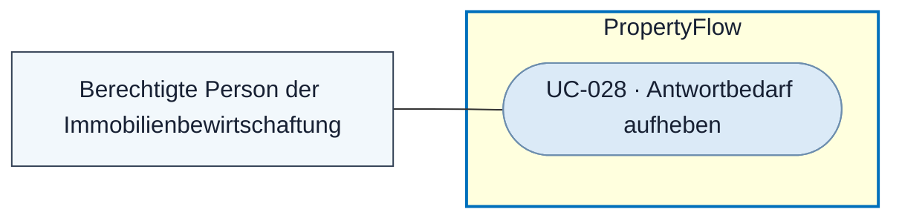

# Use Case: Antwortbedarf aufheben

## Overview

**Use Case ID:** UC-028  
**Use Case Name:** Antwortbedarf aufheben  
**Primary Actor:** Berechtigte Person der Immobilienbewirtschaftung  
**Goal:** Eine gegenstandslos gewordene Rückfrage im aktiven Fall als nicht mehr erforderlich kennzeichnen und ihren Verlauf erhalten.  
**Status:** Das manuelle Aufheben und die Verlaufsanzeige sind in der lokalen Demo mit Fällen im Arbeitsspeicher umgesetzt. Dauerhafte Audit-Zuordnung und Abstimmung mit Camunda sind vorgesehen.

**Fachliche Grundlage:** [KOM-03](../specifications/fallkommunikation.md#antwortbedarf-durch-mitarbeiter-aufheben), [FALL-05](../specifications/fallverwaltung.md#status-nach-manuellem-aufheben-des-antwortbedarfs) und [UI3](../frontend/ansicht-03-mitarbeiter-falldetail.md#antwortbedarf-aufheben).

## Use-Case-Diagramm

## Preconditions

- Eine [berechtigte Person](../specifications/fallzugriff-und-sicherheit.md#rollen-und-zusatzrechte) hat das Mitarbeiter-Falldetail eines aktiven Falls geöffnet. [UC-003](UC-003-mieteranliegen-details-anzeigen.md)
- Die gewählte veröffentlichte Rückfrage hat noch offenen Antwortbedarf. [UC-010](UC-010-externe-fallnachricht-veroeffentlichen.md)

## Main Success Scenario

1. Der Mitarbeiter wählt bei der betroffenen Nachricht «Antwortbedarf aufheben».
2. PropertyFlow prüft die Berechtigung und den aktuellen Zustand von Fall und Rückfrage.
3. PropertyFlow beendet den Antwortbedarf der gewählten Nachricht und speichert Ursache, Zeitpunkt und handelnde Person. Die ursprüngliche Nachricht und ihre ursprüngliche Kennzeichnung bleiben nachvollziehbar.
4. Entfällt der letzte offene Antwortbedarf und bestehen weder laufende Wiedervorlage noch vorrangiger aktueller Prüfbedarf, wechselt der Fall auf «In Bearbeitung». Sonst bleiben die weiter geltenden fachlichen Regeln massgeblich.
5. UI1 und UI3 zeigen den aktualisierten Antwortbedarf. Der laufende Fallprozess berücksichtigt den gespeicherten Stand.

## Alternative Flows

- **Antwortbedarf bereits beendet, Fall geschlossen oder Berechtigung fehlt.** PropertyFlow weist eine neue Aufhebung ohne Änderung zurück.
- **Ausgang unklar oder Konflikt mit einer anderen Bearbeitung.** Die Oberfläche bestätigt keinen unbelegten Erfolg. Eine technische Wiederholung erzeugt keinen weiteren Beendigungsvermerk.
- **Verspätete Auswertung einer Mieterantwort.** Ein bereits aufgehobener Antwortbedarf wird durch die Auswertung nicht wiederhergestellt.

## Postconditions

- Die betreffende Frage fordert keine weitere Antwort an und bleibt historisch als manuell aufgehoben erkennbar. Andere offene Fragen sowie ungesendeter Text und eine laufende KI-Formulierung bleiben erhalten.

## Business Rules und Prüfkriterien

- **UC-028-BR-001:** Aufheben gilt ausschliesslich für die gewählte Rückfrage. Der Beendigungsgrund dokumentiert die manuelle Aufhebung. Eine inhaltliche Beantwortung wird nur über die vorgesehene Auswertung festgestellt. [KOM-03](../specifications/fallkommunikation.md#antwortbedarf-durch-mitarbeiter-aufheben)
- **UC-028-BR-002:** Die Aktion schliesst den Fall nicht ab. Ein Wechsel auf «In Bearbeitung» folgt nur unter den vereinbarten Bedingungen. [FALL-05](../specifications/fallverwaltung.md#status-nach-manuellem-aufheben-des-antwortbedarfs)
- **UC-028-AK-01:** Bei zwei offenen Rückfragen den Antwortbedarf einer Frage aufheben. Die Nachricht bleibt sichtbar und ihre Aufhebung ist erkennbar. Die zweite Frage bleibt offen.
- **UC-028-AK-02:** Die letzte offene Frage einmal ohne weiteren Prüfgrund und einmal bei laufender Wiedervorlage aufheben. Nur im ersten Fall folgt unter den genannten Bedingungen «In Bearbeitung».
- **UC-028-AK-03:** Dieselbe Aufhebung wiederholen und eine ältere Auswertung zustellen. Die Historie enthält einen Beendigungsvermerk, und der Antwortbedarf bleibt aufgehoben.
